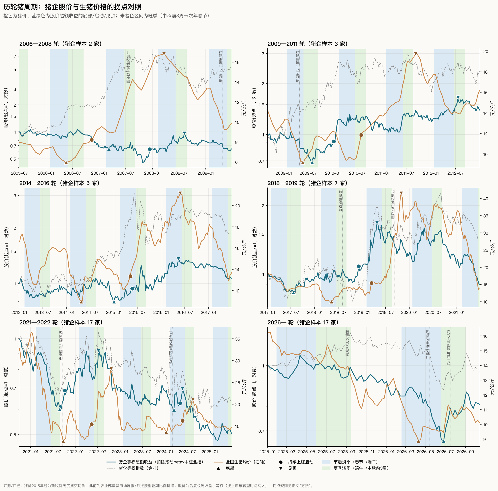
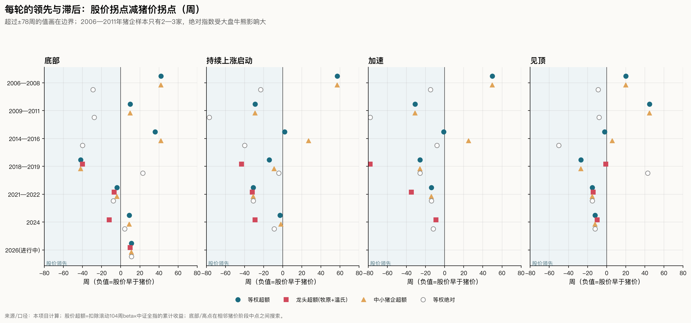
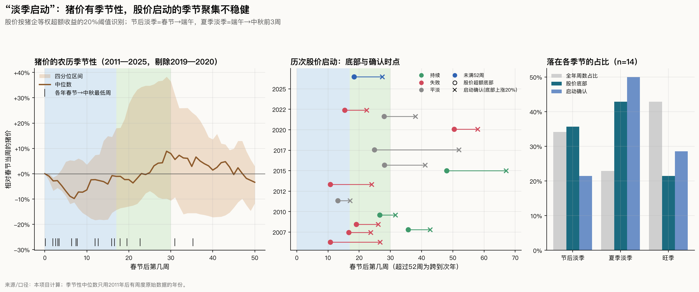
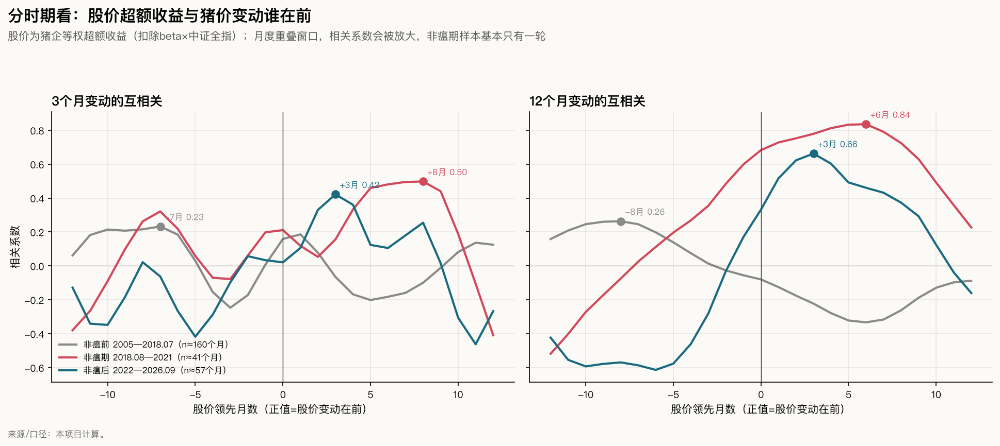
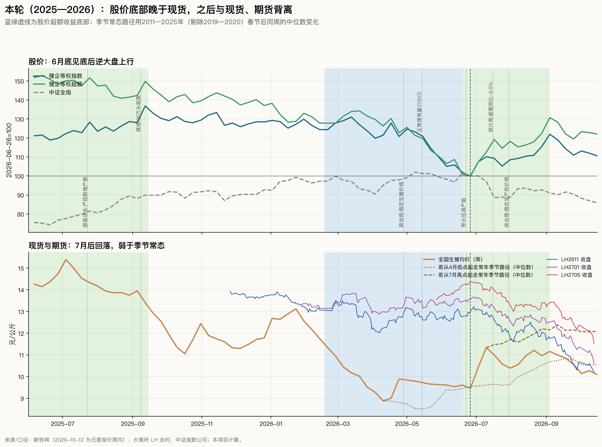
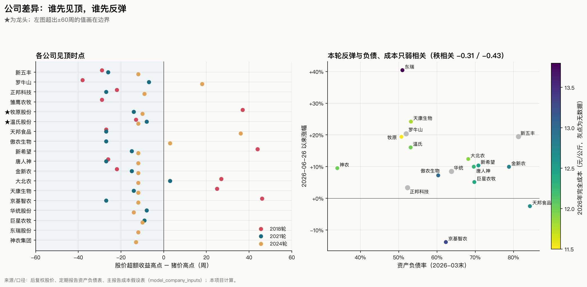

# 猪企股价与猪价：何时同步、何时领先，"淡季启动"是否成立

回答 [Issue #5](https://github.com/AlphaCatalyst/AlphaNotes/issues/5)。现货截至 2026-10-12（新牧网日度报价，当周不完整），股价、中证指数和生猪期货截至 2026-10-13 收盘；农业农村部、统计局数据截至 2026 年二季度，上市公司月度出栏截至 2026 年 8—9 月。

标签沿用主报告：【事实】为统计与公告原文（A 级），【推断】为本文计算或推理；新牧网等第三方行情按 C 级处理。猪价单位为元/公斤，期货为元/吨。议题里的说法（"曾同步—2018—2019 年开始提前交易—2026 年回到同步""猪股通常在淡季启动"）全部作为待检验的假设。数据与脚本见文末。

## 结论

1. **"方向一致"不等于"拐点同步"，三类拐点的规律也不一样。** 6 轮完整猪周期里，股价超额收益（扣除 beta × 中证全指）见底晚于现货是常态：2006、2009、2014、2024 年分别晚 42、10、36、9 周，2026 年目前晚 11 周；早于现货的只有 2018 年（早 42 周，但主要是 2018 年大盘下跌造成的，绝对股价反而晚 23 周见底）和 2021 年（早 4 周）。持续上涨的启动，2009、2018、2021 年分别早于现货 29、14、31 周，2014、2024 年基本同步，2006 年晚 57 周。见顶在 2014 年以来的 4 轮都早于现货（2、27、15、12 周），此前两轮晚于现货。没有固定的提前月数；比较稳定的只有"非瘟后见顶领先"【推断】。
2. **"淡季启动"一半是事实，一半是表象。** 现货的季节性低点 22 年中有 16 年落在春节到端午之间，大周期低点 7 轮中有 5 轮也在这一段。股价超额收益的周期底部 7 轮中 6 轮在淡季，其中 4 轮在端午到中秋前的夏季淡季（这一段只占全年 23% 的周数，单侧 p≈0.05）。但用实时规则（从底部上涨 20% 才算启动）识别的 14 次启动，淡季占 11 次，与 57% 的基准相比 p≈0.09，换阈值或换指数后多数不显著。更关键的是，淡季里的启动大多失败：节后淡季见底的 5 次没有一次持续，夏季淡季确认的 6 次有 5 次失败；3 次持续上涨中有 2 次底部在旺季。6 次主升启动中 4 次在旺季，没有一次在夏季淡季【推断】。
3. **能延续的启动都伴随"超季节"的现货走强。** 2009、2015 年两次在周期早期确认、后来持续的启动，确认时现货只比 52 周低点高 21%—28%，但近 8 周比季节常态强约 12%；只靠季节性反弹的启动（2014 年）和现货已远离低点后的启动（2020、2022 年）都失败了。非瘟前股价跟随现货的原始涨跌（含可预期的季节性），所以夏季的季节性反弹常带出"假启动"。事件研究显示，统计局季度存栏数据公布日股价有显著反应（存栏同比增速每低 1 个百分点，两日超额收益约高 0.2%，t=−2.9），农业农村部月度能繁母猪环比公布日没有反应。样本很小，只能作为描述【推断】。
4. **2018—2019 年之后关系确实变了，但只有 3 轮。** 非瘟前，股价超额收益与现货的 12 个月涨跌同向率只有 48%，最佳对齐是股价滞后 7—8 个月；非瘟期和非瘟后分别变成股价领先 6 个月（相关 0.84）和 3 个月（0.66）。4 周涨跌的同期相关从 0.35 降到接近 0。可能的原因是非瘟这种可观察的供给冲击、2021 年生猪期货上市和月度经营简报带来的信息，以及样本从 2—5 家多元化公司变成 17 家以养猪为主的公司。3 轮还不足以称为稳定规律【推断】。
5. **2026 年没有回到"股价跟随现货"。** 6 月 26 日以来，猪企等权指数涨 10.6%，中证全指跌 14.2%，超额收益 +22%；同期现货从 7 月 10 日高点跌 11%（常年同期中位数是涨 7%），远月期货跌 19%—22%。第一段（6-26—7-17）股价与现货同涨，分不清在跟谁；7 月中旬以后现货又跌 8%、LH2701 跌 19%，股价超额收益仍小幅上涨。股价对政策和统计数据反应明显：4-28 政治局会议 +2.8%，5-14 调控方案 +3.8%，7-15/16 统计局数据 +5.4%。这符合"等待供给收缩证据"，不符合"现货先涨才买"。但实际供给还没收缩（二季度出栏同比 +0.4%，胴体重 +1.8%），本轮也没结束，判断是暂定的【推断】。
6. **公司之间不一致，差异主要来自谁先被定价和负债高低。** 2018—2019 年中小猪企先涨先跌：第一波中位数超额 +64%（龙头 +33%），2019 年 2—5 月见顶；第二波龙头 +35%，中小 −33%，牧原 2020 年 7 月才见顶。2021 年以后龙头不再落后：2021—2022 年、2024 年和本轮第一波，龙头超额都高于中小（+29% 对 +27%、+22% 对 +15%、+27% 对 +21%）。2022 年高负债公司最早见顶（负债率与见顶时点的秩相关 −0.63），正邦、天邦、傲农、唐人神、京基都在 4 月 15 日见顶，早于现货高点 27 周。公司实际售价与全国价同月转向，解释不了股价的时点差异【推断】。

**回答核心问题：** 猪股上涨不需要现货先确认，需要的是供需预期改变的证据（存栏数据、政策、亏损出清）；但现货持续弱于季节常态时，启动常常失败。"淡季启动"更像大周期底部和季节性低点重合时的表象：股价常在淡季止跌，主升多在旺季。本轮股价已经先于现货和期货上涨。最直接的检验在 2027 年春节后：按常年季节性，现货届时约为 8.6 元，会低于今年 4 月低点，股价超额收益能否守住 6 月 26 日的低点，决定本轮属于"领先"还是"跟随"。

---

## 方法：先定义，再比较

| 项目 | 定义 |
|---|---|
| 现货 | 全国生猪均价周度序列：2015 年起为新牧网周度成交均价（2026-09-25 所在周以后用日度全国均价衔接，按重叠期平均差 −3.2% 调整）；2008—2014 年为农业部集贸市场周报，2003-12—2013 年为月报。按重叠期比例拼接到新牧网水平（周报与新牧网 0.9988，重叠 24 周；月报与周报 1.0006，重叠 43 个月），不超过 26 周的缺口按对数线性插值。新牧网周度数据按所覆盖那一周的周五记日期，比新牧网自己的标签早 3 天；主报告按标签记，两者日期可能差 3 天 |
| 股价 | 18 家猪企后复权周收盘，等权，按上市日或养猪成为主业的大致年份纳入：新五丰、罗牛山（2005 年起），正邦（2007），雏鹰（2010—2019），牧原（2014），温氏（2015-11），天邦（2016），傲农（2017），新希望、唐人神、金新农、大北农、天康（2018），京基智农（2019），华统（2020），巨星、东瑞、神农（2021）。龙头 = 牧原 + 温氏，中小 = 其余 |
| 超额收益 | 周收益 − beta × 中证全指周收益，beta 用过去 104 周回归、滞后 1 周（不足 52 周时取 1）。稳健性检验用两种口径：相对中证全指的比值、绝对指数；另用中证畜牧养殖指数（930707，市值加权）对照 |
| 猪价大周期拐点 | 先用 25% 的折线（zigzag）找高低点，再合并成每段至少 26 周、涨跌至少 40% 的大周期。得到 6 轮完整周期和 2026 年的候选低点 |
| 股价底部 / 见顶 | 底部：从上一轮猪价下跌段中点到本轮上涨段中点之间，股价超额收益的最低周；同时给出"底部区间"（离最低点 5% 以内的周），因为平底时单周最低点很随意。见顶：上涨段中点到下一段下跌中点之间的最高周 |
| 持续上涨启动 | 低点到高点这一段里，序列在最后一次回到涨幅 20% 以内之后，第一次超过全段对数涨幅 30% 的那一周（现货和股价用同一规则）。10%/20% 的备选规则见 CSV |
| 加速 | 这一段里最陡的 13 周上涨的起点，可能早于"持续上涨启动" |
| 领先 / 滞后 | 股价日期 − 现货日期（周），负值表示股价在前 |
| 实时启动（用于季节检验） | 股价超额收益从上一个确认高点以来的最低点上涨 20%，当周记为"确认"；底部日期只有事后才知道，确认日期是当时能知道的。这样不会因为股价后来涨了，就倒推某个低点为"启动"。结果看确认后 52 周：先比确认周再涨 30% 为"持续"，先回到底部 5% 以内为"失败"，都没有为"平淡"。稳健性：阈值 15%、30%，绝对指数用 25%，比值口径用 20% |
| 季节（农历） | 节后淡季 = 春节 → 端午；夏季淡季 = 端午 → 中秋前 3 周；旺季 = 中秋前 3 周 → 下一个春节 |
| 季节常态 | 与评价期相同的农历位置（春节后第几周），2011—2025 年（剔除非瘟扭曲的 2019—2020 年和被评价的年份）现货对数涨跌的中位数。"超季节" = 实际涨跌 − 季节常态。逐年计算区间涨跌再取中位数，不把每周中位数相加（相加会低估季节性摆动） |
| 方向一致 | 股价超额收益与现货的 3 个月、12 个月涨跌同号的月份占比；4 周涨跌的相关（四种分块起点分别计算，报告均值和区间） |
| 事件研究 | 事件日及次日的超额收益之和 CAR[0,+1]，对照所有交易日两日超额收益绝对值的均值 |

## 一、哪些阶段同步，哪些阶段领先或滞后（问题 1）

**猪价拐点**【推断，2015 年前为农业部数据，A 级；此后为新牧网，C 级】：

| 轮次 | 低点（元/公斤） | 持续上涨启动 | 加速 | 高点（元/公斤） | 低点到高点 | 低点季节 | 启动季节 |
|---|---|---|---|---|---|---|---|
| 2006—2008 | 2006-05-19（5.96） | 2006-11-10 | 2007-04-20 | 2008-03-21（16.82） | +182% | 节后淡季 | 旺季 |
| 2009—2011 | 2009-05-22（9.20） | 2010-07-30 | 2010-06-18 | 2011-09-09（19.73） | +114% | 节后淡季 | 夏季淡季 |
| 2014—2016 | 2014-04-25（10.96） | 2015-05-08 | 2015-05-08 | 2016-05-27（21.16） | +93% | 节后淡季 | 节后淡季 |
| 2018—2019 | 2018-05-11（10.00） | 2019-03-15 | 2019-07-26 | 2019-11-01（41.50） | +315% | 节后淡季 | 节后淡季 |
| 2021—2022 | 2021-09-24（11.60） | 2022-05-13 | 2022-04-08 | 2022-10-21（28.11） | +142% | 旺季 | 节后淡季 |
| 2024 | 2024-01-12（13.61） | 2024-05-24 | 2024-05-10 | 2024-08-16（21.03） | +55% | 旺季 | 节后淡季 |
| 2026 | 2026-04-10（8.88，候选） | — | — | — | — | 节后淡季 | — |

2026 年的反弹已超过 25%（7 月 10 日所在周 11.33 元），但上涨段不满 26 周、涨幅不到 40%，还不能算大周期低点；日度最低是 4 月 14 日的 8.82 元（新牧网全国报价；原文误写为各省简单平均的 8.69 元，已更正）。

**股价超额收益的拐点与领先 / 滞后**：

| 轮次 | 底部（底部区间） | 持续上涨启动 | 加速 | 见顶 | 相对现货（周）：底部 / 启动 / 加速 / 见顶 | 股价启动时现货已比低点涨 | 样本（底部时） |
|---|---|---|---|---|---|---|---|
| 2006—2008 | 2007-03-09（2007-01-12—04-13） | 2007-12-14 | 2008-04-04 | 2008-08-08 | +42 / +57 / +50 / +20 | 154% | 2 |
| 2009—2011 | 2009-07-31（07-17—08-14） | 2010-01-08 | 2009-11-13 | 2012-07-20 | +10 / −29 / −31 / +45 | 33% | 3 |
| 2014—2016 | 2015-01-02（2013-04-26—2015-03-20） | 2015-05-22 | 2015-05-01 | 2016-05-13 | +36 / +2 / −1 / −2 | 29% | 5 |
| 2018—2019 | 2017-07-21（2017-05-19—08-04） | 2018-12-07 | 2019-01-25 | 2019-04-26 | −42 / −14 / −26 / −27 | 41% | 7 |
| 2021—2022 | 2021-08-27（07-23—09-10） | 2021-10-08 | 2021-12-31 | 2022-07-08 | −4 / −31 / −14 / −15 | 4% | 17 |
| 2024 | 2024-03-15（2023-06-02—2024-04-26） | 2024-05-03 | — | 2024-05-24 | +9 / −3 / — / −12 | 11% | 17 |
| 2026 | 2026-06-26（06-19—06-26） | — | — | — | +11 / — / — / — | 底部时 7% | 17 |

换口径后的主要差别【推断】：
- **2018—2019 年的"领先"主要来自中小猪企。** 中小超额启动早 9 周、见顶早 27 周；龙头超额 2019-10-25 见顶，只比现货早 1 周；以牧原、温氏为主的中证畜牧养殖指数超额 2020-08-14 才见顶，晚 41 周。等权超额的底部（2017-07）反映的是 2018 年大盘下跌：绝对指数 2018-10-19 才见底，比现货晚 23 周，在首例非洲猪瘟（2018-08-03）之后。
- **2021—2022 年龙头见顶早 14 周，比值口径早 7 周**，方向一致。
- **2014—2016 年市值加权与等权一致**（启动 +1 周、见顶 −2 周），中小超额启动晚 27 周。底部区间长达两年（2013-04—2015-03），单周底部的时点并不可靠；用区间末端算，股价离开底部比现货晚 47 周。
- **2024 年龙头超额更早**：2023-10-20 见底，11 月初启动（早 29 周），2024-06-07 见顶（早 10 周）。等权股价见顶那周正是现货持续上涨启动的那周，没有"兑现段"。
- **绝对指数受大盘牛熊影响大**：2015 年见顶比现货早 50 周（A 股泡沫），2020 年晚 43 周；2006—2011 年的样本只有 2—3 家，且罗牛山、新五丰、正邦当时都有大块非养殖业务。

**方向一致和拐点同步要分开看。** 下表是股价超额收益与现货涨跌的同向程度【推断】：

| 时期 | 12 个月涨跌同向率（同期） | 同期相关 | 最佳对齐：股价领先月数（相关，同向率） | 3 个月涨跌最佳对齐（相关） | 4 周涨跌同期相关（区间） |
|---|---|---|---|---|---|
| 非瘟前 2005—2018.07 | 48% | −0.08 | −8（0.26，66%） | −7（0.23） | 0.35（0.30—0.37），2011—2018.07 |
| 非瘟期 2018.08—2021 | 78% | 0.68 | +6（0.84，85%） | +8（0.50） | 0.18（0.10—0.31） |
| 非瘟后 2022—2026.09 | 68% | 0.33 | +3（0.66，70%） | +3（0.42） | 0.04（−0.00—0.07）；股价领先 12 周时 0.17（0.01—0.28） |

非瘟前股价和现货在 4 周内同涨同跌（0.35），但 12 个月尺度上方向一致率只有 48%：短期跟着现货波动，大周期拐点却对不上（股价底部晚 10—42 周，见顶同步或更晚）。非瘟后正好相反：短期几乎不同步，12 个月尺度上股价领先约一个季度。

## 二、"淡季"怎么定义，猪股是否更容易在淡季启动（问题 2）

**三个概念分开。**

| 季节 | 农历区间 | 消费特点 | 占全年周数（2005-07 以来） |
|---|---|---|---|
| 节后淡季 | 春节 → 端午 | 节前备货结束，需求最弱 | 34% |
| 夏季淡季 | 端午 → 中秋前 3 周 | 高温，鲜肉消费偏弱 | 23% |
| 旺季 | 中秋前 3 周 → 下一个春节 | 中秋国庆、冬至腌腊、春节备货 | 43% |

- **消费淡季**是日历概念，见上表。
- **季节性猪价低点**：2011—2025 年（剔除 2019—2020 年）现货中位数从春节当周到节后第 7 周下跌约 10%，到第 29 周（中秋前后）比春节当周高约 9%。2005—2026 年每年春节到中秋之间的最低周，16 年落在节后淡季（多在节后 0—20 周，中位数约第 8 周），2 年在夏季淡季（2017、2023），4 年一路跌到中秋前（2005、2008、2021、2025，都是下行年）【推断】。
- **大周期底部**：现货大周期低点 7 轮中 5 轮在节后淡季，与季节性低点重合；2021、2024 年在旺季。

**按拐点类型统计的季节分布**（p 为单侧二项检验，没有做多重比较校正）【推断】：

| 拐点 | 次数 | 节后淡季 | 夏季淡季 | 旺季 | 淡季合计（基准 57%） | 夏季淡季（基准 23%） |
|---|---|---|---|---|---|---|
| 现货：大周期低点 | 7 | 5 | 0 | 2 | 71%（p=0.36） | 0% |
| 现货：持续上涨启动 | 6 | 4 | 1 | 1 | 83%（p=0.19） | 17%（p=0.79） |
| 股价超额：周期底部 | 7 | 2 | 4 | 1 | 86%（p=0.12） | 57%（p=0.05） |
| 股价超额：持续上涨启动 | 6 | 2 | 0 | 4 | 33%（p=0.94） | 0% |

**实时识别的 14 次启动**（股价超额收益，阈值 20%）【推断】：

| 底部 | 确认（较底部 +20%） | 底部季节 | 确认季节 | 结果 | 确认后 52 周 | 52 周内最高 |
|---|---|---|---|---|---|---|
| 2006-04-14 | 2006-08-04 | 节后淡季 | 夏季淡季 | 失败 | −29% | 0% |
| 2007-06-15 | 2007-08-03 | 节后淡季 | 夏季淡季 | 失败 | +13% | +20% |
| 2007-10-26 | 2007-12-14 | 旺季 | 旺季 | 持续 | +25% | +50% |
| 2008-06-20 | 2008-08-08 | 夏季淡季 | 夏季淡季 | 失败 | −40% | 0% |
| 2009-07-31 | 2009-09-04 | 夏季淡季 | 夏季淡季 | 持续 | +55% | +59% |
| 2011-05-06 | 2011-06-03 | 节后淡季 | 节后淡季 | 平淡 | +4% | +11% |
| 2013-04-26 | 2014-07-18 | 节后淡季 | 夏季淡季 | 失败 | +1% | +4% |
| 2015-01-02 | 2015-06-05 | 旺季 | 节后淡季 | 持续 | +37% | +41% |
| 2015-09-04 | 2015-12-04 | 夏季淡季 | 旺季 | 平淡 | +10% | +23% |
| 2017-07-21 | 2018-01-26 | 夏季淡季 | 旺季 | 平淡 | +9% | +9% |
| 2020-01-24 | 2020-03-06 | 旺季 | 节后淡季 | 失败 | −11% | +17% |
| 2021-08-27 | 2021-11-05 | 夏季淡季 | 旺季 | 平淡 | −4% | +26% |
| 2022-05-20 | 2022-07-08 | 节后淡季 | 夏季淡季 | 失败 | −29% | 0% |
| 2026-06-26 | 2026-08-28 | 夏季淡季 | 夏季淡季 | 未满 52 周 | — | 至今 +7% |

| 分组 | 次数 | 持续 / 失败 / 平淡 | 确认后 52 周中位数 | 52 周内最高的中位数 |
|---|---|---|---|---|
| 底部在节后淡季 | 5 | 0 / 4 / 1 | +0.5% | +4% |
| 底部在夏季淡季 | 6 | 1 / 1 / 3（另 2026 年未满） | +9% | +16% |
| 底部在旺季 | 3 | 2 / 1 / 0 | +25% | +41% |
| 确认在夏季淡季 | 7 | 1 / 5 / 0（另 2026 年未满） | −14% | +4% |

**稳健性。** 淡季聚集对阈值和口径都敏感【推断】：

| 口径 | 启动次数 | 底部在淡季（p） | 底部在夏季淡季（p） | 确认在夏季淡季（p） |
|---|---|---|---|---|
| 超额收益，20%（主口径） | 14 | 11（0.09） | 6（0.08） | 7（0.02） |
| 超额收益，15% | 21 | 15（0.13） | 7（0.19） | 7（0.19） |
| 超额收益，30% | 7 | 4（0.65） | 4（0.05） | 1（0.84） |
| 绝对指数，25% | 20 | 11（0.66） | 8（0.07） | 7（0.15） |
| 相对中证全指的比值，20% | 14 | 10（0.21） | 7（0.02） | 5（0.20） |

20 多个检验里出现两三个 p<0.05，本身就在偶然范围内。比较一致的只有"夏季淡季出现的底部偏多"，而它们后来多数没有走出持续行情。

**反例。**
- **旺季启动、而且持续**：2007-10-26（12 月确认，52 周内最高 +50%）、2015-01-02（6 月确认，+41%）。周期层面的主升启动 6 次中 4 次在旺季：2007-12、2010-01、2018-12、2021-10。
- **淡季没有启动**：2006—2025 年里有一半年份（2010、2012、2014、2016、2018、2019、2020、2023、2024、2025）淡季内没有出现后来被确认的股价底部。2024 年的周期底部在节后淡季（3-15），但只涨 16% 就见顶（5-24），不够 20% 的阈值。
- **启动后失败**：2006-08、2007-08、2008-08、2014-07、2022-07 都是夏季确认、随后跌回底部；2020-03 在节后淡季确认，当时现货已在历史高位。

**适用条件。** "淡季止跌"在两种情况下最常见：大周期底部恰好落在季节性低点附近（2009 年夏、2021 年夏、2026 年夏），或者现货出现季节性反弹。前者有机会走成持续行情，后者多数失败。区分两者要看现货是否明显强于季节常态（见下一节），不能只看日历。

## 三、启动时市场在交易什么（问题 3）

**启动确认时的现货状态**（2009 年起有季节常态可比）【推断】：

| 启动（底部 → 确认） | 结果 | 现货比 52 周低点 | 近 13 周涨跌 | 近 8 周超季节 |
|---|---|---|---|---|
| 2009-07-31 → 09-04 | 持续 | +28% | +25% | +12% |
| 2011-05-06 → 06-03 | 平淡 | +76% | +14% | +3% |
| 2013-04-26 → 2014-07-18 | 失败 | +22% | +21% | −3% |
| 2015-01-02 → 06-05 | 持续 | +21% | +19% | +12% |
| 2015-09-04 → 12-04 | 平淡 | +38% | −9% | −2% |
| 2017-07-21 → 2018-01-26 | 平淡 | +16% | +5% | −2% |
| 2020-01-24 → 03-06 | 失败 | +161% | +5% | +10% |
| 2021-08-27 → 11-05 | 平淡 | +44% | +9% | +29% |
| 2022-05-20 → 07-08 | 失败 | +98% | +84% | +33% |
| 2026-06-26 → 08-28 | 未满 52 周 | +23% | +14% | −5% |

规律只是描述性的（能计算超季节的只有 10 次）【推断】：
- **持续的两次**（2009、2015 年）都在周期早期：现货只比低点高两三成，但近 8 周比季节常态强约 12%，即"淡季猪价不弱"，而且不是季节性能解释的。
- **只有季节性反弹的会失败**：2014 年 7 月现货 13 周涨了 21%，几乎全是季节性（超季节 −3%），股价随后跌回底部。
- **现货已经远离低点后再确认的，是在兑现**：2020、2022 年确认时现货已比低点高 98%—161%，股价随后下跌。
- **2026 年 8 月的确认不像前两类成功案例**：现货比低点高 23%、13 周涨 14%，但比季节常态弱 5%。

**股价响应的是水平、方向还是预期差？** 非瘟前（2011—2018.07），股价超额收益与现货原始 4 周涨跌的同期相关为 0.35，与超季节部分为 0.31，没有更高，说明股价连可预期的季节性涨跌也一起跟。这正是夏季"假启动"多的原因：季节性反弹带动股价，反弹结束股价就回落。非瘟期间股价与超季节部分的相关（0.26）高于原始涨跌（0.18）。非瘟后两者同期都接近 0。12 个月水平上非瘟前同向率只有 48%，股价不是在交易现货的绝对水平【推断】。

**数据公布日的反应**【推断】：

| 事件 | 次数 | 回归斜率（t 值） | 公布日两日超额绝对值 | 平日两日超额绝对值 |
|---|---|---|---|---|
| 农业农村部月度能繁母猪环比（2015-12—2021-03） | 71 | 环比每高 1 个百分点 +0.07%（t=0.8） | 1.6% | 1.7% |
| 统计局季度生猪存栏（2016-04—2026-07） | 41 | 存栏同比增速变化每高 1 个百分点 −0.20%（t=−2.9） | 2.1% | 1.7% |
| 其中非瘟期 | 13 | −0.21%（t=−2.7） | 2.5% | 1.9% |
| 其中非瘟后 | 19 | −0.31%（t=−1.5） | 2.3% | 1.6% |

月度能繁环比公布时股价没有额外波动，也看不出方向；统计局季度存栏的"增速变化"（预期差的粗略代理）有显著反应。股价更像在交易超出预期的供给信号，而不是现货水平。2025—2026 年的政策事件见第五节。

## 四、2018—2019 年是否改变了股价与猪价的关系（问题 4）

**变化是真实的。**【推断】
- 见顶：非瘟前两轮晚于现货（+20、+45 周，样本 2—3 家），2014—2016 年同步（−2 周）；非瘟后 3 轮都早于现货（−27、−15、−12 周）。
- 持续上涨启动：非瘟前有早有晚（+57、−29、+2 周），非瘟后都偏早（−14、−31、−3 周）。2009 年也出现过早 29 周的启动，所以"提前交易"在 2018 年以前就有过，不是非瘟后才出现。
- 月度互相关：非瘟前股价滞后 7—8 个月（相关只有 0.23—0.26），非瘟期领先 6—8 个月，非瘟后领先 3 个月（上一节表格）。

**原因只能部分区分。**
- **非瘟本身是可观察的供给冲击。** 首例疫情 2018-08-03 公布，此后疫情通报和能繁母猪数据都在提示供给断崖，现货要到 2019 年 3 月才持续上涨。股价提前交易的是确定性很高的冲击，不需要"学习"也会领先。
- **信息更多了。** 生猪期货 2021-01-08 上市，市场能直接看到未来几个月的价格预期；上市公司月度销售简报也普及了。但本轮期货大跌而股价上涨（第五节），股价并不是简单跟着期货走。
- **市场学习**：非瘟后 3 轮都在现货高点前见顶，与"吃过一次亏后提前离场"的解释一致，但无法和信息改善分开。
- **样本变了**：2014 年以前只有 2—5 家，且有地产、贸易、饲料等业务；2018 年起是 13—17 家，以养猪为主。早期"滞后"有一部分可能是样本问题。

**结论**：非瘟后股价领先现货更明显，表现为见顶更早、12 个月尺度领先一个季度左右；但只有 3 轮，其中 2024 年还是小周期，还不足以认定"提前交易"已成为长期稳定的规律。

## 五、2026 年是否回到"股价跟随猪价"（问题 5）

**基本事实**【事实/推断】：

| 项目 | 数据 |
|---|---|
| 现货 | 周度低点 2026-04-10 所在周 8.88 元（日度最低 4-14 的 8.82 元）；7-10 所在周 11.33 元；最新 10.09 元（10-12 所在周，不完整） |
| 现货与季节常态 | 7-10 高点以来 −11.0%，2011—2025 年同期中位数 +6.8%；13 个参照年份中只有 2021、2025 年更弱，2016 年与本轮几乎相同。春节以来 −11.0%，常态 +6.1%；4 月低点以来 +13.6%，常态 +18.8%。此前 4 月低点到 7 月高点涨了 27.6%（常态 +8.3%），13 个参照年份中只有 2015、2022 年更强 |
| 股价 | 猪企等权指数 6-26 见底，至 10-13 绝对 +10.6%、超额 +22.0%；中证全指同期 −14.2%（6401 → 5491）；中证畜牧养殖指数 +8.8%。等权指数的 beta 从 0.75 降到 0.42 |
| 期货（6-25 → 10-13） | LH2611 12920 → 10210（−21.0%），LH2701 13545 → 10605（−21.7%），LH2705 14300 → 11520（−19.4%） |

**分段看**（周收盘；中证全指 7 月大跌，超额收益里有一部分是猪股没跟跌）【推断】：

| 区间 | 等权绝对 | 等权超额 | 中证全指 | 现货 | LH2611 | LH2701 |
|---|---|---|---|---|---|---|
| 06-26 → 07-17 | +9.3% | +19.3% | −11.4% | +16.3% | −3.0% | −3.2% |
| 07-17 → 08-07 | −0.1% | −3.4% | +5.4% | −4.1% | −4.6% | −4.0% |
| 08-07 → 09-04 | +11.6% | +13.4% | −2.5% | +5.8% | −2.2% | −0.9% |
| 09-04 → 09-25 | −9.0% | −8.6% | −0.7% | −5.4% | −9.4% | −7.3% |
| 09-25 → 10-13 | −0.4% | +2.2% | −5.1% | −4.5% | −4.2% | −8.6% |

股价的涨跌方向在 5 段中有 4 段与现货相同，股价对现货仍有短期反应。但累计结果不是现货决定的：7-17 以来现货 −8%、LH2701 约 −19%，股价超额收益 +2%，绝对 +1%。

**政策与数据事件**（beta 调整后的超额收益）【推断；事件本身为事实】：

| 日期 | 事件 | CAR[0,+1] | 事前 5 日 |
|---|---|---|---|
| 2025-07-23 | [农业农村部座谈会](https://www.moa.gov.cn/xw/zwdt/202507/t20250723_6475947.htm)：合理淘汰能繁母猪、严控新增产能 | −0.8% | +4.5% |
| 2025-09-08 | [农业农村部文章](https://scs.moa.gov.cn/jcyj/202509/t20250908_6477058.htm)：半年左右调减 100 万头能繁母猪 | +2.5% | +0.6% |
| 2025-09-17 | [媒体报道](https://stcn.com/article/detail/3349673.html)产能调控企业座谈会（9-16 召开，C 级） | −2.7% | +3.0% |
| 2026-03-09 | [计财司通知](https://jcs.moa.gov.cn/gzdt/202603/t20260309_6482079.htm)：设备更新贷款原则上不支持扩大养殖规模 | 0.0% | +2.9% |
| 2026-04-28 | [政治局会议](https://www.gov.cn/yaowen/liebiao/202604/content_7067187.htm)「稳定生猪等农产品价格」 | +2.8% | −6.9% |
| 2026-05-14 | [产能调控方案（2026 年修订）](https://www.agri.cn/zx/hxgg/202605/t20260514_8836581.htm)公布，正常保有量 3750 万头 | +3.8% | −7.4% |
| 2026-06-22 | [部委通稿](https://xmsyj.moa.gov.cn/gzdt/202606/t20260622_6485180.htm)：大型企业带头压减产能 | +0.8% | −7.7% |
| 2026-07-15/16 | [统计局](https://www.stats.gov.cn/sj/zxfb/202607/t20260715_1964121.html)：二季度末生猪存栏同比 +0.1%（当日 +2.2%）；次日[解读稿](https://www.stats.gov.cn/sj/zxfbhjd/202607/t20260716_1964140.html)：能繁母猪"3780万头，同比减少 263万头"（当日 +3.2%） | +5.4% | +0.3% |
| 2026-07-30 | [政治局会议](https://www.cac.gov.cn/2026-07/30/c_1787160542430981.htm)「稳定生猪等农畜产品生产和价格」 | +1.3% | +0.3% |
| 2026-09-07 | ["十五五"畜牧兽医规划](https://pig.caaa.cn/html/pig_rd/pig_zcyw/2026/0911/2483.html)公开：动态调整产能目标 | +0.8% | +6.7% |

6 月以前，4-28、5-14、6-22 三次政策发布前的 5 个交易日，股价超额收益都跌了 7% 左右；发布当天和次日反弹 1%—4%，但没有扭转跌势。6-26 见底后，7 月统计局数据公布的两天合计涨 5.4%，是本轮最大的单次反应。另有两条没有公开出处的媒体报道，只保留在 CSV 中。

**供给收缩的证据到哪一步了**【事实/推断】：

| 指标 | 最新 | 同比 | 来源 |
|---|---|---|---|
| 能繁母猪（季末） | 2026-06 3780 万头（正常保有量 3750 万头的 100.8%） | −6.5%（2025-06 为 4043） | [农业农村部季末数据](https://www.moa.gov.cn/ztzl/szcpxx/jdsj/2026/202606/)、统计局解读稿 |
| 生猪存栏 | 二季度末 42491 万头 | +0.1%（一季度 +1.5%） | 统计局 |
| 生猪出栏 | 二季度 17220 万头；上半年 37246 万头 | +0.4%；+1.7% | 统计局 |
| 猪肉产量 | 二季度 1450 万吨；上半年 3119 万吨 | +2.3%；+3.3% | 统计局 |
| 胴体重（产量 ÷ 出栏） | 二季度 84.2 公斤 | +1.8%（上年同期 82.7） | 推断 |
| 上市猪企出栏 | 6—8 月合计（19 家） | +0.7%；牧原 + 温氏 −5.3%，其余 +12% | 公司月度简报 |

能繁母猪从 2025 年 6 月的 4043 万头降到 3780 万头，但实际出栏还没下降，体重还在上升，所以现货弱于季节常态。

**判断。**
- **"必须等现货上涨才买"不成立。** 7 月中旬以后现货和期货都在跌，股价超额收益没有跟跌。
- **"等实际出栏、体重验证"也不成立。** 这些指标还没转向，股价已经涨了。
- **"等待供给收缩证据"最符合。** 股价对统计局能繁数据（7-16 当日 +3.2%）和政策文件反应最大；农业农村部 2025 年 11 月以后只公布季末能繁数，季度数据就成了主要证据。没有看到市场"不再相信母猪存栏指标"的迹象：历史上月度能繁环比本来就不怎么影响股价，本轮季末数据的反应反而更大。
- **本轮股价底部比现货晚 11 周，并不是"回到同步"的证据**：2006、2009、2014、2024 年都是如此（晚 9—42 周）。
- **局限**：本轮第一段与现货同涨；大盘大跌让超额收益显得更大；本轮还没走完，下一次现货季节性下跌是更严格的检验。

## 六、不同猪企是否一致，如何用于本轮判断（问题 6）

**见顶时点**（股价超额收益高点 − 现货高点，周）【推断】：

| 轮次 | 早于现货 20 周以上 | 早 5—20 周 | 晚于现货 |
|---|---|---|---|
| 2018—2019（现货 2019-11-01） | 罗牛山 −38，新五丰、雏鹰 −29，天邦 −27，唐人神 −26，正邦、金新农 −22 | 温氏 −13 | 天康 +25，大北农 +27，牧原 +37，新希望 +44，京基 +46 |
| 2021—2022（现货 2022-10-21） | 正邦、天邦、傲农、唐人神、京基 −27，新五丰 −26 | 新希望、金新农 −15，牧原、天康 −14，巨星 −9，温氏、华统 −8，罗牛山 −7 | 大北农 +3 |
| 2024（现货 2024-08-16） | — | 华统 −14，神农 −13，其余多数 −12，牧原、巨星 −10，正邦 −9 | 傲农 +3，罗牛山 +18，天邦 +36（重整相关） |

**两阶段框架下的龙头与中小**（超额收益中位数；2018—2019 年沿用主报告窗口，其余为股价底部 → 现货持续上涨启动 → 股价见顶）【推断】：

| 轮次 | 阶段 | 窗口 | 龙头 | 中小 | 与负债率的秩相关 | 公司数 |
|---|---|---|---|---|---|---|
| 2018—2019 | 第一波（预期） | 2018-12-28—2019-04-30 | +33% | +64% | −0.13 | 13 |
| 2018—2019 | 第二波（兑现） | 2019-04-30—2021-02-26 | +35% | −33% | +0.13 | 13 |
| 2021—2022 | 第一波 | 2021-08-27—2022-05-13 | +29% | +27% | +0.05 | 15 |
| 2021—2022 | 第二波 | 2022-05-13—2022-07-08 | +21% | +17% | −0.09 | 15 |
| 2024 | 第一波（没有第二波） | 2024-03-15—2024-05-24 | +22% | +15% | −0.61 | 17 |
| 2026 | 第一波（进行中） | 2026-06-26—2026-10-13 | +27% | +21% | −0.28 | 17 |

几点解释【推断】：
- **成本与负债。** 2022 年负债率越高见顶越早（秩相关 −0.63）。2024 年第一波负债率越高涨得越少（−0.61）。本轮反弹与负债率、主报告成本假设的秩相关分别为 −0.31、−0.43：低负债、低成本略占优，但离散很大。东瑞完全成本 13.8 元、涨幅最大（+40%），京基 13.3 元、下跌 14%。
- **扩产。** 2018—2019 年中小猪企第一波涨得多，与主报告"第一阶段买每头便宜"的结论一致；第二波奖励利润兑现，牧原 2020 年 7 月才见顶。
- **区域售价与业务结构。** 2018 年以来 7 个现货拐点、6 家有月度售价的公司（牧原、温氏、新希望、正邦、神农、东瑞），公司售价与全国月均价的转向月份基本相差 0±1 个月。例外有两个：2019 年非瘟高点，全国月均价 2020-02 见顶，牧原、新希望售价 2019-10 见顶（温氏、正邦同为 2020-02）；东瑞 2022 年早 2 个月。售价时点解释不了股价见顶相差几十周；差异来自市场先给谁定价，以及负债带来的融资风险。

**本轮各公司**（6-26 以来）【推断】：

| 公司 | 资产负债率（2026-03 末） | 主报告成本假设（元/公斤） | 绝对涨跌 | 超额收益 | 4-10（现货低点）以来 |
|---|---|---|---|---|---|
| 东瑞股份 | 51% | 13.80 | +40% | +56% | +12% |
| 天康生物 | 53% | 11.80 | +24% | +33% | 0% |
| 罗牛山 | 52% | — | +20% | +36% | −15% |
| 新五丰 | 81% | — | +20% | +32% | −5% |
| 牧原股份 | 51% | 11.50 | +19% | +30% | −4% |
| 温氏股份 | 53% | 12.00 | +16% | +24% | −6% |
| 大北农 | 68% | 11.90 | +12% | +22% | −17% |
| 新希望 | 71% | 12.50 | +10% | +20% | −16% |
| 唐人神 | 70% | 12.26 | +10% | +19% | −8% |
| 金新农 | 79% | 12.77 | +10% | +24% | −21% |
| 神农集团 | 34% | 12.00 | +10% | +20% | +5% |
| 华统股份 | 64% | — | +9% | +25% | −38% |
| 傲农生物 | 60% | 13.00 | +7% | +17% | −27% |
| 巨星农牧 | 70% | 12.40 | +5% | +21% | −19% |
| 正邦科技 | 52% | — | +3% | +12% | −4% |
| 天邦食品 | 84% | 12.65 | −3% | +4% | −11% |
| 京基智农 | 62% | 13.30 | −14% | −7% | +14% |

**用于本轮**【推断】：
- **第一波和第二波与现货、季节的关系不同。** 第一波的起点（2017-07、2021-08、2024-03、2026-06）现货都在低位，常常弱于季节常态，多在夏季淡季或节后淡季止跌，与现货关系弱。第二波跟着现货的持续上涨启动，而现货启动 6 次中 4 次在节后淡季（2015-05、2019-03、2022-05、2024-05），也就是春节后季节性回升的时候。
- **第二波越来越短。** 2019—2020 年龙头的第二波长达 22 个月；2022 年只有 8 周；2024 年没有。
- **本轮仍在第一波**，龙头领先、负债和成本只起次要作用。若现货 2027 年春节后出现持续上涨（超过季节常态），才进入第二波；那时更该看利润兑现和负债，而不是头数。

## 七、接下来看什么，哪些证据会推翻判断

| 信号 | 当前 | 支持"领先 / 等待供给证据" | 支持"跟随现货" | 来源 |
|---|---|---|---|---|
| 统计局三季度数据（10-19 前后）与农业农村部季末能繁 | 二季度能繁同比 −6.5%，存栏 +0.1% | 存栏、出栏同比转负，股价当日正反应 | 数据更差而股价不涨（CAR ≤ 0），说明不再信存栏指标 | 统计局、农业农村部 |
| 上市猪企月度出栏（每月上旬公告） | 6—8 月 +0.7%，中小 +12% | 中小猪企增速回落到 0 附近 | 继续两位数增长 | 公司公告 |
| 胴体重（统计局季度产量 ÷ 出栏） | 84.2 公斤，+1.8% | 回落 | 继续上升，头数减少被体重抵消 | 统计局 |
| 现货相对季节常态 | 7 月高点以来弱 18 个百分点 | 春节前后转为强于常态 | 继续弱于常态。按常态，从现在到明年春节后 8 周中位数 −15%（四分位 −23% 至 −6%），约 8.6 元 | 新牧网、本文计算 |
| 期货曲线 | LH2701 10605，LH2705 11520 | 远月企稳而股价不跟跌 | 股价随期货同步下跌 | 大商所 |
| 股价超额收益与 6-26 低点（0.489） | 0.597 | 明年春季现货创新低时守住 0.489 以上 | 随现货跌破 0.489 | 本文计算 |
| 本轮启动的结果 | 8-28 确认，未满 52 周 | 2027-08-27 前先比确认周再涨 30%（约 0.78）：夏季确认的持续案例增加到 2 次 | 先回到 0.514（比当前低约 14%）以下：记为失败，符合"夏季确认多失败" | 本文计算 |

**会推翻本文判断的证据：**
- **"2026 年不是跟随现货"**：如果之后两三个月股价超额收益与现货、期货同幅涨跌，并在现货季节性下跌时跌破 6-26 低点，说明 6—9 月的上涨只是政策和防御性反弹，本轮实际在跟随现货。
- **"市场交易供给收缩证据"**：如果三季度数据显示收缩更深（能繁同比 −8% 以上、存栏转负）而股价不涨，说明市场已不再相信存栏数据，议题里"母猪去化未必带来供给下降"的框架成立。
- **"淡季启动不可重复"**：如果 2026 年夏季确认的这次启动走成持续行情，夏季确认的持续比例会从 1/6 变成 2/7，底部在夏季淡季的从 1/5 变成 2/6，结论需要弱化，但仍低于底部在旺季的 2/3。
- **"非瘟后见顶领先"**：如果下一轮股价与现货同时见顶或更晚，非瘟后的领先就只是 3 次巧合。

## 更正

- [Issue #3](03-xueqiu-authors.md) 时间线写的"2026-07-15 统计局发布二季度末能繁 3780 万头"不准确：统计局 7-15 的发布稿只有生猪存栏（同比 +0.1%），能繁母猪数据见 7-16 的解读稿。已在原文更正，结论不受影响。

## 局限

- **样本少。** 只有 6 轮完整周期、14 次启动；2014 年以前只有 2—5 家股票，且多有非养殖业务，早期结论很脆弱。
- **超额收益依赖 beta 估计。** 2018 年和 2026 年大盘下跌时，超额收益会显得更大，因此正文同时给出绝对涨跌和比值口径。
- **现货是拼接序列。** 2015 年前后来源不同（农业部集贸市场价 vs 新牧网成交价），已按重叠期比例对齐，但水平和波动不完全可比；2015 年后为 C 级第三方数据。
- **拐点规则依赖阈值。** 正文给出主规则，备选规则的结果在 CSV 里；季节边界（中秋前 3 周）也是约定。
- **事件研究的发布日期来自本项目数据**，没有区分盘中、盘后发布；农业农村部 2025 年 11 月以后只公布季末能繁数，无法检验本轮月度数据的反应。
- **本轮未结束**，第五节的判断随时可能被第七节列出的证据推翻。

## 数据与方法

| 文件 | 内容 |
|---|---|
| [`scripts/issues/stock_hog_timing.py`](../scripts/issues/stock_hog_timing.py) | 本文全部计算和 6 张图：现货拼接、等权指数与超额收益、拐点与领先 / 滞后、实时启动、季节检验、互相关、事件研究、公司分析 |
| [`scripts/industry/moa_hist_prices.py`](../scripts/industry/moa_hist_prices.py) | 抓取农业部 2003—2015 年畜产品和饲料集贸市场价格月报、周报，生成 [`moa_hist_hog_prices.csv`](../data/processed/moa_hist_hog_prices.csv)（附原文链接） |
| [`scripts/fetch_csi_index.py`](../scripts/fetch_csi_index.py) | 中证全指（000985）、中证畜牧养殖（930707）日线，只存本地 |
| [`ts_hog_turns.csv`](../data/processed/issues/ts_hog_turns.csv)、[`ts_cycle_milestones.csv`](../data/processed/issues/ts_cycle_milestones.csv) | 猪价大周期拐点；各口径股价的底部、底部区间、启动（含备选规则）、加速、见顶与领先周数 |
| [`ts_launches.csv`](../data/processed/issues/ts_launches.csv)、[`ts_launch_season_tests.csv`](../data/processed/issues/ts_launch_season_tests.csv)、[`ts_launch_season_summary.csv`](../data/processed/issues/ts_launch_season_summary.csv) | 实时启动（全部阈值和口径）、启动时的现货状态、季节检验 |
| [`ts_seasonal_lows.csv`](../data/processed/issues/ts_seasonal_lows.csv)、[`ts_seasonal_profile.csv`](../data/processed/issues/ts_seasonal_profile.csv) | 每年春节到中秋的现货低点；农历季节曲线（四分位） |
| [`ts_xcorr.csv`](../data/processed/issues/ts_xcorr.csv)、[`ts_surprise_corr.csv`](../data/processed/issues/ts_surprise_corr.csv) | 分时期月度互相关与同向率；4 周涨跌与原始 / 超季节变化的相关 |
| [`ts_events.csv`](../data/processed/issues/ts_events.csv)、[`ts_event_regressions.csv`](../data/processed/issues/ts_event_regressions.csv) | 事件超额收益与回归 |
| [`ts_company_cycles.csv`](../data/processed/issues/ts_company_cycles.csv)、[`ts_company_phase_summary.csv`](../data/processed/issues/ts_company_phase_summary.csv)、[`ts_realised_price_turns.csv`](../data/processed/issues/ts_realised_price_turns.csv) | 各公司底部、见顶、分阶段收益；实际售价与全国价的拐点月份 |
| [`ts_monthly.csv`](../data/processed/issues/ts_monthly.csv)、[`ts_facts.csv`](../data/processed/issues/ts_facts.csv) | 月度股价指数（等权绝对、超额、比值、龙头、中小、中证畜牧养殖）；本轮关键数字与拼接参数 |

新牧网现货、股价日线、中证指数和期货合约日线只保留在本地，仓库只公开派生结果；现货月均价不单独公开。

本文不构成投资建议。
