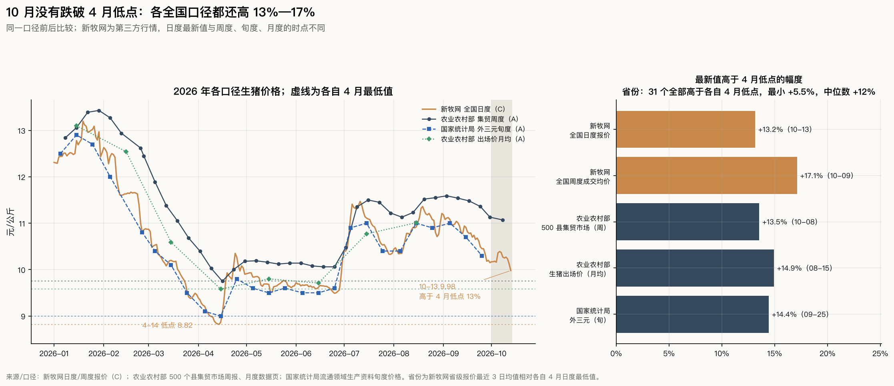
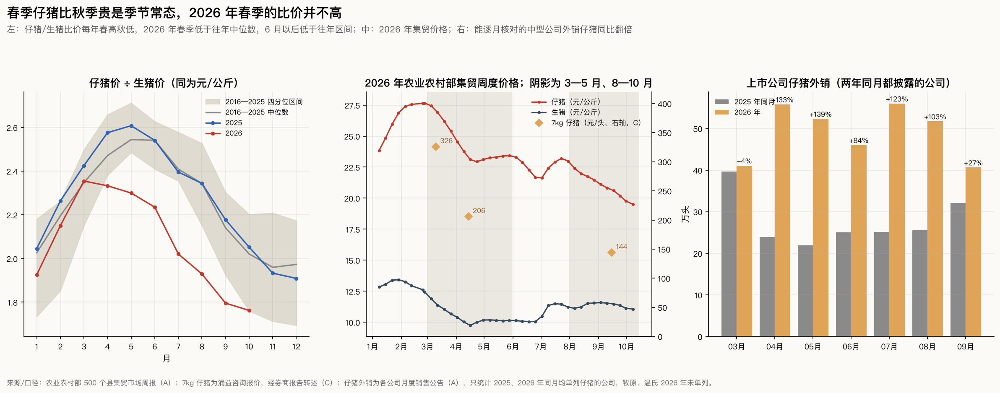
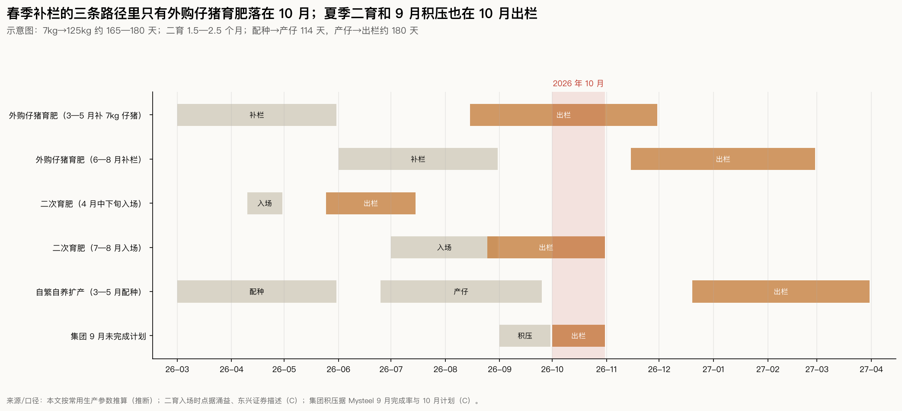
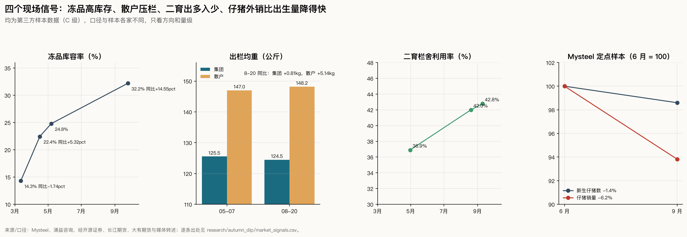
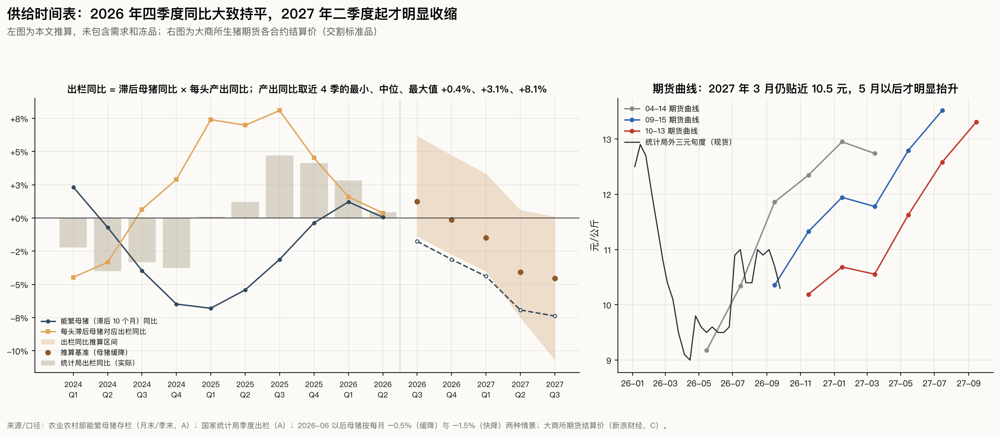

# 10 月猪价再探：是春季补栏集中出栏，还是供给过剩没有扭转

回答 [Issue #6](https://github.com/AlphaCatalyst/AlphaNotes/issues/6)。数据截止：新牧网日度全国报价到 10-13（省级到 10-14），农业农村部 500 个县集贸市场周报到 10-08 采集，统计局旬度价格到 9 月下旬（10 月上旬尚未发布），农业农村部月度数据页到 8 月，统计局季度数据和季末能繁母猪到二季度，上市公司月度销售公告到 9 月，生猪期货到 10-13 结算价；Mysteel、涌益等第三方样本数据到 9 月下旬至 10 月中旬。

标签沿用前几期：【事实】为统计与公告原文（A 级），官员或公司管理层的口头表述为 B 级；【推断】为本文计算或推理；新牧网、搜猪网、Mysteel、涌益等第三方行情和样本数据按 C 级处理；D 表示没有找到可靠数据。猪价单位为元/公斤，期货为元/吨。议题的假设链（春季低价吸引补栏 → 秋季集中出栏 → 猪价再探；补栏意愿下降 → 未来压力减轻）逐环检验，不预设成立；见底时间也不从此前"2027 年均价 18 元"的假设倒推。数据与脚本见文末。

## 结论

1. **10 月没有跌破 4 月低点，是一次"高于前低的回落"，跌幅也在往年 10 月的范围内。** 各全国口径的最新值比各自 4 月最低值高 13%—17%：新牧网全国报价 10-13 为 9.98 元，4-14 为 8.82 元；农业农村部集贸价 10-08 为 11.07 元，4 月最低 9.75 元；统计局外三元 9 月下旬 10.3 元，4 月中旬 9.0 元。31 个省份全部高于各自 4 月低点，最接近的新疆也高 5.5%。议题里的"4 月约 9 元"对应统计局 4 月中旬的 9.0 元（A），或 4-14 前后各平台 8.7—8.8 元的日度报价（C）；"跌破 10 元"是搜猪网 10-14 的 9.98 元，是整数关口，不是新低。9 月下旬到 10 月中旬新牧网跌 4.0%，往年同期 10 年中 8 年下跌，中位数 −3.1%，2025 年是 −11.9%【推断】。
2. **春季补栏不支持"抄底补栏 → 10 月集中出栏"的强版本。** 4 月仔猪/生猪比价 2.33，低于 2016—2025 年同月中位数 2.47；机构调研都说春季补栏没有形成持续承接。春季补栏的三条路径里，只有外购 7 公斤仔猪育肥（3—5 月补、8—11 月出栏）落在 10 月，而这是每年都有的季节性补栏，不是额外的抄底潮；4 月中旬抄底的二育在 5 月下旬到 7 月已经出栏；自繁自养扩产没有证据（二元母猪价格同比 −18%—−20%，能繁母猪在下降）。仔猪 4 月比 9 月贵是季节常态；2026 年比价从 4 月到 9 月降了 23%，比常年的约 14% 多，原因是秋季仔猪特别弱（9 月比价 1.80，与 2018 年并列 2016 年以来同期最低），不是春季特别强【推断】。
3. **10 月这一段下跌由几股暂时力量叠加触发。** 国庆假期积压集中在节后释放：Mysteel 统计的 10 月重点省份计划出栏比 9 月实际多 1.91%（按天数折算日均略少）；7—8 月入场的二育在 9—10 月出栏，栏舍利用率 9 月起"出多入少"；散户压栏的大猪陆续兑现（8 月散户出栏均重 148.2 公斤，同比 +5.1 公斤）；冻品库容率 32.2%，同比高 14.55 个百分点，价格一反弹冻品就出库。以上是 C 级样本数据，只能说明方向【推断】。
4. **但 10 元左右的价格水平说明供给过剩还没扭转，主因不是春季补栏，而是一年前偏高的母猪存栏加上每头母猪产出的提高。** 决定 10 月前后出栏的能繁母猪（往前推 10 个月）只比上年少 1.8%—3.1%；每头滞后母猪对应的出栏 2025 年同比增长 4.5%—8.1%，2026 年上半年放缓到 +1.6%、+0.4%。统计局上半年出栏 +1.7%、猪肉 +3.3%；19 家上市公司 9 月出栏同比仍 +2.5%。上半年 17 家以养猪为主的上市公司全部亏损，牧原经营现金流为负；能繁母猪的明显下降集中在 2026 年二季度（环比 −3.2%），要到 2027 年二季度前后才变成明显更少的出栏【推断】。
5. **仔猪价格下跌不能直接读成未来供给减少。** Mysteel 定点样本 6—9 月新生仔猪只减少 1.4%，仔猪销量减少 6.2%：外销减少得比出生快，部分仔猪留作自养，买方从散户变成企业自己。能逐月核对的 4—6 家中型公司 2026 年 4—8 月外销仔猪同比增加 84%—139%，但牧原、温氏 2026 年不再单列仔猪，行业外销总量无法核对。判断未来供给要看新生仔猪和季末能繁，不看仔猪价格本身【推断】。
6. **见底窗口分三层看。** 短期止跌：基准是 10 月下旬到 11 月中旬，前提是 11 月计划出栏不再高于 10 月、散户均重回落；2025 年 10 月中旬的下探到月底就基本收复。季节性反弹：11 月到春节（2027 年 2 月 6 日）前，但冻品高库存会限制高度，2025 年 11—12 月统计局价格只在 11.3—11.8 元。周期底部：按"滞后母猪 × 每头产出"推算，2026 年四季度出栏同比约 −0.2%（区间 −2.7% 到 +4.7%），2027 年一季度约 −1.5%（−4.0% 到 +3.4%），二季度约 −4% 到 −5%（−7.5% 到 +0.6%）。较早窗口是 4 月低点就是本轮底部，10 月只是更高的回落；基准窗口是 2027 年 2—4 月，春节后季节性低点前后最后一次探底，此后供给同比明显下降；较晚窗口是 2027 年下半年以后，条件是每头产出增速回到 +5% 以上，或母猪在 9 月底政策期限过后止降【推断】。

**回答核心问题：** 10 月这一段下跌主要是暂时的集中出栏，幅度与往年 10 月的季节性回落相当；但价格停在多数主体的成本以下，说明供给过剩还没有扭转。春季补栏只解释了一部分时点，不是主因。暂时的压力可能在 11 月中旬前后减轻；结构性压力要到 2027 年二季度前后才明显减轻，2027 年春节后还要再经历一次季节性低点的检验。下面这些数据出现后，对周期见底的判断才更有把握：10 月下旬统计局三季度出栏同比不高于 +1%、季末能繁不高于 3700 万头；新生仔猪连续同比下降，而且仔猪销量的降幅不再明显快于出生量；冻品库容率在春节前回落到 25% 以下；散户出栏均重的同比增幅收窄到 2 公斤以内；上市公司月度出栏同比转负。

---

## 方法与口径

| 项目 | 定义 |
|---|---|
| 价格口径 | 每个序列只和自己比：新牧网全国日度报价和周度成交均价（C）、农业农村部 500 个县集贸市场周度价格和月度生猪出场价（A）、统计局流通领域重要生产资料市场价格中的生猪（外三元）旬度价格（A）。集贸价高于出场价，不同平台同一天相差 0.1—0.2 元，不跨序列比较高低 |
| 4 月低点与最新 | 每个序列 2026 年 4 月内的最低值；最新为各序列最后一个观测。新牧网周度按所覆盖那一周的周五记日期 |
| 10 月季节性 | 9 月 22—28 日所在周的均价 → 10 月 13—19 日所在周的均价，2015—2025 年剔除 2019 年（非瘟）。2026 年新牧网用日度：9 月 21—27 日均值 → 10-11—10-13 均值 |
| 仔猪/生猪比价 | 农业农村部集贸周度仔猪价 ÷ 生猪价（都是元/公斤）的月均。比价消掉了猪价大周期，主要剩下补栏意愿和季节 |
| 公司仔猪外销 | 上市公司月度销售公告中单列的仔猪头数（剔除累计数和大于总销量的匹配）；同比面板只统计 2025、2026 年同月都单列的公司，按股票代码匹配 |
| 滞后母猪 | 出栏季度的三个月各往前推 10 个月，取能繁母猪月末存栏的均值。2025 年 11 月以后农业农村部只公布季末数，中间月份按对数线性插值；2026 年 6 月以后用两个情景：每月 −0.5%（缓降）和 −1.5%（快降） |
| 每头产出 | 统计局季度出栏 ÷ 滞后母猪。它的同比把 PSY、成活率、出栏时点和体重选择混在一起，分不开 |
| 出栏推算 | (1 + 滞后母猪同比) × (1 + 每头产出同比) − 1；每头产出同比取最近 4 个季度（2025Q3—2026Q2）的最小、中位、最大值：+0.4%、+3.1%、+8.1% |
| 补栏预期利润 | t 日买 7 公斤仔猪（涌益报价，C），养到 125 公斤，6 个月后按 t 日的期货价格出栏（出栏月落在两个合约之间时线性插值）。成本 = 仔猪 + 料肉比 2.6 × 118 公斤增重 × 农业农村部育肥猪配合饲料集贸价 + 其他 180 元/头 |

## 一、10 月发生了什么（问题 1）

**各口径的 4 月低点与最新值**【价格为事实或第三方报价，比较为推断】：

| 序列 | 级别 | 4 月最低 | 最新 | 最新比 4 月低点 | 最新比 8 月中旬—9 月高点 |
|---|---|---|---|---|---|
| 新牧网全国日度报价 | C | 8.82（4-14） | 9.98（10-13） | +13.2% | −12.1%（11.36） |
| 新牧网全国周度成交均价 | C | 8.88（4-06—4-12 当周） | 10.40（10-05—10-11 当周） | +17.1% | −7.2%（11.21） |
| 农业农村部集贸市场（周） | A | 9.75（[4-16 采集](https://xmsyj.moa.gov.cn/jcyj/202604/t20260422_6483464.htm)） | 11.07（[10-08 采集](https://xmsyj.moa.gov.cn/jcyj/202610/t20261014_6488573.htm)） | +13.5% | −4.5%（11.59） |
| 农业农村部生猪出场价（月均） | A | 9.58（4 月） | 11.01（[8 月](https://www.moa.gov.cn/ztzl/szcpxx/jdsj/2026/202608/)） | +14.9% | — |
| 统计局外三元（旬） | A | 9.0（[4 月中旬](https://www.stats.gov.cn/sj/zxfb/202604/t20260424_1963388.html)） | 10.3（[9 月下旬](https://www.stats.gov.cn/sj/zxfb/202610/t20261008_1965465.html)） | +14.4% | −6.4%（11.0） |

**"4 月约 9 元"从哪里来。** 统计局 4 月中旬外三元 9.0 元（A），是官方口径的 4 月最低。各平台 4-14 前后的日度报价：新牧网全国 8.82 元，[猪易通](https://cj.zhue.com.cn/zhushixingqing/2026/0414/403763.html) 8.79 元，一篇[财富号文章](https://caifuhao.eastmoney.com/news/20261006143424039929450)引用的未注明机构数据 8.67 元（C）。农业农村部月度出场价 4 月均价 9.58 元、集贸市场周度低点 9.75 元（A）。所以"约 9 元"是对日度低点和统计局旬度价的近似；月均价比日度低点高约 0.8 元，不能混用。"跌破 10 元"出自[搜猪网](https://www.soozhu.com/article/521003/) 10-14 的全国瘦肉型猪出栏均价 9.98 元（C）。

**各省。** 31 个省份 10-12—10-14 的报价均值全部高于各自 4 月最低值：最接近的是新疆（+5.5%）、河北（+7.7%）、天津（+7.8%）、北京（+7.9%），中位数 +12.2%，海南最高（+34.5%）【推断，新牧网，C】。北方产区离前低最近，但也没有跌破。

**10 月的跌幅在往年范围内**（9 月下旬所在周 → 10 月中旬所在周）【推断】：

| 年份 | 新牧网周度（C） | 农业农村部集贸（A） |
|---|---|---|
| 2015 | −2.0% | — |
| 2016 | −10.8% | −6.7% |
| 2017 | −1.1% | −1.4% |
| 2018 | −4.1% | −0.8% |
| 2020 | −10.9% | −9.6% |
| 2021 | +5.8% | −8.2% |
| 2022 | +12.8% | +13.7% |
| 2023 | −4.9% | −4.2% |
| 2024 | −1.3% | −2.8% |
| 2025 | −11.9% | −9.0% |
| 中位数（下跌年数） | −3.1%（10 年 8 跌） | −4.2%（9 年 8 跌） |
| 2026（到目前） | −4.0%（日度，到 10-13） | −2.6%（到 10-08） |

2025 年 10 月中旬新牧网跌 11.9%，到 10 月底基本收复（−0.8%）；统计局 10 月中旬 10.9 元，下旬回到 12.0 元。今年到目前为止的跌幅比去年小，与往年中位数接近。

**"二次探底"和"双底"怎么说。** 现在准确的说法是"高于前低的二次回落"：各口径都没有跌破 4 月低点。技术上的"双底"要等价格重新突破中间高点（7 月中旬，新牧网周度 11.33 元）才算形态完成；即使形态完成，也只描述价格路径，不说明供给已经收缩。2025 年 10 月也有过一次 V 形回升，2026 年 4 月照样跌出新低。周期底部要靠第六节的供给证据确认【推断】。

## 二、仔猪价格：4 月比 9 月贵说明什么（问题 2）

**先统一单位和规格。** 三个常用口径不能互相换算：

| 口径 | 单位与规格 | 春季 | 秋季 | 变化 |
|---|---|---|---|---|
| 农业农村部集贸市场仔猪（A） | 元/公斤，规格未注明 | 4 月均价 23.50 | 9 月均价 20.51；10-08 为 19.51 | −12.7%；−17.0% |
| 涌益规模场 7 公斤仔猪（C） | 元/头 | 3-10 为 326；4 月均价 202（同比 −63%） | 9-15 为 144 | 比 4 月均价 −29% |
| 搜猪网三元仔猪（C） | 元/头 | 4-14 为 300 | 10-14 为 190.67 | −36% |

议题用的是农业农村部周度数据，本文核对一致：4 月均价仔猪 23.50 元、生猪 10.07 元；9-03 采集 21.12、11.59 元；9-24 采集 20.20、11.36 元；最新 10-08 为 19.51、11.07 元（A）。4 月均价是月均，9 月两个数是周度单点，按月均比，9 月仔猪 20.51 元、生猪 11.42 元。按头计价的小规格仔猪跌得更多，因为 7 公斤断奶仔猪离补栏决策最近，对预期利润最敏感【推断】。

**比价：春高秋低是常态**（农业农村部集贸周度的月均，A；比较为推断）：

| 年份 | 4 月仔猪 | 9 月仔猪 | 4 月仔猪比 9 月 | 4 月比价 | 9 月比价 | 4 月比价比 9 月 |
|---|---|---|---|---|---|---|
| 2016 | 47.13 | 45.07 | +4.6% | 2.38 | 2.48 | −4.3% |
| 2017 | 42.97 | 34.10 | +26.0% | 2.69 | 2.31 | +16.1% |
| 2018（4 月、9 月各 2 周） | 26.26 | 25.50 | +3.0% | 2.37 | 1.80 | +32.0% |
| 2019 | 36.45 | 55.87 | −34.8% | 2.43 | 2.08 | +16.6% |
| 2020 | 98.95 | 106.63 | −7.2% | 2.94 | 2.98 | −1.4% |
| 2021 | 85.96 | 30.47 | +182% | 3.63 | 2.27 | +59.8% |
| 2022 | 25.77 | 44.06 | −41.5% | 1.92 | 1.86 | +3.3% |
| 2023 | 36.89 | 31.40 | +17.5% | 2.52 | 1.87 | +34.3% |
| 2024 | 36.73 | 41.45 | −11.4% | 2.39 | 2.10 | +13.8% |
| 2025 | 39.16 | 30.06 | +30.3% | 2.58 | 2.18 | +18.3% |
| 2026 | 23.50 | 20.51 | +14.6% | 2.33 | 1.80 | +29.9% |

- 仔猪价格本身跟着猪价大周期走（2019、2022 年是上涨周期，9 月远高于 4 月），比较补栏意愿要看比价。
- 2026 年 4 月比价 2.33，低于 2016—2025 年中位数 2.47；3 月 2.36 与中位数持平，5 月 2.30 低于中位数 2.55。春季补栏意愿没有高于常年。
- 9 月比价 1.80，与 2018 年并列最低；10 月第一周 1.76。
- 4 月比价比 9 月高 29.9%（中位数约 +16%），在 11 年里排第 4，前面是 2021、2023、2018 年，都是秋季补栏需求骤降的年份。

**四种解释逐一对照**【推断】：

| 解释 | 证据 | 判断 |
|---|---|---|
| 春季补栏需求更强 | 4 月比价低于常年；[华源证券](https://pdf.dfcfw.com/pdf/H3_AP202605261822882985_1.pdf)：「传统补栏旺季并未形成持续性承接」；4 月外售仔猪头均利润 −65.8 元（C） | 不成立 |
| 秋季可卖的仔猪更多 | Mysteel 样本 6—9 月新生仔猪 −1.4%、仔猪销量 −6.2%（C）；4 家中型公司 9 月外销仔猪 40.6 万头，同比 +27%（A） | 样本里外销在减少，中型公司在增加，行业总量无法核对（D） |
| 对未来猪价的预期不同 | 春季补栏时，出栏月的期货价格高于盈亏平衡价，头均预期 +80—105 元；10-13 补栏、2027 年 4 月出栏只有约 +29 元（第五节）；9-24 外购仔猪育肥头均 −103 元（C） | 成立：秋季仔猪弱主要来自预期利润变差 |
| 季节、疫病、仔猪质量 | 比价春高秋低是常态；疫病和仔猪质量没有找到可量化的数据（D） | 季节成立；其余无法判断 |

**"更贵"不等于"更多补栏"。** 价格是需求和可卖仔猪的交点：仔猪贵可能是需求强，也可能是外销少。Mysteel 6 月称[「养殖主体收缩外销以规避亏损」](https://ncp.mysteel.com/a/26070616/ABBA8591BF13493E.html)，外销减少本身就会抬高仔猪价，补栏量并不更多。补栏量要看成交量：Mysteel 样本仔猪销量 6 月 48.24 万头，9 月 45.26 万头（C）；3—5 月的样本成交量没有找到（D）。

## 三、春季买入的猪是否在 10 月上市（问题 3）

**三条时间线**【推断；饲养时间为行业常用值】：

| 路径 | 春季动作 | 饲养时间 | 出栏时间 | 和 10 月的关系 | 证据 |
|---|---|---|---|---|---|
| 外购仔猪育肥 | 3—5 月买 7 公斤仔猪 | 养到 120—130 公斤约 5—6 个月 | 8 月中旬—11 月 | 落在 10 月 | 7 公斤仔猪 3-10 为 326 元、4-14 为 206 元，4 月均价同比 −63%（C）；补栏没有形成持续承接（C） |
| 二次育肥 | 4 月中旬买 110—120 公斤标猪 | 压到 140—150 公斤约 1.5—2.5 个月 | 5 月下旬—7 月 | 不在 10 月；10 月出栏的是 7—8 月入场的二育 | [东兴证券](https://pdf.dfcfw.com/pdf/H3_AP202605221822677493_1.pdf)：「二育集中进场抢夺标猪猪源」；4 月下旬二育占销量 1.34%，比中旬低 0.63 个百分点；栏舍利用率 4-30 为 36.9%，8-20 为 42%，9-10 为 42.78%、出多入少（C） |
| 自繁自养扩产 | 3—5 月多配种、少淘汰 | 妊娠 114 天 + 育肥约 6 个月 | 2027 年 1—3 月；新留后备母猪再晚 3—4 个月 | 不在 10 月 | 二元母猪价格 4—8 月同比 −18%—−20%（A）；50 公斤二元母猪 4 月 1404 元/头，同比 −14%（C）；6 月末能繁母猪同比 −6.5%（A） |

**压栏证据**【C，样本口径】：

- [涌益 8-20](https://www.microbell.com/data/9cd59b266c7af6c8beff978cb45b1f1c.html)：全国、集团、散户出栏均重 128.37、124.48、148.21 公斤，同比 +0.39、+0.81、+5.14 公斤；[9-24](https://www.18qh.com/zixun/c-2026-09-30-4493859.html) 全国 128.82 公斤，同比 +0.27 公斤。
- [150 公斤以上出栏占比](https://pdf.dfcfw.com/pdf/H3_AP202609241829864356_1.pdf) 9-17 为 4.61%，同比低 0.53 个百分点；Mysteel 8 月 140 公斤以上存栏占比同比 +0.55 个百分点。
- 统计局胴体重（猪肉 ÷ 出栏）二季度 84.2 公斤，同比 +1.8%（A）。

压栏集中在散户，全国均重只比去年高 0.3%，大猪出栏占比还低于去年。春季外购的仔猪按正常生长周期就落在 8—11 月，不需要用压栏解释；压栏和二育的作用是把一部分 9 月该出的猪推到 10 月，并让每头猪更重【推断】。

## 四、新增供给，还是出栏时点和主体的变化（问题 4）

**先把头数和肉量分开**（[统计局](https://www.stats.gov.cn/sj/zxfb/202607/t20260715_1964121.html)出栏和猪肉为 A 级，比值为推断）：

| 季度 | 出栏同比 | 猪肉同比 | 胴体重同比 | 滞后母猪同比 | 每头产出同比 |
|---|---|---|---|---|---|
| 2025Q1 | +0.1% | +1.2% | +1.1% | −6.8% | +7.4% |
| 2025Q2 | +1.2% | +1.4% | +0.2% | −5.4% | +7.0% |
| 2025Q3 | +4.7% | +7.1% | +2.3% | −3.1% | +8.1% |
| 2025Q4 | +4.1% | +7.1% | +2.8% | −0.4% | +4.5% |
| 2026Q1 | +2.8% | +4.2% | +1.3% | +1.2% | +1.6% |
| 2026Q2 | +0.4% | +2.3% | +1.8% | +0.1% | +0.4% |

过去一年供给增加主要来自每头母猪产出提高和体重增加，而不是母猪更多（滞后母猪同比在 2025 年为负）。2026 年上半年每头产出增速明显放缓，出栏同比从 +4.7% 降到 +0.4%，但体重让猪肉仍增长 2.3%【推断】。

**定点屠宰量不能当作供给增速。** [农业农村部月度数据](https://www.moa.gov.cn/ztzl/szcpxx/jdsj/2026/202608/)：生猪定点屠宰企业屠宰量 4—8 月同比 +12%—+23%，1—8 月 30089 万头、同比 +17.7%（A）；同期统计局上半年出栏只增长 1.7%。差距更可能来自屠宰向定点企业集中，本文不用它推算供给【推断】。

**上市公司出栏**【公告为 A 级，比较为推断】：19 家上市公司（同月两年都有月报）7、8、9 月出栏同比 +4.4%、+2.9%、+2.5%，三季度合计 +3.3%；二季度合计 +3.7%，而统计局二季度全国出栏只增长 0.4%。如果三季度上市公司与全国的差距不变（约 3.3 个百分点），全国三季度出栏同比接近 0，低于推算的基准 +1.3%。中型公司扩张明显：正邦 1—8 月出栏 726.8 万头，同比 +47%。

**逐项对照其他解释**【推断】：

| 解释 | 证据 | 判断 |
|---|---|---|
| 春季补栏带来额外的猪 | 4 月比价低于常年，补栏没有持续承接（C）；农业农村部在国新办发布会上称一季度[「新生仔猪数量17个月后首次同比下降」](https://www.jwview.com/jingwei/html/m/04-23/668146.shtml)（B） | 不是主因 |
| 仔猪从集团流向中小户 | 4—6 家中型公司 4—8 月外销仔猪同比增加 84%—139%（A）；正邦 1 月外销仔猪 53 万头（A） | 改变出栏主体和时点，不增加总头数 |
| 标猪转入二育 | 二育占销量 1%—2%，栏舍利用率 37%—43%（C） | 延后 1.5—2.5 个月并增重，夏季批次在 9—10 月释放 |
| 集团出栏节奏 | [9 月计划完成率 99.01%，10 月计划比 9 月实际多 1.91%](https://ncp.mysteel.com/a/26100810/09F34666011FFE45.html)，按天数折算日均略少（C）；上市公司 9 月同比 +2.5%（A） | 节后集中出栏是 10 月的直接触发因素 |
| 生产效率 | 每头产出同比 2025 年 +4.5%—8.1%，2026 年上半年 +1.6%、+0.4% | 过去一年的主要供给来源，正在减弱 |
| 压栏释放 | 散户均重同比 +5.1 公斤，全国 +0.3—0.4 公斤；150 公斤以上出栏占比低于上年（C） | 局部存在，量级有限 |
| 淘汰母猪 | 二季度能繁环比 −3.2%（A）；8 月三家机构样本能繁环比 −1.7%—−3.0%（C） | 淘汰母猪本身的肉量小，对 10 个月后的出栏是减量 |
| 消费疲弱 | 没有可靠的月度消费数据（D） | 无法量化 |
| 冻品库存 | 库容率 3-12 为 14.32%，4-16 为 22.45%，9-25 为 32.2%，同比 +14.55 个百分点（C）；双汇 6 月末存货 68.2 亿元，比年初多 23%，二季度增加约 10 亿元，2025 年同期基本持平（A，存货含原料和产成品，不全是冻肉） | 春季低价入库，现在成了价格一涨就出库的隐性供给 |
| 进口 | 1—8 月猪肉进口 50.0 万吨，同比 −29.1%（A） | 减少约 20 万吨，不到国内同期产量的 1%，影响很小 |
| 成活率 | 没有官方数据（D） | 包含在每头产出里，分不开 |

**哪些只能作为推断。** "仔猪从集团流向中小户""标猪转入二育"只改变时点和主体、不增加总量，这一点由定义推出，但规模没法核对：牧原、温氏 2026 年不再单列外销仔猪，二育没有全国统计。每头产出把 PSY、成活率、出栏时点、体重选择和统计误差混在一起。冻品库容率是重点企业样本，不是全国库存量。

## 五、各类主体在做什么（问题 5）

| 主体 | 在做什么 | 证据 |
|---|---|---|
| 头部集团 | 按政策压减母猪；出栏和体重仍在高位 | 部委 6-22 [通稿](https://xmsyj.moa.gov.cn/gzdt/202606/t20260622_6485180.htm)要求大型企业带头压减产能和产量（A）；牧原称能繁母猪比 2025 年初高点调减约 50 万头（B，[公司回应的转述](https://caifuhao.eastmoney.com/news/20261006143424039929450)）；集团出栏均重同比 +0.8 公斤（C）；上半年牧原、温氏、新希望归母净利润 −60.8、−43.7、−17.0 亿元，牧原经营现金流 −22.2 亿元（A） |
| 中型上市公司 | 出栏扩张，部分公司外销仔猪大增 | 正邦 1—8 月出栏 +47%（A）；唐人神 9 月外销仔猪 23.1 万头，2025 年 9 月 1.3 万头（A）；天邦 9 月 9.2 万头，同比 −63%（A）；上半年全部亏损（A） |
| 中小自繁自养户 | 深度亏损，但没有看到恐慌性淘汰 | 5000—10000 头规模自繁自养 9-24 头均 −193 元，8 月行业均值 −195 元（C）；5 月初高胎淘汰母猪价格相当于商品猪的 76.8%，比例还在上升（C） |
| 外购仔猪育肥户 | 春季按当时的期货价格有利可图而补栏；现在亏损出栏，秋季补栏谨慎 | 见下表；9-24 外购仔猪育肥头均 −103 元（C）；Mysteel 9 月样本仔猪销量环比 −3.1%（C） |
| 二育 | 4 月中旬抄底，7—8 月再入场，9 月起出多入少 | 见第三节 |
| 屠宰和贸易商 | 春季低价入库冻品 | 冻品库容率、双汇存货（见第四节） |

**谁退出、谁抄底、谁接手空栏。** 退出的主要是头部集团的母猪（政策和亏损），没有看到散户恐慌出清。抄底的是二育（4 月中旬、7—8 月两次）、屠宰和贸易商（冻品）、部分中型公司（出栏扩张）。中型公司外销的仔猪流向谁没有数据，最可能是外购育肥户和代养户（D）。新进入者没有找到数据（D）；外购育肥门槛低，低价仔猪会吸引一部分人进场，但春季比价不高说明这种进场不多【推断】。

**企业是否把外销仔猪转为自养或代养。** Mysteel 6 月说养殖主体在收缩外销；样本仔猪销量 6—9 月 −6.2%，新生仔猪 −1.4%（C）。新希望外销仔猪从 1 月的 22.2 万头降到 7—9 月的 4.7—7.4 万头，天邦 9 月降到 9.2 万头（A）。方向上是在转为自养，但牧原、温氏不单列，量级无法核对（D）。

**预期利润：当前亏损不等于不会补栏**【推断；7 公斤仔猪为 C 级报价，饲料为 A 级，期货为大商所结算价】：

| 补栏日 | 7 公斤仔猪（元/头） | 饲料（元/公斤） | 盈亏平衡价 | 出栏月与当日期货价 | 预期头均利润（元） | 实际（按统计局价） |
|---|---|---|---|---|---|---|
| 3-10 | 326 | 3.38 | 12.34 | 2026-09：13.19（LH2609） | +105 | 9 月均价 10.67 → −210 |
| 4-14 | 206 | 3.41 | 11.46 | 2026-10：12.10（LH2609、LH2611 插值） | +81 | 9 月下旬 10.3 → −145 |
| 9-15 | 144 | 3.35 | 10.81 | 2027-03：11.78（LH2703） | +121 | — |
| 10-13 | 144（沿用 9-15 报价） | 3.37 | 10.86 | 2027-04：11.09（LH2703、LH2705 插值） | +29 | — |

料肉比每差 0.2，头均利润差约 80 元。[建信期货](https://www.ccbfutures.com/upload/20260403/20260403172614988.pdf)转述的 3 月底外购仔猪育肥预期成本为 11.4 元/公斤（C），比本文同期测算低约 0.7 元，所以本文的利润偏保守。

3—4 月现货亏损最深的时候，按出栏月的期货价格补栏仍有每头 80—105 元的预期利润，这就是"亏损时仍补栏"的机制；结果出栏时现货远低于当初的期货，每头亏 145—210 元。9 月中旬按 2027 年 3 月合约测算仍有 +121 元；10-13 远月期货下移后只剩约 +29 元，接近盈亏平衡。秋季补栏意愿下降有价格依据，但 2027 年 2—4 月外购育肥的出栏会因此少多少，取决于企业是否把这些仔猪留作自养【推断】。

**补贴、信贷、合同、现金流。**

- 政策：5-14 公布的[产能调控方案（2026 年修订）](https://www.agri.cn/zx/hxgg/202605/t20260514_8836581.htm)把能繁母猪正常保有量定为 3750 万头，绿色区间 92%—103%（约 3450—3863 万头）（A）。二季度末 3780 万头，已在绿色区间内。媒体说的"9 月底前完成压减"（C）期限已过，之后压减是否放松是重要变量【推断】。
- 信贷：限贷只有媒体转述（C），没有找到官方文件（D）。
- 合同：代养、放养合同条款没有公开数据（D）。
- 现金流：上半年 17 家以养猪为主的上市公司（Issue #5 的样本，不含已退市的雏鹰）全部亏损（A）；三季度统计局旬度价格在 10.3—11.0 元（A），低于多数主体成本（C），亏损在延续。

## 六、见底窗口（问题 6）

**供给时间表**【推断；能繁母猪为 A 级，2026 年 7 月以后为情景】：

| 出栏季度 | 对应能繁月份 | 滞后能繁同比 | 出栏同比推算（低 / 基准 / 高） | 说明 |
|---|---|---|---|---|
| 2026Q3 | 2025-09—11 | −1.8% | −1.4% / +1.3% / +6.2% | 统计局 10 月 20 日前后公布实际值，可检验 |
| 2026Q4 | 2025-12—2026-02 | −3.1% | −2.7% / −0.2% / +4.7% | 1、2 月按季末插值 |
| 2027Q1 | 2026-03—05 | −4.4% | −4.0% / −1.5% / +3.4% | 4、5 月按季末插值 |
| 2027Q2 | 2026-06—08 | −6.9%（缓降）；−7.9%（快降） | −6.6% / −4.1% / +0.6%（缓降）；−7.5% / −5.0% / −0.4%（快降） | 7、8 月为情景 |
| 2027Q3 | 2026-09—11 | −7.4%（缓降）；−11.0%（快降） | −7.0% / −4.5% / +0.1%（缓降）；−10.7% / −8.3% / −3.8%（快降） | 全部为情景 |

推算只用母猪和每头产出，不含体重、冻品、进口和需求；体重每高 2%，肉量就多 2%。三季度实际值是第一次检验：基准 +1.3%，第四节按上市公司差距推的约 0%。

**期货曲线**（大商所结算价，元/吨）：10-13 的 LH2611、LH2701、LH2703、LH2705、LH2707、LH2709 分别为 10190、10685、10555、11630、12580、13310。同一批合约中的 LH2611、LH2701，4-14 是 12345、12950，9-15 是 11325、11945。远月从 4 月以来下移 2000 多元/吨。市场的定价是 2027 年一季度仍在 10.5—10.7 元，二季度起抬升，形状与本文基准窗口一致；这是市场价格，不是本文的预测。

**三层窗口**【推断】：

| 层次 | 较早 | 基准 | 较晚 | 需要看到 | 反证 |
|---|---|---|---|---|---|
| 短期止跌 | 10 月下旬 | 10 月下旬—11 月中旬 | 11 月下旬以后 | 11 月计划出栏不高于 10 月实际；散户均重回落；二育低位入场 | 11 月计划继续上调；均重继续上升；价格跌破 4 月低点 |
| 季节性反弹 | 11 月 | 12 月—2027 年 1 月（春节 2 月 6 日前） | 弱或没有 | 冻品库容率回落；腌腊和节前备货 | 价格一涨冻品就出库，反弹不过 9 月高点 |
| 周期底部 | 2026 年 4 月已是底部，10 月是更高的回落 | 2027 年 2—4 月，春节后季节性低点前后最后一次探底，此后供给同比明显下降 | 2027 年下半年以后 | 三季度出栏同比 ≤ +1%；季末能繁 ≤ 3700 万头；新生仔猪连续同比下降；冻品去库 | 三季度出栏 ≥ +4%；能繁止降回升；每头产出增速回到 +5% 以上；中型公司继续扩张 |

较早窗口要求供给收缩从 2026 年四季度就显现：三季度出栏同比不高于 0、上市公司月度出栏同比转负、冻品在 11—12 月明显去库。较晚窗口对应每头产出增速回到 2025 年的 +7%—8%，或者 9 月底政策期限过后母猪止降。

**和 Issue #5 的关系。** [Issue #5](05-stock-hog-timing.md) 按常年季节性从 10 月的价格外推，2027 年春节后 8 周现货约 8.6 元，会低于今年 4 月低点。那是只用季节性、不考虑供给变化的检验线。本文的供给时间表显示，2027 年一季度出栏只比 2026 年一季度少约 1.5%（区间 −4.0% 到 +3.4%），而冻品库存比去年同期高得多，所以春节后再次探底、接近甚至跌破 4 月低点都有可能；二季度供给同比下降 4%—5% 后，价格中枢才有明显抬升的基础。是否创新低不是本文的预测对象，取决于每头产出、冻品和需求【推断】。

**特别检验：仔猪价格下跌是否只是买方变化。**

- 新生仔猪：农业农村部称一季度新生仔猪数量 17 个月后首次同比下降（B）；Mysteel 样本 [6 月](https://ncp.mysteel.com/a/26070616/ABBA8591BF13493E.html) 578.13 万头、[9 月](https://ncp.m.mysteel.com/a/26101016/2210CC08CD4CC57B_abc.html) 570.05 万头，降 1.4%（C）。
- 仔猪销量：同一样本 6 月 48.24 万头、9 月 45.26 万头，降 6.2%（C）。外销降得比出生快约 5 个百分点。
- 公司：唐人神、金新农外销增加，天邦、新希望外销减少（A）。

仔猪价格和销量的下降，有一部分是企业把仔猪留作自养，不对应未来出栏减少。按 Mysteel 样本，6—9 月出生量只降 1.4%，对应的 2027 年 1—3 月出栏不会比现在少很多，与供给时间表的一季度 −1.5% 一致【推断】。

## 七、接下来看什么，哪些证据会推翻判断

| 信号 | 当前 | 支持"暂时集中出栏，结构压力 2027 年二季度减轻" | 支持"过剩更持久，见底推迟" | 来源 |
|---|---|---|---|---|
| 统计局三季度出栏、季末能繁（10 月 20 日前后） | 二季度出栏 +0.4%，能繁 3780 万头（−6.5%） | 出栏同比 ≤ +1%，能繁 ≤ 3700 万头 | 出栏 ≥ +4%，或能繁止降 | 统计局（A） |
| 新生仔猪与仔猪销量 | 样本出生 6—9 月 −1.4%，销量 −6.2% | 出生连续同比下降，销量降幅接近出生 | 出生持平而销量大降（只是转自养） | 农业农村部（B）、Mysteel（C） |
| 冻品库容率 | 32.2%，同比 +14.55 个百分点 | 春节前回落到 25% 以下 | 春节后仍在 30% 以上 | Mysteel（C） |
| 出栏均重 | 散户 148.2 公斤（+5.1），全国 128.8 公斤（+0.3） | 散户同比增幅收窄到 2 公斤以内，全国转为同比下降 | 继续上升 | 涌益（C） |
| 集团计划与上市公司出栏 | 10 月计划 +1.91%；上市公司 9 月 +2.5% | 11—12 月计划不高于实际；月度出栏同比转负 | 继续正增长 | Mysteel（C）、公司公告（A） |
| 二育 | 栏舍利用率约 4 成，出多入少 | 低位温和入场，托底但不积压 | 大规模入场，把压力推到春节前后 | 涌益（C） |
| 期货远月 | LH2703 10555，LH2705 11630 | 远月不再下移 | 2027 年 5 月以后的合约继续下移，市场在定价更久的过剩 | 大商所 |
| 政策与产能 | 能繁在绿色区间，9 月底期限已过 | 继续压减 | 中型公司继续扩张，能繁回升 | 农业农村部（A）、公司公告（A） |

**会推翻本文判断的证据：**

- **"10 月是暂时集中出栏"**：如果 11—12 月计划出栏继续上调、价格跌破 4 月低点而均重没有回落，说明不是积压，而是存栏本身更多，三季度出栏也会高于推算。
- **"春季补栏不是主因"**：如果出现春季外购仔猪补栏量明显高于往年的直接证据（例如 3—5 月仔猪成交量同比大增），需要修正。
- **"结构压力 2027 年二季度减轻"**：如果每头产出增速回到 +5% 以上，或季末能繁在 9—12 月止降回升，窗口推迟到 2027 年下半年以后。
- **"仔猪价格下跌不等于供给减少"**：如果新生仔猪也像仔猪销量那样大幅下降，仔猪价格下跌就确实对应未来供给减少，见底可能提前。

## 更正

- [Issue #5](05-stock-hog-timing.md) 两处写"日度最低是 4 月 14 日的 8.69 元"，口径不对：8.69 元是新牧网当天各省报价的简单平均，而 Issue #5 的日度序列用的是新牧网全国报价，当天为 8.82 元。已在原文改为 8.82 元，结论不受影响。[Issue #3](03-xueqiu-authors.md) 写的"32 省均价 8.69 元"标明了口径，不需要改。

## 局限

- **第三方样本口径不同。** Mysteel、涌益、卓创的样本、规格和加权都不同，同一指标的数字也常对不上（例如 8 月能繁环比，不同转述把 −1.67% 归到不同机构）。本文只看方向，不精确归属。
- **母猪数据不完整。** 能繁母猪 2025 年 11 月以后只有季末数，中间月份是插值；2026 年 7 月以后完全是情景。
- **每头产出是混合指标。** 它的同比混合了 PSY、成活率、出栏时点和统计口径的变化；近 4 季区间（+0.4% 到 +8.1%）很宽，推算区间也很宽。
- **补栏利润模型的参数是假设。** 饲料用集贸零售价，可能高于规模场的实际成本；7 公斤仔猪只有几个时点的报价。
- **缺数据。** 消费、冻品出库量、空栏率、新进入者、春季仔猪成交量都没有可靠数据（D）。
- **不预测价格水平。** 本文只给条件和窗口，第七节的数据会随时修正这些判断。

## 数据与方法

| 文件 | 内容 |
|---|---|
| [`scripts/issues/autumn_dip.py`](../scripts/issues/autumn_dip.py) | 本文全部计算和 5 张图 |
| [`scripts/industry/nbs_tenday.py`](../scripts/industry/nbs_tenday.py) | 统计局旬度价格，生成 [`nbs_tenday_hog_2025_2026.csv`](../data/processed/nbs_tenday_hog_2025_2026.csv)（附发布稿链接） |
| [`ad_calibers.csv`](../data/processed/issues/ad_calibers.csv)、[`ad_province_vs_april.csv`](../data/processed/issues/ad_province_vs_april.csv) | 各口径 4 月低点与最新值；各省离 4 月低点的距离（只有百分比） |
| [`ad_october_moves.csv`](../data/processed/issues/ad_october_moves.csv) | 历年 9 月下旬到 10 月中旬的涨跌（新牧网只有百分比） |
| [`ad_moa_piglet_monthly.csv`](../data/processed/issues/ad_moa_piglet_monthly.csv)、[`ad_piglet_seasons.csv`](../data/processed/issues/ad_piglet_seasons.csv) | 农业农村部仔猪、生猪月均价与比价；春秋对比 |
| [`ad_company_piglets.csv`](../data/processed/issues/ad_company_piglets.csv)、[`ad_company_piglet_panel.csv`](../data/processed/issues/ad_company_piglet_panel.csv) | 上市公司月度外销仔猪（附公告链接）；同月面板 |
| [`ad_listed_sales.csv`](../data/processed/issues/ad_listed_sales.csv) | 上市公司月度出栏同比（同月两年都有月报的公司） |
| [`ad_moa_monthly.csv`](../data/processed/issues/ad_moa_monthly.csv)、[`ad_moa_feed.csv`](../data/processed/issues/ad_moa_feed.csv) | 农业农村部月度数据页（定点屠宰、仔猪、出场价、二元母猪、进口）；周度育肥猪配合饲料价 |
| [`ad_per_sow.csv`](../data/processed/issues/ad_per_sow.csv)、[`ad_supply_schedule.csv`](../data/processed/issues/ad_supply_schedule.csv) | 滞后母猪与每头产出；供给时间表（两个母猪情景） |
| [`ad_placement_margins.csv`](../data/processed/issues/ad_placement_margins.csv) | 补栏预期利润与实际利润 |
| [`research/autumn_dip/market_signals.csv`](../research/autumn_dip/market_signals.csv) | 第三方现场信号（仔猪、冻品、二育、均重、利润、出生与销量、计划出栏、产能），每条附来源链接和 40 字以内的摘录 |

新牧网日度和周度价格、期货合约日线只保留在本地，仓库只公开派生结果。

本文不构成投资建议。
