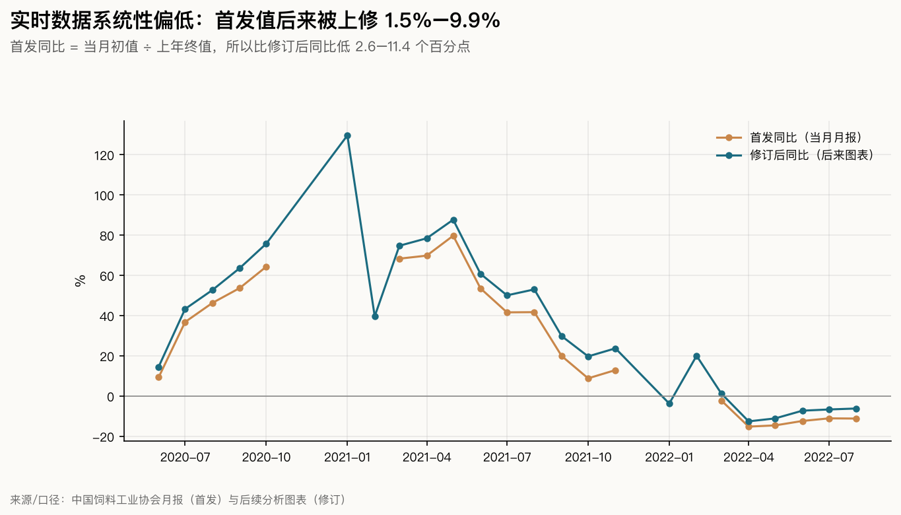
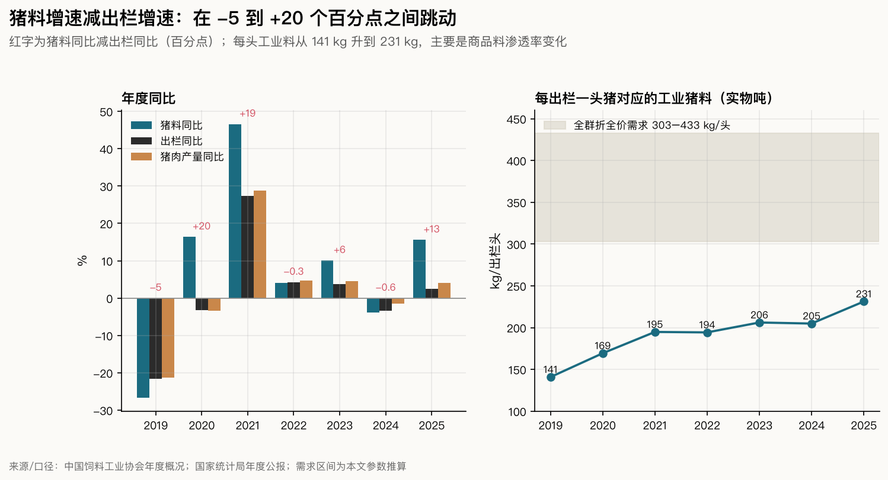
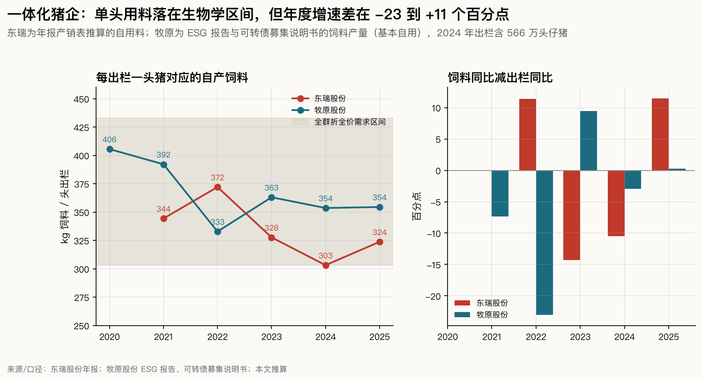
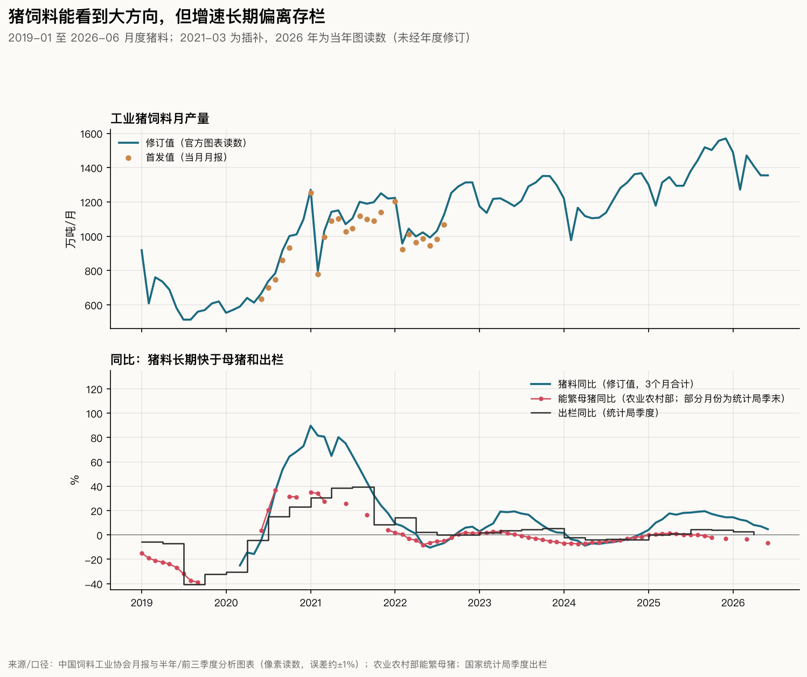
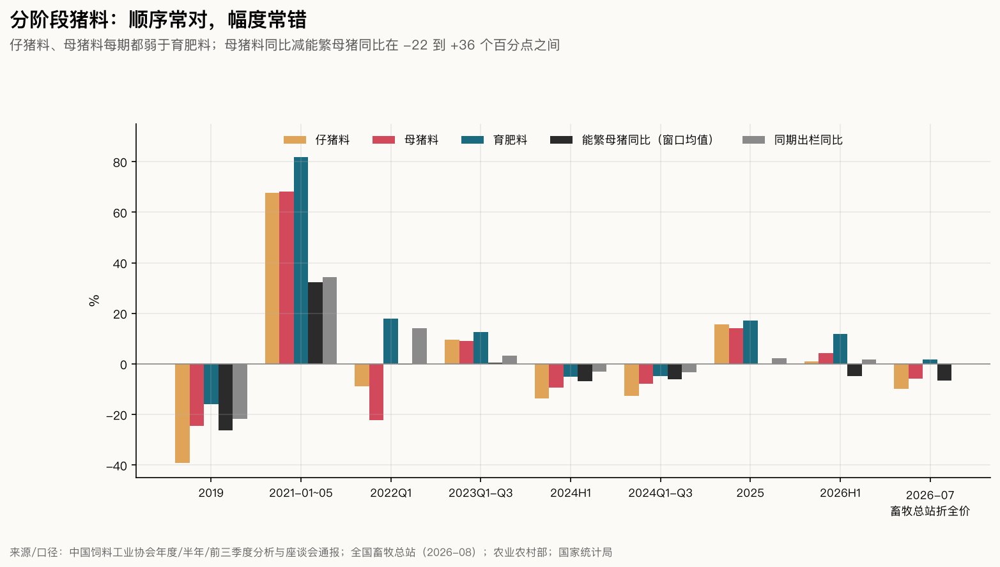

# 用母猪料、仔猪料、育肥料追踪产能：能看到什么，看不到什么

回答 [Issue #7](https://github.com/AlphaCatalyst/AlphaNotes/issues/7)。数据截止：

- **协会月报：** 中国饲料工业协会（下称协会）月度《全国饲料生产形势》到 2026 年 8 月数据（9-18 发布），这一期只有总量和产品形态。
- **月度猪料：** 公开数据只到 2022 年 8 月（2022-09-15 发布）。此后的月度猪料来自协会半年和前三季度分析的附图，本文按像素读数重建，最新到 2026 年 6 月（2026 年上半年分析，7-20 发布）。
- **分阶段折全价：** 公开的只有全国畜牧总站 2026 年 7 月一期（8-24 发布）。
- **对照数据：** 能繁母猪到 2026 年二季度末；统计局季度出栏到二季度，三季度数据预计 10 月 20 日前后发布。
- **公司数据：** 到 2025 年年报、ESG 报告和 2026 年半年报。

标签沿用前几期：

- 【事实】为统计与公告原文（A 级）；
- 官方署名分析和公司管理层口头表述为 B 级；
- 【推断】为本文计算或推理；
- 钢联、涌益、卓创等第三方样本和行业技术资料按 C 级处理；
- D 表示没有找到可靠数据。

议题里的三条前提逐条检验，不预设成立：“保质期短”“专料专用”“产销量接近实际耗用”。饲料量也不直接等同于存栏量。数据与脚本见文末。

## 结论

1. **饲料数据能可靠地给出方向，不能直接换算成头数。**
   - 2020—2026 年，季度猪饲料总量同比领先统计局出栏同比约一个季度，相关系数 0.91（2022 年以来 0.82）。
   - 但两者每年有 −5 到 +20 个百分点的系统偏差。每出栏一头猪对应的工业猪料，从 2019 年的 141 公斤升到 2025 年的 231 公斤。
   - 偏差来自四个方面：自配料转向工业料；一体化企业持证饲料厂扩张；实物吨里浓缩料和预混料比重变化；出栏体重上升。
   - 总量只能确认已经发生的拐点：2022 年和 2024 年两次总量同比转负，都比当轮猪价低点晚 1—2 个月【推断】。
2. **分阶段数据的先后顺序可靠，幅度不可靠。**
   - 2019 年以来公开的 8 个窗口里，仔猪料增速每次都低于育肥料，差距在 −1.7 到 −26.7 个百分点之间。
   - 仔猪料的方向与随后两个季度出栏的方向，7 次中 6 次一致，但仔猪料的变化幅度是出栏的 2—9 倍。
   - 母猪料同比与能繁母猪同比相差 −22 到 +36 个百分点。2023 年前三季度、2025 年和 2026 年上半年，母猪料都在增长，而能繁母猪在窗口末已同比下降。
   - 只有折合全价后，母猪料才和能繁母猪接近：2026 年 7 月折全价母猪料同比 −5.8%，6 月末能繁母猪同比 −6.5%【推断】。
3. **精度分三层。**
   - 行业：方向和拐点大致可用，幅度误差常在 5—10 个百分点，必须折全价，并扣掉工业料覆盖率的漂移。
   - 区域：只有分省年度总量（2021 年数据起），没有分省阶段数据。区域增长多半来自大企业新建饲料厂，不能归到某一家公司。
   - 公司：只能用年报做年度校验。东瑞、牧原每出栏一头猪对应的自产料在 303—406 公斤之间，落在全群理论需求区间内；但饲料增速与出栏增速每年相差 −23 到 +11 个百分点。温氏不披露饲料量，牧原 2026 年上半年也没有披露【推断】。
4. **当前周期：折全价数据显示去化正在进行，幅度温和。**
   - 全国畜牧总站 7 月数据：折全价母猪料同比 −5.8%，“已连续第四个月同比下降，且降幅持续扩大”；仔猪料 −9.8%，同样连续 4 个月下降；育肥料 +1.7%。
   - 扣掉出栏体重增加（约 2 公斤活重）后，育肥头数大约持平到略降（−0.6% 到 −1.3%）。这与统计局二季度出栏 +0.4%、季末存栏 +0.1% 吻合。
   - 协会上半年的实物数据（仔猪 +1.1%、母猪 +4.2%、育肥 +11.8%）看起来像扩张，主要是产品形态和体重造成的。7 月同一批数据，实物同比比折全价高 3.7—5.7 个百分点【推断】。
5. **对未来出栏：四季度起同比转负的方向较明确，幅度不确定。**
   - 7 月在吃仔猪料的猪，大约在 10 月到明年 1 月出栏。
   - 历史上，随后两个季度的出栏变化约为仔猪料（实物）变化的 0.1—0.5 倍。按此换算 2026 年四季度到 2027 年一季度的出栏同比：用 7 月实物降幅约 −0.4% 到 −2.1%，用折全价降幅约 −1.1% 到 −5.0%。比例是按实物口径估的，真实值大概在两者之间，中心约 −1% 到 −2%。如果仔猪料降幅全部是头数减少，下限约 −10%。
   - [Issue #6](06-autumn-dip.md) 用滞后母猪推算的中值是四季度 −0.2%、2027 年一季度 −1.5%。两者方向一致，饲料法略偏向减少。
   - 价格底部的具体时间不能从饲料数据推出【推断】。
6. **跟踪方法：每月核对一组组合信号，不看单一指标。** 能确认真实去化的组合有五项：
   - 折全价母猪料连续 3 个月 ≤ −3%，且与能繁母猪一致；
   - 折全价仔猪料连续为负，且比育肥料低 8 个百分点以上；
   - 育肥料扣掉体重效应后不增长；
   - 浓缩料和预混料没有回升；
   - 两个季度内统计局出栏同比转负。

   截至 10 月 18 日，前四项已满足（但折全价只有 7 月一期公开数值），最后一项要看 10 月 20 日前后的三季度数据和明年 1 月的四季度数据。

**回答核心问题：**

- **饲料数据能作为判断依据吗？** 可以用来判断“猪有没有减少、减少在哪一段”，但只有满足三个条件才可靠：
  - 用折合全价口径，不用实物吨；
  - 扣掉自配料转商品料、一体化扩张带来的覆盖率漂移；
  - 和能繁母猪、出栏、屠宰数据交叉验证。
- **什么时候影响出栏？** 有参考价值：仔猪料领先出栏约 4—6 个月，母猪料约 6—10 个月。
- **价格什么时候见底？** 没有可靠的领先性。
- **议题里的三条前提，检验结果各不相同：**
  - “产销量接近实际耗用”对一体化企业基本成立：东瑞年末成品饲料库存只够 1.4—1.7 天产量。经销渠道上，产销时间差大约在一个月以内，涨价前会放大。
  - “保质期短”只对配合料成立，颗粒料储存期约 1—3 个月；浓缩料可以囤。
  - “专料专用”不成立：后备母猪吃育肥料、亏损期提前换育肥料都很常见。
- **能否验证单个上市猪企的产能？** 只能用年报自产料做年度规模校验，不能用月度或区域饲料数据推断。

---

## 方法与口径

| 项目 | 定义 |
|---|---|
| 猪饲料（实物） | 协会统计的配合饲料、浓缩饲料、添加剂预混合饲料三类实物吨数直接相加。统计范围是持证饲料生产企业，养殖者自配料不在内 |
| 折全价 | 全国畜牧总站把浓缩料、预混料按添加比例折成全价料后计算的同比。折算系数没有公开 |
| 阶段 | 按统计调查制度（国统制〔2022〕147 号）：仔猪料＝哺乳仔猪饲料＋保育饲料；母猪料＝后备母猪饲料＋其他母猪饲料（怀孕、哺乳）；生长肥育猪饲料指 30 公斤以上。猪饲料下另有“其他”一行，三个阶段之和小于总量 |
| 月度猪料重建 | 2020-06 至 2022-08 用月报首发值。2019—2026 年用协会 4 张分析图中折线的像素读数：同一月份取后来年份图表（已经年度修订）的中位数；2026 年只有当年图，未经修订；2021-03 在所有图中都被遮挡，用相邻月份的修订比例插补。重建的月度合计与年报相差 −0.3% 到 +0.3%（2019、2022—2025 年）；2020、2021 年分别偏高 2.9%、4.2%，原因不明 |
| 实时口径 | 首发值和发布日取自月报原文。回测只使用发布日之前能看到的数据，不用事后修订值 |
| 领先滞后 | 季度猪料（重建修订值）同比，与统计局季度出栏、猪肉产量、季末存栏同比的相关系数。样本分 2020Q1 起（26 季）和 2022Q1 起（18 季） |
| 理论需求 | 稳态全群模型：母猪系（能繁、后备、公猪）＋仔猪＋育肥，折算为每出栏一头猪需要的全价料。参数见第三节 |
| 覆盖率 | 每出栏一头的工业猪料 ÷ 理论全价需求。它混合了自配料、产品形态和参数误差，只看趋势 |
| 公司口径 | 东瑞用年报产销表推算自用料：饲料生产量 − 对外销售量 − 库存增加，2021、2022 年用年报注释的原值。牧原用 ESG 报告和可转债募集说明书披露的饲料产量，公司称饲料产能主要用于自身养殖 |

## 一、真实养殖里饲料怎么被消耗（问题 1）

### 1.1 保质期、库存天数和补货频率

- **配合料确实放不久。** 技术资料给出的储存期：“颗粒状配合饲料的储存期为1~3个月”，粉料不宜超过 10 天（[中国养猪网](https://www.zhuwang.com.cn/show-91-297300-1.html)，C）。
- **散装料比重在快速上升，交付更接近即产即用。** 散装料由罐车直送猪场料塔，几乎没有渠道库存。散装料占配合饲料的比重：

  | 年份 | 2020 | 2021 | 2022 | 2023 | 2024 | 2025 |
  |---|---|---|---|---|---|---|
  | 占配合饲料比重 | 25.6% | 33.4% | 38.2% | 43.7% | 49.2% | 53.4% |

  来源：协会历年年度概况，2025 年见[年报](https://www.chinafeed.org.cn/hyfx/hyfx_erji/202602/t20260206_469692.htm)【事实】。
- **一体化企业的成品料库存只有一两天。** 东瑞年报产销表里，年末饲料库存只相当于全年产量的 1.4—1.7 天：2022 年 838 吨，2025 年 2339 吨【推断】。牧原存货中的原材料（饲料原料）2025 年末为 62.44 亿元（[年报](https://static.cninfo.com.cn/finalpage/2026-03-28/1225042507.PDF)），2026 年 6 月末为 79.36 亿元（[半年报](https://static.cninfo.com.cn/finalpage/2026-08-21/1225485220.PDF)）【事实】。一体化企业要囤，囤的是原料，不是成品料。
- **浓缩料和经销渠道可以囤。**
  - 协会 2020 年 7 月月报列出猪料大增的原因之一：“饲料产品涨价预期推动养殖场户提前备货”（[月报](https://www.chinafeed.org.cn/hyfx/hyfx_erji/202008/t20200818_359362.htm)）【事实】。
  - 2022 年的媒体调查称“经销商囤积浓缩料的情况在饲料一条街比较普遍”（[财联社，新浪转载](https://finance.sina.com.cn/roll/2022-06-18/doc-imizmscu7450256.shtml)，C）。
  - 厂家季末向经销商压货的说法，没有找到可靠证据（D）。

**判断：** 对一体化企业和散装配合料，月度产量基本等于当月耗用。对袋装浓缩料、预混料和经销渠道，产销时间差在一个月左右，涨价前会放大。所以月度数据至少要做 3 个月合计；单月环比不能直接读成存栏变化【推断】。

### 1.2 阶段边界和串用

- **统计定义：**
  - 后备母猪饲料“一般指饲喂被选留后尚未参加配种的母猪饲料”，计入母猪料。
  - 保育饲料“一般指饲喂仔猪断奶到保育结束阶段的猪饲料”，计入仔猪料。
  - 育肥料的定义是“生长肥育猪饲料：一般指饲喂30公斤以上、以育肥为目的猪饲料”。

  来源：[统计调查制度原文](https://zjjcmspublic.oss-cn-hangzhou-zwynet-d01-a.internet.cloud.zj.gov.cn/jcms_files/jcms1/web2243/site/attach/0/a9e723add93c44e9841ca6c046c4040a.pdf)【事实】。
- **实际饲喂经常跨段：**
  - “许多猪场采用生长肥育猪饲料或经产母猪饲料代替后备母猪料饲喂青年母猪”（[福建省科技厅](https://kjt.fujian.gov.cn/ztzl/kjcg/nlmyy/202004/t20200401_5226900.htm)，C）。
  - 亏损期也会换料。协会 2022 年一季度分析写到：“教槽料、保育料使用阶段缩短，使用量减少，育肥料使用增加”（[分析](https://www.chinafeed.org.cn/hyfx/hyfx_erji/202204/t20220427_402387.htm)）【事实】。
- **含义：** 猪价低迷时，仔猪料的降幅会夸大仔猪头数的减少，育肥料的增幅会夸大育肥头数的增加。2026 年 3—9 月猪价多在 9—11 元/公斤，正是这种情形。所以仔猪料和育肥料要放在一起看，看两者的差，不看各自的绝对值【推断】。

### 1.3 生产到消耗的滞后，以及统计本身的修订

- 协会月报统计的是出厂量，不是耗用量。月度数是样本企业的测算值，每期都注明“全国饲料产量以年度公布为准”（[2026 年 8 月月报](https://www.chinafeed.org.cn/hyfx/202609/t20260918_474508.htm)）【事实】。
- 2020-06 至 2022-08 的月度猪料，首发值后来全部被上修，幅度 1.5%—9.9%。首发同比是“当月初值 ÷ 上年终值”，所以比修订后的同比低 2.6—11.4 个百分点。例如 2021 年 10 月首发同比 +8.8%，修订后为 +19.7%；2022 年 3 月首发 −2.2%，修订后 +1.3%，实时看到的是一次提前出现的“转负”【推断】。
- 发布滞后越来越长。从月末到发布日的中位数：2020 年 13.5 天，2022 年 22 天，2026 年 28 天（最长 64 天）【推断】。

### 1.4 自配料、产品形态和二次育肥

- **工业饲料只覆盖一部分耗料。** 农业农村部 2020 年答记者问：2019 年“饲料消耗量约为3.5亿吨，其中商品配合饲料2.1亿吨，占比为60%”，其余为养殖者自配（[农业农村部](https://www.moa.gov.cn/xw/zwdt/202006/t20200616_6346573.htm)，B）。自配料“及其饲喂的动物应该属于同一个法人或自然人”，不需要生产许可，也不进入工业统计。
- **产品形态不能直接相加。** 全国畜牧总站明确说母猪工业饲料“含预混饲料、浓缩饲料、全价饲料”，实物吨数直接相加（[分析](https://pig.caaa.cn/html/pig_rd/pig_hydt/2026/0824/2482.html)，B）。
  - 1 吨预混料或浓缩料，对应的全价料远多于 1 吨。猪场从“买预混料或浓缩料再自配”改为买配合料时，同样一头猪会让工业料吨数成倍增加。
  - 东瑞招股书里有个案例：一家客户 2018 年以前以买预混料、浓缩料为主，非洲猪瘟后改买高温制粒配合料，“2019 年和2020 年销售的饲料超过95%为配合饲料”（[招股书](https://static.cninfo.com.cn/finalpage/2021-04-13/1209677069.PDF)）【事实】。
  - 2026 年 8 月全部畜种中，配合料同比 +3.7%，浓缩料 −7.2%，预混料 −8.8%（[月报](https://www.chinafeed.org.cn/hyfx/202609/t20260918_474508.htm)）【事实】。产品结构仍在向配合料转，所以实物吨会高估真实耗料增速。
- **官方列过的漂移来源。** 协会 2020 年 7 月月报一次列出了几项：
  - “母猪养殖自配料转商品料情况增多”；
  - “三元杂母猪比例提高增加耗料量”；
  - “商品猪二次育肥增加饲料用量”。

  2023 年三季度又写到“二次育肥比重增大”【事实】。

## 二、数据源清单（问题 2）

完整清单见 [`research/feed_tracking/sources.csv`](../research/feed_tracking/sources.csv)（18 个来源，含发布方、公开或付费、频率、滞后、历史、口径、获取方式和限制）。最重要的几项：

| 来源 | 级别 | 频率与滞后 | 历史 | 阶段与口径 | 主要限制 |
|---|---|---|---|---|---|
| 协会月度生产形势（含猪料） | A | 月；月末后 8—46 天 | 2020-05 至 2022-08 数据 | 猪料总量；个别月份有阶段同比 | 样本测算值，首发偏低 |
| 协会月度生产形势（2022-09 起） | A | 月；2026 年中位 28 天 | 2022-09 起 | 只有总量和配合、浓缩、预混 | 不分畜种 |
| 协会季度、半年、前三季度分析 | A | 不定期；约 3—4 周 | 找到 5 个窗口（2022Q1 至 2026H1） | 阶段同比，附月度猪料折线图 | 缺 2023H1、2025H1、2025Q1-Q3 |
| 协会年度概况 | A | 年；次年 2 月 | 2015 年起 | 总量；仅 2019 年报有阶段；2021 年数据起有分省猪料 | 分省没有阶段拆分 |
| 协会专题（2026-03-29） | A/B | 一次 | 2025 年 | 2025 年阶段同比；饲料反推模型的结论 | 模型参数和猪的偏差率未公开 |
| 全国畜牧总站折全价分析 | B | 不定期；约 24 天 | 只找到 2026-07 一期 | 阶段实物同比与折全价同比 | 折算系数未公开 |
| 统计调查制度 | A | — | 2022 版 | 阶段定义；统计范围为持证企业 | 2026 新版的指标解释未核实 |
| 能繁母猪、出栏、定点屠宰 | A | 月或季 | 长期 | 对照组 | 月度母猪不连续；屠宰覆盖范围多次调整 |
| 上市猪企年报和 ESG 报告 | A | 年或半年 | 东瑞 2021 起，牧原 2018 起 | 集团饲料产量、外销、库存 | 没有阶段；温氏不披露 |
| 饲料企业年报 | A | 年或半年 | 各公司不同 | 猪料外销量 | 份额、托管工厂、并购和口径变化 |
| 钢联、涌益、卓创样本 | C | 月；5—13 天 | 2022—2025 年起 | 阶段环比或同比，只有百分比 | 样本未披露，多次与官方相反 |
| 省级数据 | A/C/D | 年（广东有半年） | 2021 年起 | 分省总量 | 多数省份没有公开数据 |
| 年鉴、统计资料（纸质） | D | 年 | 1991 年起 | 可能含 2017—2020 年月度 | 付费，本文未取得 |

**最大的缺口有五个：**

1. 2022 年 9 月以后没有公开的月度猪料；
2. 分阶段数据不定期，2023 年上半年、2025 年上半年和前三季度都没找到；
3. 折全价系数不公开；
4. 没有分省阶段数据；
5. 第三方样本只有百分比，而且常与官方相反。例如钢联 2024 年 6 月仔猪料同比 +1.13%，而协会 2024 年上半年仔猪料是 −13.5%。

**四种饲料口径必须分开：**

| 口径 | 含义 | 是否进入协会统计 | 例子 |
|---|---|---|---|
| 工业饲料 | 持证饲料企业生产的配合料、浓缩料、预混料 | 是 | 2025 年全国猪料 16639 万吨 |
| 外销商品料 | 饲料企业卖给外部养殖者 | 是 | 海大 2025 年猪料外销 770 万吨 |
| 集团内部用料 | 一体化企业持证饲料厂供自有猪场和合作农户 | 持证厂在统计范围内；牧原是否实际报送未核实 | 牧原 2025 年饲料产量 2764 万吨；温氏不披露 |
| 自配料 | 养殖者自行配制、自用，不对外提供 | 否 | 2019 年全部畜种约 40% |

买浓缩料或预混料回去自配，是第五种情况：只有浓缩料、预混料本身的吨数进入统计。

## 三、分阶段反推框架（问题 3）

### 3.1 反推链条和参数

反推链条是：实际消耗量 → 阶段平均存栏 → 生长与转群 → 未来出栏。每一步都要一个参数，参数本身有区间：

| 参数 | 低 | 中 | 高 | 依据 |
|---|---|---|---|---|
| 母猪年耗料（全价） | 1.0 吨 | 1.1 吨 | 1.2 吨 | 猪场技术资料（C） |
| 母猪年更新率 | 35% | 40% | 45% | 信息化猪场样本 34.7%—45%（C） |
| 后备母猪培育期耗料 | 240 公斤 | 270 公斤 | 300 公斤 | 猪场技术资料（C） |
| 公猪料摊到每头母猪 | 15 公斤 | 25 公斤 | 35 公斤 | 本文假设 |
| 仔猪料（教槽＋保育）每头 | 21 公斤 | 33 公斤 | 46 公斤 | 教槽 1—6 公斤、保育 20—40 公斤（C） |
| 育肥料肉比（30 公斤到出栏） | 2.5 | 2.75 | 3.0 | 上市公司约 2.5—2.9（B）；行业更高（C） |
| 出栏活重 | 120 公斤 | 125 公斤 | 130 公斤 | 2025 年出栏均重约 128 公斤（C） |
| 每头母猪年出栏 | 19.5 | 18.0 | 16.5 | 2025 年出栏 ÷ 2024 年末能繁约 17.6（A 数据推算） |
| 保育到出栏成活率 | 97% | 94.5% | 92% | 育肥成活率 92%—97%（B） |

稳态下，每出栏一头猪需要的全价料为 303 / 365 / 433 公斤（低 / 中 / 高）。其中：

- 母猪系约占 19%，仔猪料 7%—12%，育肥料 69%—74%；
- 全群料重比（按活重）为 2.53 / 2.92 / 3.33【推断】。

**关键误差在分母上，不在分子上。** 每出栏一头猪对应的工业猪料，2019 年只覆盖中值需求的 39%（区间 32%—46%），2025 年升到 63%（53%—76%）。这 24 个百分点的上升，就是第一节说的渗透率和产品形态漂移，相当于平均每年 4 个百分点；而周期中期能繁母猪一年的变化通常只有几个百分点。不处理覆盖率，就会把渗透率的上升误读成存栏的增长【推断】。

### 3.2 每个阶段能推出什么、推不出什么

| 阶段 | 能推出 | 推不出 | 主要干扰 |
|---|---|---|---|
| 母猪料 | 母猪系平均存栏的方向（含后备） | 能繁和后备各多少；怀孕和哺乳各多少 | 三元母猪淘汰、后备吃育肥料、配合料替代自配 |
| 仔猪料 | 约 2 个月内断奶仔猪流量的方向 | PSY；出生头数 | 亏损期缩短教槽和保育阶段、教槽料普及 |
| 育肥料 | 育肥段平均存栏 × 采食 | 头数和体重各占多少 | 出栏体重、二次育肥、热应激 |

产能和流量要分清：

- 设计产能（栏位）不吃料，空栏在饲料里看不出来；
- 饲料对应的是在用产能，也就是真正有猪的栏位乘以采食量；
- 月度饲料反映月内的平均存栏，不是月末存栏，存栏快速变化时两者会有差别；
- 出栏是流量，育肥料只能通过“出栏 ≈ 育肥存栏 ÷ 育肥天数”间接对应。

### 3.3 2026 年 7 月的读数换成头数

单头耗料和覆盖率的假设都给区间。体重效应按统计局胴体重计算：2026 年二季度比上年同期 +1.48 公斤，约合 +2.0 公斤活重。活重每增加 1 公斤，单头育肥料增加 1.15%—1.53%，合计 +2.3%—3.1%。

| 阶段 | 口径 | 饲料同比 | 单头耗料变化假设 | 推算头数同比（覆盖率不变） | 覆盖率变化 −1% 到 +2% 时 |
|---|---|---|---|---|---|
| 母猪 | 折全价 | −5.8% | −2% 到 +2% | −3.9% 到 −7.6% | −2.9% 到 −9.5% |
| 母猪 | 实物 | −2.1% | −2% 到 +2% | −0.1% 到 −4.0% | +0.9% 到 −5.9% |
| 仔猪 | 折全价 | −9.8% | −5% 到 0 | −5.1% 到 −9.8% | −4.1% 到 −11.6% |
| 仔猪 | 实物 | −4.1% | −5% 到 0 | +0.9% 到 −4.1% | +2.0% 到 −6.0% |
| 育肥 | 折全价 | +1.7% | +2.3% 到 +3.1%（体重） | −0.6% 到 −1.3% | +0.4% 到 −3.3% |
| 育肥 | 实物 | +6.2% | +2.3% 到 +3.1%（体重） | +3.0% 到 +3.8% | +4.9% 到 +1.0% |

折全价母猪料推出的区间（−3.9% 到 −7.6%）覆盖了能繁母猪的实际值（6 月末 −6.5%）；实物口径则明显偏轻。折全价育肥料推出的头数，与统计局二季度出栏 +0.4%、存栏 +0.1% 一致；实物口径推出的 +3% 以上与统计数据不符。因此本文后面一律以折全价为准【推断】。

协会 2026 年 3 月的专题称已“构建饲料消耗反推模型”，反推的能繁母猪与监测数据“偏差率较小，数据吻合度较高”（[专题](https://www.chinafeed.org.cn/hyfx/hyfx_erji/202603/t20260329_470403.htm)）【事实】。但猪的偏差率、折算系数和料比参数都没有公开，外部无法复现。用公开数据复现的结果是：不折全价，偏差就很大。

## 四、行业、区域和公司（问题 4）

### 4.1 行业

行业层面的可用精度，见第五节的回测：方向和拐点大致可用，幅度误差常在 5—10 个百分点。

全国畜牧总站能给出单月的分阶段数据，说明统计系统内有月度分阶段统计，但对外只是不定期公开。

### 4.2 区域

- 协会年报从 2021 年数据起附分省猪饲料表，有总量和同比，没有阶段。
- 2025 年的六个最大省份：

  | 省份 | 广西 | 广东 | 四川 | 河南 | 山东 | 湖南 |
  |---|---|---|---|---|---|---|
  | 猪饲料（万吨） | 1733 | 1676 | 1238 | 1199 | 1161 | 1083 |
  | 同比 | +11.9% | +12.7% | +22.9% | +13.9% | +20.1% | +15.1% |

  来源：[年报附图](https://www.chinafeed.org.cn/hyfx/hyfx_erji/202602/t20260206_469692.htm)【事实】。
- 区域增长常常反映企业布局，而不是当地存栏。协会 2022 年写到“全国大企业集中投资广西”【事实】。
- 东瑞 2025 年饲料产量约 49 万吨，相当于广东猪料的 2.9%；它的增量（约 21 万吨）可以解释广东当年增幅中约 1.4 个百分点。这个推算前提是东瑞的饲料厂都在广东、都已报送统计，两点都没有核实。反过来，用广东猪料推东瑞的产能，更不可行【推断】。

### 4.3 公司：东瑞、牧原、温氏

**东瑞：年报能做年度校验。**

| 年份 | 饲料生产量（万吨） | 对外销售（万吨） | 年末饲料库存（天） | 自用料（万吨） | 生猪销售（万头） | 年末生猪库存（万头） | 自用料 / 出栏（公斤） | 饲料同比 − 出栏同比（百分点） |
|---|---|---|---|---|---|---|---|---|
| 2021 | — | — | — | 12.66（注释） | 36.76 | — | 344 | — |
| 2022 | 20.62 | 1.39 | 1.5 | 19.36（注释） | 52.03 | 42.28 | 372 | +11.4 |
| 2023 | 21.69 | 1.21 | 1.6 | 20.47 | 62.45 | 44.74 | 328 | −14.3 |
| 2024 | 28.06 | 1.53 | 1.4 | 26.51 | 87.44 | 76.48 | 303 | −10.5 |
| 2025 | 49.27 | 1.30 | 1.7 | 47.84 | 147.74 | 108.94 | 324 | +11.5 |

来源：东瑞 2021—2025 年年报产销表，链接见 [`company_feed.csv`](../research/feed_tracking/company_feed.csv)【事实】；自用料（2023—2025 年）和比值为本文推算。

- 东瑞对外销售的饲料只占产量的 3%—7%，饲料基本自用。
- 2026 年半年报称“具备约75 万吨的年产能”，2025 年产量约为其三分之二（[半年报](https://static.cninfo.com.cn/finalpage/2026-08-29/1225525045.PDF)）【事实】。
- 自用料增速与出栏增速的差在 −14 到 +12 个百分点之间摆动，原因是存栏变化：2024 年年末存栏 +71%，饲料喂给了下一年才出栏的猪。所以东瑞的饲料能确认扩张是真的（2025 年自用料 +80.5%，出栏 +69.0%，存栏 +42.4%），但只能按年确认，也不能精确到季度【推断】。
- 东瑞没有披露外购成品饲料量和分阶段吨数（D）。

**牧原：只有年度饲料产量。**

| 年份 | 饲料产量（万吨） | 出栏（万头） | 饲料 / 出栏（公斤） | 饲料同比 | 出栏同比 | 占全国工业猪料 |
|---|---|---|---|---|---|---|
| 2020 | 734.7 | 1811.5 | 406 | — | — | 8.2% |
| 2021 | 1579 | 4026.3 | 392 | +114.9% | +122.3% | 12.1% |
| 2022 | 2037 | 6120.1 | 333 | +29.0% | +52.0% | 15.0% |
| 2023 | 2317 | 6381.6 | 363 | +13.7% | +4.3% | 15.5% |
| 2024 | 2531.9 | 7160.2 | 354 | +9.3% | +12.2% | 17.6% |
| 2025 | 2764.4 | 7798.1 | 354 | +9.2% | +8.9% | 16.6% |

来源：牧原可转债募集说明书、2022—2025 年 ESG 报告（[2025 年](https://static.cninfo.com.cn/finalpage/2026-03-28/1225042525.PDF)）【事实】；比值和占比为本文计算，占比假设牧原的饲料全部进入工业统计（未核实）。

- 2024 年出栏含 565.9 万头仔猪，扣除后每头 384 公斤。
- 牧原一家的饲料约占全国工业猪料的六分之一，而它的出栏只占全国约 11%：它的饲料 100% 计入工业料，全行业平均只有约 63%。所以全国猪料里有相当一部分反映的是一体化龙头自己的猪群。龙头扩张、散户自配减少时，全国猪料会上升，而全国存栏未必变化【推断】。
- 牧原的料肉比也在下降：投资者关系记录显示，育肥阶段料肉比从 2022 年底的“2.9 左右”降到 2025 年 9 月的“2.64 左右”（B）。同样的头数和体重，耗料在减少，这会部分抵消体重上升的效应。
- 2026 年上半年饲料产量未披露（D）。

**温氏：饲料量完全不可见。**

- 年报说明，合作农户使用的“饲料、兽药等养殖物资的权属属于公司”，给农户的饲料是集团内部转移，不是销售（[2025 年年报](https://static.cninfo.com.cn/finalpage/2026-04-22/1225137588.PDF)）【事实】。
- 投资者关系记录称“公司所用饲料基本上为自产自用”（B）。
- 饲料产量、产能、厂数都不披露（D）。
- **重复计算风险：** 如果把温氏合作农户当作独立的商品料需求方，再加上温氏饲料厂的产量，就把同一批料算了两次。反过来，如果把合作农户的栏舍算作社会散户产能，又会把温氏的猪算两次【推断】。

**饲料企业的增长不等于存栏增长。**

| 公司 | 2025 年猪料销量同比 | 2026 年上半年 | 口径 |
|---|---|---|---|
| 海大集团 | 约 +37%（770 万吨） | +15% | 外销，含海外 |
| 新希望 | +26%（533 万吨） | 271 万吨 | 外销 |
| 禾丰股份 | +13%（160 万吨） | 约 +1% | 外销 |
| 大北农 | +4.47%（446.70 万吨） | +12.04% | 外销 |
| 全国猪料 | +15.6% | +7.9% | 工业饲料 |

来源：各公司 2025 年年报与 2026 年半年报，链接见 [`company_feed.csv`](../research/feed_tracking/company_feed.csv)【事实】。

公司自己给出的增长来源，大多是份额和客户结构的变化：

- 海大为生猪养殖集团提供“整体输出为其托管饲料工厂综合服务体系”，原本属于养殖集团内部的料，可能因此转成了饲料企业的外销量。2026 年半年报又说，行业增量大部分来自规模化一体化企业，“其生猪饲料是封闭内部供给”。
- 新希望针对放养公司推出核心预混料，以“满足其自配饲料的需求”。
- 禾丰 2025 年取消一个 30 万吨猪料项目，原因是“一体化规模养殖场出栏占比增大，商品饲料市场空间萎缩”。
- 神农集团子公司把内部供料记为销售：2025 年饲料生产 101.10 万吨，“其中外销4.58万吨、向集团内部养殖企业销售75.77万吨”，合并时再抵销。

以上均为【事实】。所以，饲料企业的猪料增速只能反映它的份额，不能当作存栏指标。

## 五、控制变量与历史验证（问题 5）

### 5.1 必须控制的变量

| 变量 | 影响 | 处理 |
|---|---|---|
| 季节与春节 | 2 月产量通常比上年 12 月低 14%—27%（2020 年除外）；与 1 月相比，取决于春节在哪个月，从 +3% 到 −37% 不等 | 1—2 月合并；只做同比 |
| 天数 | 31 天月份多生产一天；全国畜牧总站也注明“考虑到比6月多生产一天的影响” | 看日均或 3 个月合计 |
| 样本变化 | 月度为样本测算值，年度会修订 | 用修订值做历史；实时数据单独回测 |
| 渗透率 | 覆盖率 2019—2025 年上升约 24 个百分点 | 用覆盖率区间做敏感性分析 |
| 产品形态 | 实物与折全价相差 3.7—5.7 个百分点（2026-07） | 以折全价为准 |
| 天气 | 夏季高温降低采食（C） | 同月比较 |
| 疫病 | 2019 年非洲猪瘟、2021 年前后变异毒株 | 单独标记异常窗口 |
| 体重 | 胴体重 +1.48 公斤，单头育肥料约 +2.3%—3.1% | 从育肥料中扣除 |
| 料肉比 | 龙头企业育肥料肉比 3 年下降约 0.25（B） | 与体重效应相互抵消，只能给区间 |
| 配方 | 豆粕占比下降、低蛋白日粮，对吨数影响较小 | 不单独处理 |

交叉验证的对象包括：能繁母猪（官方）、配种和分娩（第三方，C）、仔猪价格与上市公司仔猪外销、出栏体重、统计局季度出栏、定点屠宰（只看环比）、上市公司月度出栏。

### 5.2 总量：同步到领先一个季度

| 饲料领先季度 | 出栏（2020Q1 起） | 出栏（2022Q1 起） | 猪肉（2020Q1 起） | 猪肉（2022Q1 起） | 季末存栏（2020Q1 起） | 季末存栏（2022Q1 起） |
|---|---|---|---|---|---|---|
| 0 | 0.86 | 0.38 | 0.84 | 0.41 | 0.97 | 0.74 |
| 1 | 0.91 | 0.82 | 0.89 | 0.83 | 0.80 | 0.34 |
| 2 | 0.69 | 0.62 | 0.70 | 0.70 | 0.41 | −0.09 |
| 3 | 0.40 | 0.02 | 0.42 | 0.12 | 0.11 | −0.46 |

表中是季度猪料同比与各指标同比的相关系数。猪料同比和出栏同比的平均差，全样本约 9—10 个百分点，2022 年以来约 4—5 个百分点【推断】。

| 序列 | 转向时点 |
|---|---|
| 猪料 3 个月合计同比 | 2020-07 转正，2022-05 转负，2022-10 转正，2024-02 转负，2024-12 转正；到 2026-06 仍为正 |
| 能繁母猪同比 | 2022-03 转负，2022-10 转正，2023-07 转负，2025-02 转正，2025-09 转负 |
| 统计局季度出栏同比 | 2020Q3 转正，2022Q3 转负，2022Q4 转正，2024Q1 转负，2025Q1 转正 |
| 猪价月均低点（新牧网，C） | 2019-02，2022-03，2024-01；2026-04 为目前最低 |

- **总量是出栏指标，不是母猪指标。** 2023—2024 年它比能繁母猪晚 7 个月转负。2025 年 9 月母猪转负后，到 2026 年 6 月仍未转负，已经晚了 9 个月以上。
- **总量不能预告价格底部。** 2022 年和 2024 年，总量转负分别比猪价低点晚 2 个月和 1 个月；按发布日计算，还要再晚 3—4 周【推断】。

### 5.3 分阶段：历次窗口回测

| 窗口（发布日） | 仔猪料 | 母猪料 | 育肥料 | 能繁母猪（窗口均值 / 期末） | 母猪料 − 能繁 | 仔猪料 − 育肥料 | 窗口内出栏 | 随后两季出栏 |
|---|---|---|---|---|---|---|---|---|
| 2019 年（2020-03-11） | −39.2 | −24.5 | −15.9 | −26.2 / −38.9 | +1.7 | −23.3 | −21.6 | −19.9 |
| 2021 年 1—5 月（2021-06-21） | +67.6 | +68.2 | +81.8 | +32.3 / +27.7 | +35.9 | −14.2 | +34.4 | +21.0 |
| 2022Q1（2022-04-26） | −8.8 | −22.3 | +17.9 | −0.2 / −3.1 | −22.1 | −26.7 | +14.1 | +1.3 |
| 2023 年前三季度（2023-11-14） | +9.5 | +9.1 | +12.6 | +0.6 / −2.8 | +8.5 | −3.1 | +3.3 | +1.4 |
| 2024H1（2024-07-29） | −13.5 | −9.4 | −5.0 | −6.7 / −6.0 | −2.7 | −8.5 | −3.1 | −3.6 |
| 2024 年前三季度（2024-10-23） | −12.5 | −7.7 | −4.7 | −6.1 / −4.2 | −1.6 | −7.8 | −3.2 | −1.8 |
| 2025 年（2026-03-29） | +15.6 | +14.2 | +17.3 | −0.1 / −2.9 | +14.3 | −1.7 | +2.4 | +1.7 |
| 2026H1 实物（2026-07-20） | +1.1 | +4.2 | +11.8 | −4.9 / −6.5 | +9.1 | −10.7 | +1.7 | 待公布 |
| 2026-07 实物（2026-08-24） | −4.1 | −2.1 | +6.2 | 6 月末 −6.5 | +4.4 | −10.3 | — | — |
| 2026-07 折全价（2026-08-24） | −9.8 | −5.8 | +1.7 | 6 月末 −6.5 | +0.7 | −11.5 | — | — |

单位均为同比 %，差值为百分点。2026 年上半年的能繁母猪只有两个季末观测。出栏为统计局季度出栏同比。

能确认的规律【推断】：

1. **仔猪料的方向能提示随后两个季度的出栏方向（7 次中 6 次），但幅度只有 0.1—0.5 倍。** 唯一不一致的是 2022 年一季度，仔猪料 −8.8%，随后两季出栏 +1.3%，到 2022 年三季度才转负。
2. **仔猪料减育肥料的差，平稳年约 −2 到 −3，收缩期在 −8 以下。** 2019、2022Q1、2024H1、2024 年前三季度和 2026 年 7 月都在 −8 以下。但 2021 年扩张期也有 −14.2，那是 2020 年补栏的猪进入育肥段。所以价差要和仔猪料本身的正负一起看。
3. **母猪料是最不可靠的阶段。**
   - 2020 年 7、8 月，母猪料同比 +77.8%、+93.4%，同期能繁母猪只有 +20.3%、+37.0%。协会给出的原因是备货、自配料转商品料和三元母猪。
   - 2022 年一季度母猪料 −22.3%，能繁母猪几乎不变。
   - 2023 年前三季度和 2025 年方向相反。
   - 只有 2019 年和 2024 年的窗口与母猪接近，差在 3 个百分点以内。
4. **母猪料的拐点曾经有用，但只有一次。**
   - 2021 年 5 月，协会写到“母猪饲料环比下降0.4%”，是“连续20个月除季节性下降外的首次下降”（[通报](https://www.chinafeed.org.cn/xwdt_10092/xhxw/202106/t20210621_381070.htm)）【事实】。能繁母猪 2021 年 6 月见顶，猪价在 2021 年 9 月底和 2022 年 3 月探底，距母猪料拐点 4—10 个月。
   - 2023—2024 年那一轮，母猪料没有给出下降信号。

**实时预测的检验：**

- 协会 2026 年 3 月依据四季度仔猪料增速放缓，判断“预示未来6个月生猪出栏量或将逐步回落”。随后统计局出栏同比从一季度 +2.8% 降到二季度 +0.4%，方向正确，幅度没有给。
- 全国畜牧总站 8 月判断“9月份起生猪上市量将少于去年同期”，待 10 月下旬的三季度出栏和 9 月定点屠宰检验。

### 5.4 失效案例

| 时间 | 信号 | 实际 | 原因 |
|---|---|---|---|
| 2020 年下半年 | 母猪料同比 +78% 到 +93% | 能繁母猪 +20% 到 +37% | 备货、自配转商品料、三元母猪（官方列明） |
| 2021 年 10 月（首发） | 猪料同比 +8.8%，看似快速降温 | 修订后 +19.7% | 首发值偏低，后来被上修 |
| 2022Q1 | 母猪料 −22.3% | 能繁母猪约 −0.2% | 三元母猪淘汰、上年基数虚高 |
| 2023 年前三季度 | 母猪料 +9.1% | 能繁母猪期末 −2.8% | 覆盖率上升 |
| 2025 年 | 猪料 +15.6%，三个阶段都增长 14% 以上 | 出栏 +2.4%，能繁年末 −2.9% | 一体化扩张、产品形态、体重 |
| 2026H1 | 实物三个阶段都为正 | 能繁母猪 −6.5% | 实物口径；折全价后已转负 |
| 2024-06 钢联样本 | 仔猪料同比 +1.13% | 协会上半年 −13.5% | 第三方样本以商品料为主 |

## 六、当前周期（问题 6）

### 6.1 现在能看到什么

| 时点 | 母猪料 | 仔猪料 | 育肥料 | 来源 |
|---|---|---|---|---|
| 2026 年上半年（实物） | +4.2% | +1.1% | +11.8% | 协会（A） |
| 2026 年 7 月（实物） | −2.1% | −4.1% | +6.2% | 全国畜牧总站（B） |
| 2026 年 7 月（折全价） | −5.8% | −9.8% | +1.7% | 全国畜牧总站（B） |
| 2026 年 8 月（钢联样本） | 环比、同比双降 | 环比、同比双降 | 环比 +6.70%，同比 +2.81% | 钢联（C） |

对照数据：

- 能繁母猪：2025 年 9 月同比转负，12 月末 3961 万头（−2.9%），2026 年 3 月末 3904 万头（−3.3%），6 月末 3780 万头（−6.5%）【事实】；
- 统计局出栏同比：2026 年一季度 +2.8%，二季度 +0.4%；
- 二季度末存栏 +0.1%，胴体重同比 +1.48 公斤。

### 6.2 议题列出的几种情形

- **母猪料下降而仔猪料尚未下降。** 这是去化早期的典型顺序：2021 年 5 月母猪料先转，2022 年一季度仔猪料才转负。本轮不同，按全国畜牧总站的说法，折全价母猪料和仔猪料从 4 月起同时连续下降。这说明产能调减已经传到了仔猪段，不只是母猪段【推断】。
- **育肥料上升而出栏下降。** 上半年实物育肥料 +11.8%，而出栏只有 +1.7%。这 10 个百分点的差大致可以拆成三块：
  - 产品形态约 4.5 个百分点（按 7 月育肥料实物 +6.2% 与折全价 +1.7% 的差）；
  - 体重约 2.3—3.1 个百分点；
  - 剩下约 3 个百分点，来自覆盖率上升或压栏。

  统计局季末存栏同比几乎为零，没有大规模压栏的迹象。全国畜牧总站也说 7 月育肥料“同比增幅不断收窄”【推断】。
- **春季补栏、秋季出栏、散户重新进场。**
  - 4—7 月折全价仔猪料连续同比下降，与 [Issue #6](06-autumn-dip.md) 的结论一致：春季补栏没有形成持续承接。
  - 散户重新进场通常表现为浓缩料、预混料回升，但 8 月这两类分别是 −7.2%、−8.8%（全部畜种），不支持散户大规模回归。这是弱推断，因为这两个数不分畜种【推断】。

### 6.3 组合信号是否确认了真实去化

| 条件 | 阈值 | 截至 2026-10-18 | 状态 |
|---|---|---|---|
| 折全价母猪料 | 连续 3 个月 ≤ −3%，与能繁母猪相差不超过 3 个百分点 | 7 月 −5.8%，连续第 4 个月下降；能繁 −6.5% | 满足（数值只公开了 7 月） |
| 折全价仔猪料 | 连续 3 个月为负，比育肥料低 8 个百分点以上 | 7 月 −9.8%，连续 4 个月；差 −11.5 | 满足 |
| 育肥料扣体重 | 不增长 | 约 −0.6% 到 −1.3% | 满足 |
| 浓缩料、预混料 | 不回升 | 8 月 −7.2%、−8.8% | 满足（全部畜种） |
| 统计局出栏 | 两个季度内同比转负 | 二季度 +0.4% | 待 10 月 20 日前后的三季度数据 |

**判断：** 饲料数据支持“产能在真实去化”，但幅度温和。能繁母猪同比减少约 6.5%；仔猪头数同比减少约 5%—10%，其中靠近 −10% 的一端可能包含低价期缩短教保阶段的影响。它不支持“深度去化”【推断】。

### 6.4 换成出栏头数和体重

- **出栏头数：** 7 月在吃仔猪料的猪，约在 10 月到 2027 年 1 月出栏。
  - 历史比例：随后两季出栏变化 ≈ 仔猪料变化 × 0.11—0.51，中位数 0.21。这 6 个窗口都用实物口径。
  - 乘 7 月实物仔猪料（−4.1%），2026 年四季度到 2027 年一季度出栏同比为 −0.4% 到 −2.1%（中位 −0.8%）；乘折全价（−9.8%）为 −1.1% 到 −5.0%（中位 −2.0%）。
  - 前者口径一致，但 7 月实物数受产品形态影响偏高；后者更接近真实耗料，但历史比例按实物口径算，直接乘会偏大。真实值大概在两者之间，中心约 −1% 到 −2%。
  - 如果仔猪料降幅全部是头数，下限约 −10%。
  - 对照 [Issue #6](06-autumn-dip.md) 用“滞后母猪 × 每头产出”的推算：四季度中值 −0.2%（区间 −2.7% 到 +4.7%），2027 年一季度 −1.5%（−4.0% 到 +3.4%）。两种方法方向一致，饲料法略偏向减少【推断】。
- **出栏体重：** 育肥料折全价仍在增长，而头数大约持平，说明体重偏高；但育肥料增幅在收窄。如果仔猪减少传导到出栏，而体重维持高位，猪肉产量的降幅会小于头数降幅【推断】。
- **价格底部：** 饲料数据给不出日期。
  - 总量同比的转向落后于价格低点；
  - 母猪料先于价格见底的样本只有一次（领先 4—10 个月）；
  - 本轮 4 月的价格低点与折全价母猪料、仔猪料开始下降几乎同时出现。

  能说的只有：供给减少的方向已经确认，时间上与 Issue #6 的见底窗口不矛盾。全国畜牧总站的判断是“生猪市场价格具备温和回升的基本面支撑”，同时说“今年市场供应总体充裕”（B）。

## 七、月度跟踪表

完整版见 [`research/feed_tracking/tracking.csv`](../research/feed_tracking/tracking.csv)（13 项指标）。核心几项：

| 指标 | 来源与频率 | 信号 | 交叉验证 | 失效条件 | 最新读数 |
|---|---|---|---|---|---|
| 折全价母猪料同比 | 全国畜牧总站，不定期 | 连续 3 个月 ≤ −3% 且与能繁一致 | 能繁母猪、仔猪价格 | 只有实物口径时；与能繁背离超过 5 个百分点 | 7 月 −5.8% |
| 折全价仔猪料同比 | 同上 | 连续为负：4—6 个月后出栏转弱 | 两季后统计局出栏、仔猪外销 | 亏损期提前换料 | 7 月 −9.8% |
| 仔猪料 − 育肥料 | 同上（计算） | 低于 −8 且仔猪料为负：收缩 | 能繁母猪、出栏体重 | 扩张期波峰移入育肥段 | −11.5 |
| 育肥料扣体重 | 同上＋统计局胴体重 | 扣体重后的增速 ≈ 育肥头数变化 | 季度出栏、存栏 | 热应激、二次育肥集中 | 约 −1% |
| 猪料总量 3 个月同比 | 协会半年图表 | 确认已发生的拐点 | 下一季度出栏 | 覆盖率漂移；当年值会上修 | 4—6 月 +4.7%（未修订） |
| 产品形态结构 | 协会月报，月 | 浓缩、预混明显弱于配合：实物高估 | 实物与折全价的差 | 不分畜种 | 8 月 +3.7 / −7.2 / −8.8 |
| 能繁母猪 | 农业农村部、统计局 | 同比持续为负 | 折全价母猪料 | 月度发布不连续 | 6 月末 −6.5% |
| 统计局出栏与胴体重 | 统计局，季 | 饲料信号是否落地 | 定点屠宰环比 | 季度频率粗 | 二季度 +0.4%、+1.48 公斤 |
| 公司自产料 / 出栏 | 年报、ESG，年 | 长期 300—410 公斤；饲料增速比出栏高或低 10 个百分点以上 | 公司存栏、产能利用率 | 仔猪销售结构、存货变化 | 东瑞 324、牧原 354（2025） |

**接下来看什么：**

- 10 月 20 日前后：统计局三季度出栏与季末能繁，以及 9 月定点屠宰（只看环比和季节性）。
- 10 月底前后：协会前三季度分析，2024 年同类分析在 10 月 23 日发布。如果有，可以拿到前三季度的实物阶段同比。
- 全国畜牧总站是否继续发布 8、9 月的折全价阶段数据。
- 上市公司三季报和月度出栏。
- 2027 年 1 月的四季度出栏，用来检验 −0.4% 到 −5% 的区间。
- 2027 年 2 月的协会年报，用来修订 2026 年的月度读数。

**会推翻本文判断的证据：**

- **“折全价数据显示真实去化”：** 如果后续月份折全价母猪料转正而能繁母猪继续下降，或者折全价仔猪料转正，说明 7 月的读数受到了单月噪声或口径调整的影响。
- **“四季度起出栏同比转负”：** 如果统计局四季度和 2027 年一季度出栏同比都仍为正，说明仔猪料的降幅主要来自单头耗料下降（缩短教保阶段），不是头数减少。这时饲料法的幅度要下修。三季度出栏对应的是 4 月以前的仔猪，仍为正不构成反证。
- **“育肥料上升主要是口径和体重”：** 如果统计局季末存栏同比明显转正，同时出栏体重继续上升，说明压栏比本文估计的多，未来的集中出栏压力更大。
- **“散户没有大规模回归”：** 如果浓缩料、预混料同比明显转正，工业料就会开始低估存栏，本文的覆盖率修正方向要反过来。

## 局限

- **重建月度数据有误差。**
  - 图表像素读数的误差约 ±1%；2021-03 为插补值。
  - 2026 年是当年图读数，历年当年图读数事后被上修约 1%—3%。
  - 2020、2021 年的重建合计比年报高 2.9%、4.2%，原因不明。
- **分阶段样本少。** 只有 8 个公开窗口，统计规律都很脆弱。折全价数值只公开了 7 月一期，前三个月只有“连续下降”的定性描述。
- **参数多为 C 级。** 母猪年耗料、仔猪料、成活率来自技术资料和信息化样本，全行业的真实值可能偏离；稳态模型不处理存栏的动态变化。
- **公司数据只有年度。** 牧原饲料是否进入工业统计未核实；温氏完全不可见；饲料企业的口径（外销、含海外、含内部）各不相同。
- **第三方样本只看方向。** 钢联、涌益、卓创的样本和口径都没有公开。
- **不预测价格。** 本文只给出栏方向和区间，不给价格水平和见底日期。

## 数据与方法

| 文件 | 内容 |
|---|---|
| [`scripts/industry/cfia_feed.py`](../scripts/industry/cfia_feed.py) | 抓取协会月报和分析，图片月报转录，分析图折线像素读数，生成 `cfia_*.csv` |
| [`scripts/issues/feed_tracking.py`](../scripts/issues/feed_tracking.py) | 本文全部计算和 5 张图 |
| [`cfia_feed_releases.csv`](../data/processed/cfia_feed_releases.csv) | 76 篇协会发布：标题、发布日、类型、解析出的猪料与阶段同比、链接 |
| [`cfia_pig_feed_monthly.csv`](../data/processed/cfia_pig_feed_monthly.csv) | 2019-01 至 2026-06 月度猪料：修订值、首发值、首发同比、发布日、修订幅度 |
| [`cfia_pig_feed_chart_readings.csv`](../data/processed/cfia_pig_feed_chart_readings.csv) | 每张分析图、每个月份的像素读数 |
| [`cfia_pig_feed_stage.csv`](../data/processed/cfia_pig_feed_stage.csv)、[`cfia_pig_feed_annual.csv`](../data/processed/cfia_pig_feed_annual.csv) | 分阶段同比窗口；年度猪料 |
| [`ft_annual.csv`](../data/processed/issues/ft_annual.csv)、[`ft_model_steady.csv`](../data/processed/issues/ft_model_steady.csv) | 年度偏差、每头工业料、覆盖率；稳态全群需求 |
| [`ft_quarterly.csv`](../data/processed/issues/ft_quarterly.csv)、[`ft_leadlag.csv`](../data/processed/issues/ft_leadlag.csv)、[`ft_turns.csv`](../data/processed/issues/ft_turns.csv)、[`ft_monthly.csv`](../data/processed/issues/ft_monthly.csv) | 季度面板、领先滞后、转向时点、月度面板 |
| [`ft_vintage.csv`](../data/processed/issues/ft_vintage.csv)、[`ft_release_lag.csv`](../data/processed/issues/ft_release_lag.csv) | 首发值与修订值；发布滞后 |
| [`ft_stages.csv`](../data/processed/issues/ft_stages.csv)、[`ft_projection.csv`](../data/processed/issues/ft_projection.csv) | 分阶段窗口与能繁母猪、出栏对照；仔猪料到出栏的历史比例与 2026Q4—2027Q1 推算 |
| [`ft_model_july2026.csv`](../data/processed/issues/ft_model_july2026.csv)、[`ft_weight_effect.csv`](../data/processed/issues/ft_weight_effect.csv) | 2026 年 7 月头数推算的敏感性；体重效应 |
| [`ft_company.csv`](../data/processed/issues/ft_company.csv) | 东瑞、牧原的自产料与出栏 |
| [`research/feed_tracking/sources.csv`](../research/feed_tracking/sources.csv) | 数据源清单 |
| [`research/feed_tracking/tracking.csv`](../research/feed_tracking/tracking.csv) | 月度跟踪表 |
| [`research/feed_tracking/evidence.csv`](../research/feed_tracking/evidence.csv) | 官方和第三方表述，每条附链接和 40 字以内的摘录 |
| [`research/feed_tracking/company_feed.csv`](../research/feed_tracking/company_feed.csv) | 公司饲料产销、存货、料肉比和口径表述，每条附公告链接和摘录 |

协会网页和图片原件、上市公司 PDF 原文、第三方行情只保留在本地，仓库只公开派生结果和带链接的短摘录。

本文不构成投资建议。
