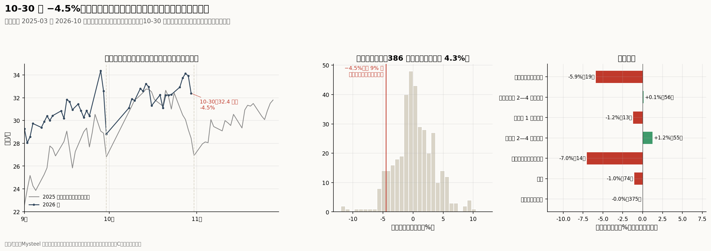
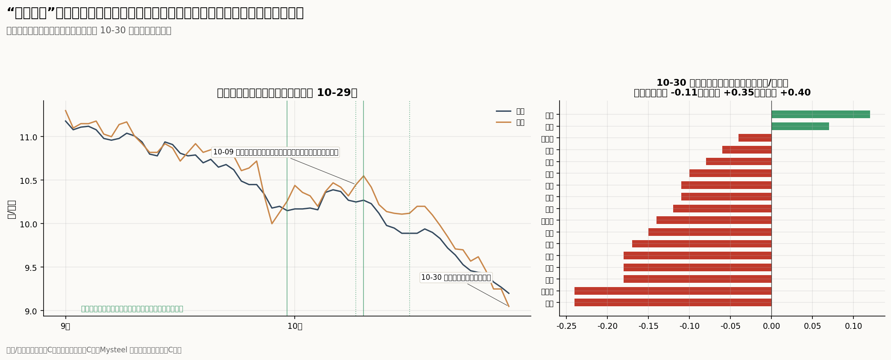
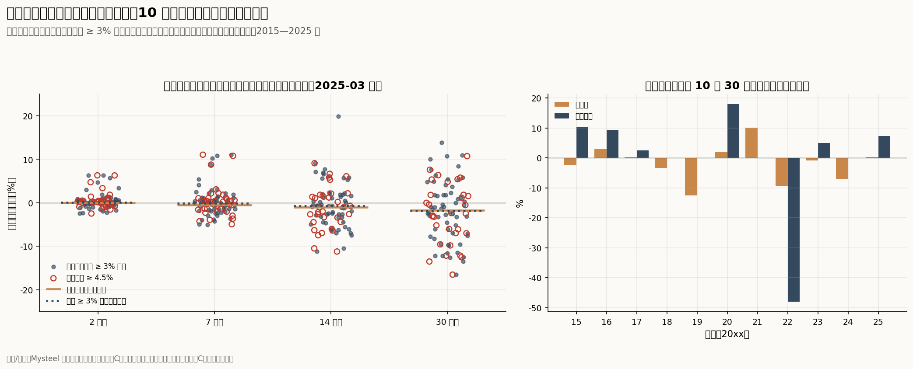
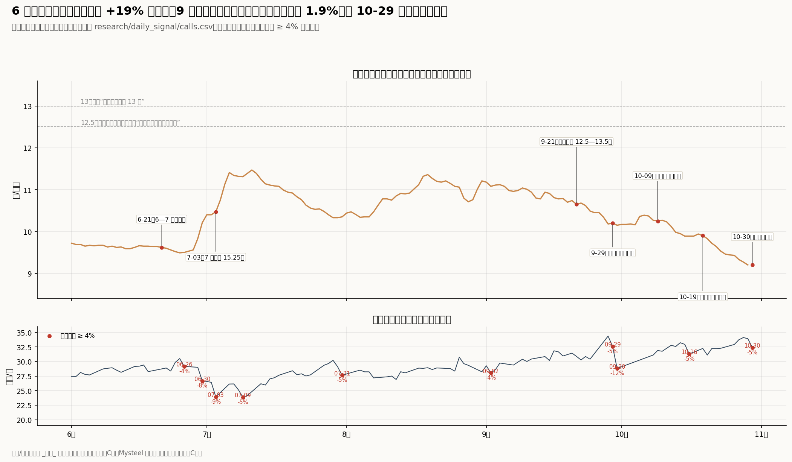

# 单日出栏大降能说明到哪一层：短期回暖、供给拐点与周期主升

回答 [Issue #9](https://github.com/AlphaCatalyst/AlphaNotes/issues/9)。数据截止：

- **钢联（Mysteel）重点养殖企业日度出栏：** 由公开页面重建，2025-03-14 至 2026-10-29 共 400 个工作日，含全国和 7 个大区。10-30 只有全国总量（当天 14:22 发布的摘要），分区数要到 11-02 才公开。钢联的计划出栏、区域日报、标肥价差、二次育肥成本、周报和解读到 10-30 17:47。钢联文章的时间都以文章页面显示的为准。
- **价格：** 新牧网全国与河南日度均价到 10-29。中国养猪网 10-30 早间的省级表，以及当晚 21:49 抓取的河南省和 17 个地市页面。
- **官方数据：**
  - 统计局：三季度数据（10-19 发布）和 10 月中旬价格（10-24）；
  - 农业农村部：三季度末能繁母猪和 9 月定点屠宰量（10-29），10 月第 3 周集贸价格（10-27）。
- **期货与股票：** 大商所生猪期货 10-30 结算价；中证畜牧养殖指数、中证全指、牧原和温氏到 10-30 收盘。
- **作者帖子：** 10-09 至 10-30 共 48 条，全部取到全文。更早的帖子沿用 [Issue #3](03-xueqiu-authors.md) 的底稿。

**标签：** 沿用前几期。

- 【事实】为统计与公告原文（A 级）；官员或公司管理层的口头表述为 B 级。
- 【推断】为本文计算或推理。
- 钢联、新牧网、中国养猪网等第三方行情和样本数据按 C 级处理。
- D 表示没有找到可靠数据。

猪价单位为元/公斤，期货为元/吨。

**检验方法：** 议题要求不预设博主对错。本文把原帖（[414748375](https://xueqiu.com/4932531422/414748375)，10-30 15:23）拆成三层，分别检验：

- **短期回暖：** 几天到两周内，价格止跌或小幅回升。原帖：「猪价短期就会有提振，静待本周双休价格回暖」。
- **供给拐点：** 规模场缩量成为趋势，未来几周到三个月可供出栏的猪持续减少。原帖：「基本确定规模场缩量趋势已成」。
- **周期主升：** 价格回到成本以上并持续数月。原帖：「或许，浩浩荡荡的猪周期即将迎来一次暴力主升」。

帖子只引用不超过 40 字的原话。数据与脚本见文末。

## 结论

1. **数字属实，但幅度和时点都不罕见。**
   - 钢联 10-30 全国出栏 323,941 头，比 10-29 少 4.51%（15,284 头），与作者所说一致【事实，C】。
   - 2025-03 以来 386 个常规工作日中，有 34 天（8.8%）降幅不小于这一次。
   - 10-30 既是 10 月最后一个工作日，也是周五。月末最后一个工作日 19 个月里有 18 个下降，中位数正好是 −4.5%。
   - 降完之后，出栏仍高于 2026 年约 92% 的工作日，同比 +13.9%。
   - 10-26 至 10-30 这一周日均 33.4 万头，比前一周多 4.4%，比 2025 年同一周多 15.1%。
   - 华东 −8.2%、西南 −13.08% 的分区数要到 11-02 才公开。西南序列有 29% 的工作日与前一天完全相同，常隔几天跳一次，−13% 更可能是一次台阶式更新【推断】。

2. **一天定不了趋势，这一次最像月末控量。**
   - **月内节奏：** 10 月计划出栏比 9 月实际多 1.91%。10-20 完成 61.96%，钢联当时写“下旬出栏压力不减”。样本出栏 10-20 至 10-28 冲高 9.7%，最后两个工作日才回落。
   - **原因：** 钢联 10-30 的区域日报写的是“月末主动控量”“缩量保价”；10-29、10-30 两天 25 篇公开摘要都没有提到天气、运输、疫情或停收【事实，C】。
   - **重量和大猪：** 出栏均重升到 125 公斤，钢联称其“放大实际供给”。钢联同日的解读说标肥价差在收窄，原因是“大猪需求不足，二次育肥顺势出栏”。二次育肥成本比标猪价高 0.6 元，也没有人进场接猪。
   - **含义：** 月末少卖的是头数，压栏增重的猪之后还要卖。这是把供给往后推，不是减少供给【推断】。

3. **“出栏、屠宰一起降”说的是 10-29 的两个小变化；屠宰端看不到收缩，需求偏弱。**
   - **日期口径：** 钢联屠宰日报的表头是发布日，数据是前一天全天。作者 10-30 说的“昨日屠宰”对应 10-29，与 10-29 出栏 −0.59% 对得上。但那一期公开部分没有数字，无法核对（D）。
   - **屠宰平稳：** 10 月公开的 4 个屠宰数在 12.5—12.8 万头，单日变化 +0.1% 到 +0.8%；同一天的出栏在 −5.00% 到 +3.01% 之间。出栏的起伏来自养殖端节奏，不是屠宰端需求。
   - **需求偏弱：** 钢联同一条摘要写“需求端不济”；10-29 河北山西“屠宰企业压价收购意愿较强”；川渝白条从 12.8—13.8 元下调到 12.3—13.3 元【事实，C】。指向的是“不想买”，不是“买不到”。

4. **“河南涨了”取决于看哪个报价，历史上也没有预测力。**
   - **10-30 的河南：** 中国养猪网河南外三元跌 0.11 元，17 个地市只有郑州、信阳上涨。涨的是内三元（+0.35）和土杂猪（+0.40）两个品种的报价【事实，C】。
   - **其他地区：** 31 个省份 28 个下跌；钢联公开数字的 12 个省级报价 11 跌 1 平。生猪期货以河南为基准交割地，10-30 的 LH2611 结算 8970 元/吨，低于河南现货。
   - **先例：** 作者 10-09 以「河南地区的重要猪企挺价意愿比较明显」判断拐点，此后河南从 10.55 元跌到 9.05 元。
   - **历史检验：** 2015 年以来“一周跌 3% 以上后河南单日上涨”的 46 次，全国两周后上涨的只有 26%（全部样本日 47%）【推断】。

5. **历史上，出栏大降之后只有两三天的小幅偏强。**
   - **降幅 4.5% 以上的 33 天：** 两天后全国均价上涨的比例 67%（全部工作日 43%），中位幅度 +0.26%；两周后 41%（基准 33%），中位数 −1.5%。
   - **叠加“当天河南上涨”：** 两天后上涨的比例升到 77%，两周后 47%，三个月后 17%（基准 27%）。
   - **价格已经大跌之后的缩量**（此前 30 天跌 5% 以上；现在是 −9.8%）：两周后上涨的只有 25%，75% 在两周内跌破此前 30 天的低点。
   - **去掉扎堆的事件后**（与上一次相隔 10 个工作日以上），两天的偏强基本消失（47%）。
   - **作者记录：** 作者 9-21 至 10-25 的 12 次定时判断之后，价格最多涨 1.9%，到 10-29 都低于判断当天【推断】。
   - **含义：** “本周双休价格回暖”有约三分之二到四分之三的基准概率。但即使兑现，也只说明有月末效应，区分不了后两层。

6. **中期供给收缩是真的，但落在 2027 年，不在这个 11 月。**
   - **存栏：** 三季度末存栏同比 −2.6%，其中 38% 来自能繁母猪（−433 万头）。其余的猪只少 1.8%，三季度出栏还增长 0.7%、猪肉增长 3.0%【事实，A】。作者说的“存栏降了、十月却库库出栏”因此并不矛盾。
   - **时间表：** 用新数据重算 [Issue #6](06-autumn-dip.md) 的出栏推算：2026 年四季度同比约 −1.1%（−2.7% 到 +1.3%），2027 年一季度约 −2.4%，二季度约 −6.0%，三季度约 −8.6% 到 −9.5%。胴体重同比 +2.3%，按重量算的收缩来得更晚【推断】。
   - **期货：** 排序一致：LH2701 结算 9530，LH2709 结算 12825。
   - **仔猪：** 作者 10-25 说“仔猪率先止跌反弹”，数据上没有出现：集贸仔猪价 10 月第 1—3 周为 19.51、19.05、18.45 元【事实，A】。

7. **股价不按日度出栏交易；相对大盘，股价已经计入了大量供给收缩预期。**
   - **出栏大降日：** 出栏降幅 4.5% 以上的 33 天，中证畜牧养殖相对中证全指的超额收益，当天、次日和 10 个交易日都与普通工作日差不多。
   - **6-26 以来：** 中证畜牧养殖 +6.1%，中证全指 −22.6%，两者之比上升 37%；同期现货 −3.2%，LH2701 −30%。
   - **9-29 以来**（作者几次判断期间）：猪股绝对值跌了 2%—4%，只是大盘跌得更多。
   - **作者自己的框架：** 「基本猪价主升，意味着股价开始进入回撤」。按此，主升如果成立，对持股者是退出信号，而不是加仓信号【推断】。

**回答核心问题：**

- **能支持第一层。** 在月末控量、需求偏弱的背景下，未来几天价格止跌或小幅回升的概率较高，历史上约三分之二到四分之三。钢联当天的判断也只是“近两日行情或暂时稳定”。
- **对第二层只是弱证据。** 单日降幅在常见范围内，又正逢月末；10 月最后一周的出栏仍处于年内高位；出栏均重还在上升，大猪和二育的猪还在集中出栏。
- **对第三层没有证据。** 周期主升需要持续几个月的供给收缩，官方数据和期货都把它放在 2027 年；期货只有 2027 年 9 月合约的价格在 12.5 元以上。

**如何区分两种情形：** 区分“少卖了几天、价格暂时回暖”和“未来可供猪源持续减少”，要看 11 月上中旬的四组数据：

1. 11-02 至 11-13 钢联样本日均出栏的同比，是否从 +7.4% 降到 +3% 以下（约每日 30.1 万头以下）；
2. 出栏均重是否连续 3 周下降，同时标肥价差不再收窄（大猪出清）；
3. 钢联 11 月计划出栏是否低于 10 月实际；
4. 屠宰量是否稳定在每日 12.5 万头以上，同时出栏下降。

只兑现第一项，仍可能只是节奏变化；四项都兑现，才能说规模场缩量成了趋势。这也是 [Issue #6](06-autumn-dip.md) 给“短期止跌”设的前提。周期主升至少要看到两件事同时出现：全国均价连续 4 周在 12.5 元（作者给的规模场成本）以上，远月期货同时上行。

---

## 方法与口径

| 项目 | 定义 |
|---|---|
| 出栏数据 | 钢联“重点养殖企业日度出栏量统计情况”。当天约 14:20 发布，摘要只有全国总量和环比；页面表格首行是上一个工作日的全国和 7 个大区。本文用全部可抓到的页面重建日度表。70 天可比的日子里，当日摘要总量与次日表格 69 天一致 |
| 屠宰数据 | 钢联屠宰日报的表头是发布日，数据是前一天 0—24 时（钢联原文说明），公开部分没有数字。公开的屠宰量只出现在不定期的全国日报摘要里，10 月有 4 期 |
| 常规工作日 | 有出栏数据的工作日，剔除长假后第一个工作日（与节前比，涨幅系统性偏大）。环比的基数是上一个有数据的工作日 |
| 月末、月初 | 按当月有数据的工作日排序：月末最后一个、倒数第 2—4 个；月初第 1 个、第 2—4 个 |
| 价格 | 事件研究用新牧网全国日度均价（C）。“t 日之后 h 天”指从 t 日（或之前最近一天）到 t+h 至 t+h+3 天内第一个有数据的日子。“再创新低”指 h 天内跌破 t 日之前 30 天的最低价。季节基准用新牧网全国周度均价，2015—2025 年每年 10-30 起，容差 6 天 |
| 阈值 | 出栏降幅取 10-30 的 4.5%，另取较宽的 3%；观察窗口取 2、7、14、30、91 天，分别对应周末、一周、两周、一个月、三个月。都在看结果之前设定，基准为全部常规工作日 |
| 河南 | 新牧网河南日度；中国养猪网省级价格（2015-12 以来每周两天的长历史，和 2026-09 以来的逐日省级表）；10-30 河南省和 17 个地市页面（外三元、内三元、土杂猪）；钢联豫皖日报（只公开了部分日子） |
| 供给时间表 | 沿用 [Issue #6](06-autumn-dip.md)，用三季度数据和 9 月能繁母猪重算。出栏季度的三个月各往前推 10 个月，取能繁母猪均值。每头产出同比取最近 4 个季度的最小、中位、最大值（现为 +0.4%、+2.1%、+4.5%）。2026 年 9 月以后的能繁母猪用两个情景：每月 −0.5%（缓降）和 −1.5%（快降） |
| 股票 | 中证畜牧养殖指数相对中证全指的比值（超额收益）。[Issue #5](05-stock-hog-timing.md) 用的是猪企等权指数扣除 beta × 中证全指，方向可比，数值不能直接比。牧原、温氏用后复权价；腾讯后复权序列缺 10-30 的牧原，按当日原始涨跌接上 |
| 作者判断 | 6-21 以来带时点或价格目标的 18 条，原话、期限和检验标准写入 `calls.csv`；价格用新牧网全国日度 |

## 一、这个指标在测量什么（问题 1）

### 来源和发布时间

作者引用的是钢联的“重点养殖企业日度出栏量统计情况”。10-30 那一期 14:22 发布。摘要给出全国 323,941 头、较上一工作日缩量 4.51%，并写道：“养殖场出栏积极性不高，缩量保价，需求端不济，近两日行情或暂时稳定”【事实，C】。作者 15:23 发帖。

这是样本企业报告的当天出栏头数，不是计划出栏（钢联另有月度计划数据），也不是挂牌量。摘要只有全国数。作者引用的华东 −8.2%、西南 −13.08% 不在公开部分；公开页面要到下一个工作日（11-02）才在表格里给出 10-30 的分区数，所以这两个数目前无法核对。

### 样本、基数和代表性

- **样本：** 钢联选定的重点养殖企业，名单和权重未公开。2026 年日均约 30—34 万头，约为全国日均出栏的 18%（三季度全国出栏 16,493 万头 ÷ 92 天 ≈ 179 万头）【推断】。
- **区域权重：** 2025-03 以来的平均占比为华东 23%、华南 21%、西南 20%、华中 17%、华北 10%、西北和东北各 4%。
- **环比基数：** 和上一个工作日比，周一与上周五比。
- **代表性：** 样本只覆盖规模企业，不代表散户和中小场，两者在低价时的行为还可能相反。钢联 10-30 的河北山西日报写的是「头部前期放量低价压制散户高价成交」。

### 绝对头数

全国减少 15,284 头，约为全国一天出栏的 0.85%。若华东、西南分别按 −8.2%、−13.08% 计算，两区合计减少约 16,437 头（华东约 8,040 头，西南约 8,397 头）。这比全国减少的总数还多约 1,150 头，意味着其余五区合计略增【推断】。

### 正常波动

| 序列 | 常规工作日 | 单日变化标准差 | 5% 分位 | 与前一天完全相同的天数占比 | 不高于作者所说降幅的天数 |
|---|---|---|---|---|---|
| 全国 | 386 | 4.3% | −5.3% | 1.3% | 34 天（8.8%） |
| 华东 | 385 | 9.2% | −14.5% | 2.3% | 47 天（12.2%） |
| 西南 | 385 | 5.4% | −7.2% | 28.6% | 7 天（1.8%） |

- **全国和华东：** 降幅在常见范围内。
- **西南：** −13.08% 少见。但西南、华北、东北分别有 29%、22%、21% 的工作日与前一天数值完全相同，变化集中在少数几天：
  - 西南 10-15 至 10-23 一直是 63,400 头，10-27 起是 64,200 头；
  - 华北 10-21 从 27,440 头跳到 39,740 头，10-26 又回到 29,740 头。作者 10-29 自己也把它称为“莫名的出栏异常”。

这类序列的单日大跳，更像是样本企业隔几天才更新一次，或口径有调整，不宜按天解读【推断】。

### 出栏和屠宰的日期

- **出栏日报：** 日期就是发布当天，钢联没有说明统计时段。
- **屠宰日报：** 钢联写明“表头日期为钢联采集并发布数据的日期”，数据是“昨日24小时（0:00~23:59）内的生猪屠宰量”【事实，C】。

所以作者 10-30 说的“昨日屠宰情况已出”，是 10-30 14:08 那期屠宰日报，对应 10-29 全天；他拿来对照的“昨日出栏的微降”是 10-29 的 −0.59%，日期一致。10-30 出栏大降对应的屠宰量要等下一期屠宰日报。

两组样本不是同一批企业：出栏是养殖企业卖出，屠宰是屠宰企业宰杀，只能看方向，不能逐头对应。

**信息当时何时可知：**

| 发布时间 | 来源 | 内容 | 数据对应的日子 |
|---|---|---|---|
| 10-28 16:48 | 钢联全国日报 | 出栏 341,249 头（+1.15%，10 月高点）；屠宰 128,154 头（+0.77%） | 表头 10-28 |
| 10-29 14:31 | 钢联出栏日报 | 339,225 头（−0.59%），“出栏压力仍大” | 10-29 |
| 10-29 17:13 | 钢联生猪周报 | 周均价 9.27 元（−4.43%），“预计下周趋势难改” | 10-22 至 10-29 |
| 10-29 19:58 | 作者前序帖 | 「估计这几天要开始缩量了，耐心持股不要慌」 | — |
| 10-30 11:35 | 钢联河北山西日报 | “月末主动控量及备货预期支撑下，猪价主线或以稳为主” | 10-30 |
| 10-30 14:08 | 钢联屠宰日报 | 公开部分没有数字 | 10-29 |
| 10-30 14:22 | 钢联出栏日报 | 323,941 头（−4.51%），“缩量保价，需求端不济” | 10-30 |
| 10-30 14:24 | 钢联标肥价差 | 标猪 9.03、肥猪 9.97，价差 −0.94 | 10-30 |
| 10-30 15:23 | 作者原帖 | 出栏、屠宰、河南三条信号与“暴力主升” | — |
| 10-30 16:29 | 钢联畜牧周度前瞻 | 猪肉均价 12.86 元（−3.53%），预测偏弱 | 本周 |
| 10-30 17:47 | 钢联解读 | “出栏均重攀升至125公斤，放大实际供给”；标肥价差“收窄至-0.89” | 10 月 |
| 10-30 21:49 | 中国养猪网河南页面 | 外三元 −0.11，内三元 +0.35，土杂猪 +0.40 | 10-30 |
| 11-02 下午 | 钢联出栏日报 | 10-30 的分区数 | 10-30 |

完整时间线（6 月下旬至 11 月中旬）见 [`timeline.csv`](../research/daily_signal/timeline.csv)。

### 实时数据与修订

70 天可比的日子里，当日摘要的全国总量与次日表格 69 天一致（8-06 相差 0.4%），全国数没有修订问题。实时性的问题在分区：当天公开的只有全国数。

## 二、一天能不能说明趋势（问题 2）

### 日历效应

按 2025-04 以来的完整月份统计（2025 年 3 月只有后半个月，不计入）：

| 日子 | 天数 | 平均单日变化 | 中位数 | 下降的比例 |
|---|---|---|---|---|
| 全部常规工作日 | 375 | −0.0% | 0.0% | 49% |
| 周五 | 74 | −1.0% | −0.4% | 57% |
| 月末最后一个工作日 | 19 | −5.9% | −4.5% | 95% |
| 月末倒数第 2—4 个工作日 | 56 | +0.1% | −0.1% | 55% |
| 月初第 1 个工作日 | 13 | −1.2% | +1.0% | 38% |
| 月初第 2—4 个工作日 | 55 | +1.2% | +0.9% | 29% |
| 长假前最后一个工作日 | 14 | −7.0% | −4.0% | 86% |
| 长假后第一个工作日（与节前比） | 14 | +5.2% | +3.9% | 21% |

- 10-30 同时是周五和月末最后一个工作日。按历史，这一天的“正常”变化就在 −4.5% 到 −6% 之间。19 个月里，只有 2025 年 11 月的月末是上升的（+0.9%）。

### 为什么月末少卖

规模企业按月度计划出栏。10 月的节奏如下：

| 时点 | 计划进度 | 钢联当时的判断 |
|---|---|---|
| 10 月初 | 计划 1,508.18 万头，比 9 月实际多 1.91% | “涨价动力不足” |
| 10-11 | 完成 32.19% | “中下旬销售压力仍大” |
| 10-20 | 完成 61.96%（时间进度约 65%） | “部分企业被动增重”，“下旬出栏压力不减” |

此后样本出栏从 10-20 的 31.1 万头冲到 10-28 的 34.1 万头（+9.7%），10-29、10-30 才回落。10-30 河北山西日报写的是“月末主动控量及备货预期支撑下，猪价主线或以稳为主”【事实，C】。这与“完成月度计划后月末收量”一致，也与作者 10-20 的预期「十月下旬集团厂做一个短期的脉冲缩减拉价」一致。作者自己用的词就是“短期”和“脉冲”。

### 替代解释

| 解释 | 证据 | 判断 |
|---|---|---|
| 天气、物流、疫病、临时停收 | 10-29、10-30 两天钢联 25 篇公开摘要都没有提到 | 可以排除（公开信息范围内） |
| 月末完成计划后收量 | 月末效应、10 月进度、钢联“月末主动控量” | 最可能 |
| 养殖端挺价惜售 | 钢联“缩量保价”“养殖场扛价情绪渐起” | 成立，与上一条同时存在 |
| 此前超卖，之后没猪可卖 | 均重上升、二育不进场、10 月最后一周仍是出栏最多的一周 | 不支持：超卖会卖出更轻的猪，均重应该下降 |
| 样本或分区口径变化 | 西南、华北的台阶式变化 | 影响分区，不影响全国数 |

### 日度、周、滚动和月度累计

| 口径 | 数值 | 比较 |
|---|---|---|
| 单日（10-30） | 32.4 万头 | 环比 −4.5%，同比 +13.9% |
| 一周（10-26 至 10-30 日均） | 33.4 万头 | 比前一周 +4.4%，比 2025 年同一周 +15.1% |
| 两周滚动（10-19 至 10-30 日均） | 32.7 万头 | 同比 +7.4% |
| 10 月（10-08 至 10-29 日均） | 32.5 万头 | 比 9 月 +6.6%，同比 +4.1% |

单日之外的口径都没有缩量。算上 10-30，10 月最后一周仍是出栏最多的一周。

### 月末之后

12 个非节前、有后续数据的月末之后，下月前 5 个工作日的出栏均值比月末那天高的有 8 个，中位数 +2.1%；但比上月均值低的也有 8 个，中位数 −4.1%。月初出栏低于上月均值是常态，所以 11 月上旬的出栏只能和去年同期比，不能和 10 月比。

2025 年 10 月最像这次，可以看清“少卖几天、价格暂时回暖”的样子【推断】：

- **缩量和价格：** 样本出栏从 10-21 的 326,524 头降到 10-31（周五、月末）的 269,158 头（−17.6%）。中间 10-24 回升过一次，最后五个工作日连续下降。价格在缩量期间上涨，从 10-20 的 11.42 元涨到 10-29 的 12.56 元。
- **回补之后：** 11 月出栏回补（下个工作日 +3.85%），价格 11-05 回到 11.97 元，12-03 低到 11.43 元。
- **和今年的差别：** 今年 10 月下旬出栏先冲高，最后两天才回落（10-28 至 10-30 累计 −5.1%）。2025 年那样连续五个工作日、累计 −17% 的缩量还没有出现。

### 提前卖，还是压栏后补卖

两种情形方向相反：

- **提前卖：** 10 月上中旬冲量，透支 11 月的出栏，11 月会偏少。
- **压栏：** 月末少卖、等价格，猪变重、晚卖，11 月会偏多。

现在的数据偏向压栏：

- **均重：** 钢联 10-26 出栏均重 124.66 公斤；10-30 的解读说 10 月“出栏均重攀升至125公斤，放大实际供给”。
- **标肥价差：** −0.94 元，肥猪比标猪贵，压栏增重有利可图。10-20 的完成度报告写“部分企业被动增重”。钢联 10-30 的解读说价差“收窄至-0.89”，原因是“大猪需求不足，二次育肥顺势出栏”，即压栏和二育的大猪已经在往外卖。
- **二次育肥：** 从 100 公斤养到 120 公斤的成本是 9.63 元，高于标猪价 9.03 元，二育没有进场接猪的动力【事实，C】。

压栏增重推迟了供给，但没有减少供给，月末少卖的猪会在之后几周卖出。

### 怎样才算“规模场缩量趋势”

至少需要同时满足四条【推断】：

- **持续性：** 两周以上的日均出栏同比明显收窄（见第八节的阈值）。
- **覆盖面：** 不止一两个大区；西南这类台阶式序列不算。
- **累计量：** 周、月口径同步下降。
- **重量：** 均重同步回落。否则只是头数减少、重量增加，供给没有变少。

### 实际出栏与有效产能

出栏是流量，产能看能繁母猪和存栏这类存量。一天少卖 1.5 万头，相对三季度末 42,533 万头的存栏可以忽略。真正决定未来几个月供给的，是 10 个月前的能繁母猪，见第五节。

## 三、出栏和屠宰：供给还是需求（问题 3）

### 屠宰

公开的屠宰量（钢联样本屠宰企业，来自全国日报摘要）：

| 日报 | 出栏 | 屠宰 |
|---|---|---|
| 10-16 | 313,039 头（−5.00%） | 124,878 头（+0.22%） |
| 10-19 | 322,456 头（+3.01%） | 125,822 头（+0.12%） |
| 10-23 | 322,782 头（+0.16%） | 125,846 头（+0.21%） |
| 10-28 | 341,249 头（+1.15%） | 128,154 头（+0.77%） |

屠宰一直平稳，出栏起伏，说明出栏的变化主要来自养殖端的节奏【推断】。作者所说 10-29 的屠宰“微降”无法用公开数据核对；即便属实，一天的微降也说明不了需求变化。作者 10-19 自己写过「出栏对价格都指引不如屠宰……这就是我放弃使用出栏指标的重要原因」。

### “买不到猪”还是“不想买猪”

| 指标 | 买不到猪（供给紧） | 不想买猪（需求弱） | 10-29、10-30 的读数 |
|---|---|---|---|
| 屠宰企业收购 | 提价收购，收购难度加大 | 压价收购 | 10-29 河北山西：“终端表现一般，屠宰企业压价收购意愿较强”；10-30：“屠宰端周末有一定备货预期” |
| 屠宰量与开工率 | 被动下降 | 主动减量 | 10 月公开的 4 个屠宰数都微增；开工率没有公开数据（D） |
| 白条价格 | 上涨 | 下调 | 川渝贵批发市场 10-29 为 12.8—13.8 元，10-30 下调到 12.3—13.3 元 |
| 批发市场到货 | 到货少、价格涨 | 到货少、价格不涨 | 北京新发地到货 −5.51%，价格 10.8—13.0 元；上海西郊到货 +5.60% |
| 冻品 | 出库加快 | 入库，库存高位 | 钢联解读：“冻品库存高位” |
| 标猪价 | 领涨 | 下跌 | 钢联标猪 9.03（−0.07），中国养猪网 28 个省份下跌 |

各项读数都落在“不想买”一侧。再加上养殖端惜售，10-30 是“量缩价跌”，不是“量缩价涨”【推断】。

钢联的周度判断也偏弱【事实，C】：

- **生猪周报（10-29）：** “预计下周趋势难改，猪价延续偏弱运行”。
- **畜牧周度前瞻（10-30）：** 猪肉均价 12.86 元（−3.53%），预测偏弱。

### 冻品和鲜冻转换

- **库存：** [Issue #6](06-autumn-dip.md) 记录的冻品库容率为 32.2%，同比高 14.55 个百分点。钢联 10-30 的解读仍把“冻品库存高位”列为三重供给压力之一。
- **影响：** 屠宰企业低价时分割入库，价格一反弹就出库，会压住反弹的高度【推断】。

### 官方的月度屠宰

农业农村部 9 月生猪定点屠宰企业屠宰量 3,985.69 万头，环比 +6.2%，同比 +11.2%【事实，A】。屠宰在向定点企业集中，所以这个同比明显高于统计局三季度出栏的 +0.7%，只能看变化方向。

### 小结

10-30 的出栏下降主要来自养殖端主动控量，是供给节奏的变化，不是需求突然变好。需求偏弱，所以控量只能托住价格、难以推高价格。这也是钢联预计“近两日行情或暂时稳定”而不是上涨的原因【推断】。

作者 10-23 提醒过腌腊季的需求：「需求端好像十一月腌腊季就突然变得不存在了」。但季节基准显示，多数年份 10-30 之后两周的价格仍偏弱（第六节）。腌腊需求在这两周的价格里通常还体现不出来【推断】。

## 四、“河南涨了”（问题 4）

### 报价还是成交

中国养猪网和钢联的省级价格都是“出栏均价”，由样本企业和经纪人的报价汇总，不是交易所成交价。不同平台的水平不一样：10-29 的河南，新牧网是 9.05 元，中国养猪网是 9.23 元。所以只能各自和自己比。作者没有说明用的是哪个报价。

### 10-30 的河南

| 口径 | 10-30 | 单日变化 |
|---|---|---|
| 中国养猪网河南外三元（全省） | 9.12 | −0.11 |
| 　17 个地市外三元 | 2 涨 15 跌 | 郑州 +0.12、信阳 +0.07；其余 −0.04 到 −0.24，中位数 −0.12 |
| 中国养猪网河南内三元 | 9.98 | +0.35 |
| 中国养猪网河南土杂猪 | 9.85 | +0.40 |
| 钢联豫皖日报 | 10-30 未公开 | 10-28 河南 9.18（−0.07），10-27“继续下调” |

外三元（标猪）在跌，内三元、土杂猪在涨。后两者本来就比外三元贵 0.7—0.9 元，与全国肥猪贵于标猪的格局一致（肥猪 9.97 元，标猪 9.03 元）。期货交割和多数报价用的是外三元标猪。单看这两个品种，说明不了标猪的供需【推断】。

### 其他地区

- **中国养猪网：** 31 个省份 3 涨 28 跌（黑龙江 +0.04、青海 +0.15、江苏 +0.01），上海 −0.22、浙江 −0.27。
- **钢联：** 10-30 公开数字的 12 个省级报价 11 跌 1 平（山东持平），川渝贵跌 0.16—0.20 元【事实，C】。
- **期货：** 大商所生猪期货以河南为基准交割地，河南的地区升贴水为 0【事实，A】。10-30 的 LH2611（11 月合约）结算 8970 元/吨，即 8.97 元/公斤，比河南外三元 9.12 元低约 1.6%。市场给 11 月河南价格的定价，略低于当前现货【推断】。

### 标肥价差、均重、二育和调运

- **标肥价差、均重、二育：** 价差 −0.94 元且在收窄，均重 125 公斤，二育成本比标猪价高约 0.6 元。三项都说明大猪多、二育在出栏而不是进场，不支持“河南缺猪”【推断】。
- **调运：** 跨省调运没有公开的日度数据（D）。

### 没卖出去的猪去了哪里

可能的去向有三条，都意味着供给推迟，而不是消失【推断】：

- **留在栏里：** 继续增重，在之后几周出栏。
- **二育：** 二育在亏损，不会接走这些猪。
- **冻品：** 屠宰端低价分割入库的冻品，会在价格反弹时出库。

### 两次先例

两次的信号组合都和 10-30 相同：出栏大降，河南走强。此后价格都继续下跌【事实，C】。

- **10-09：** 作者写「河南地区的重要猪企挺价意愿比较明显」，并说拐点就是现在。钢联豫皖当天“稳中走强”，10-10 河南 +0.03 元。新牧网河南 10-10 到 10.55 元，此后跌到 10-29 的 9.05 元（−14%）。
- **10-16：** 钢联出栏 −5.00%，屠宰 +0.22%，豫皖“稳中小幅上调”。此后 12 天全国均价（钢联口径）从 9.75 元跌到 9.18 元。

### 历史检验

| 样本 | 情形 | 次数 | 全国 14 天后上涨的比例 | 中位数 |
|---|---|---|---|---|
| 新牧网日度，2025-01—2026-10 | 此前 7 天累计跌 3% 以上，河南当日上涨 | 55 | 31% | −2.7% |
| 同上 | 全部日子 | 652 | 34% | −1.0% |
| 中国养猪网每周两天，2015-12—2026-10 | 一周累计跌 3% 以上，河南单日上涨 | 46 | 26% | −3.8% |
| 同上 | 全部样本日 | 1,064 | 47% | −0.6% |
| 同上 | 其中 10—11 月的上述情形 | 9 | 56% | +3.8% |

10—11 月的 9 次表现较好，但样本太少；10—11 月全部样本日中，两周后上涨的比例为 44%，差别不显著【推断】。

## 五、从短期回暖到周期主升，中间缺哪些环节（问题 5）

### 证据链

| 环节 | 作者的说法 | 证据 | 判断 |
|---|---|---|---|
| ① 出栏下降属实 | 全国 −4.5%，华东 −8.2%，西南 −13.08% | 全国属实；分区要等 11-02 | 全国成立 |
| ② 是规模场主动缩量 | 「基本确定规模场缩量趋势已成」 | 钢联写“缩量保价”“月末主动控量” | 成立，但每个月末都有 |
| ③ 缩量会持续 | 同上；前序帖「估计这几天要开始缩量了」 | 周、月口径仍在年内高位；月末之后通常回补；均重还在上升，大猪和二育的猪还在集中出栏 | 证据不足 |
| ④ 屠宰印证 | 「屠宰也微降」 | 10-29 屠宰未公开；10 月公开的 4 个数都微增 | 未能核实 |
| ⑤ 河南印证 | 「今天河南地区猪价居然涨了」 | 外三元下跌，只有内三元、土杂猪和 2 个地市上涨；历史上没有预测力 | 不成立（标猪口径） |
| ⑥ 短期价格回暖 | 「静待本周双休价格回暖」 | 月末之后两天上涨的比例 79%，中位 +0.2% | 大概率小幅成立 |
| ⑦ 未来可供猪源持续减少 | 前序帖：「三季度存栏同比去年下降2.6%」 | 存栏、能繁下降属实；推算的出栏收缩在 2027 年 | 中期成立，时点不在 11 月 |
| ⑧ 周期主升 | 「或许，浩浩荡荡的猪周期即将迎来一次暴力主升」 | 期货近月 9.0—9.5 元，只有 LH2709 在 12.5 元以上；仔猪还在跌 | 没有证据 |

逐条的证据、方向和来源见 [`evidence.csv`](../research/daily_signal/evidence.csv)（32 条）。

作者的表述有确定的，也有条件的：

- **确定：** 「基本确定规模场缩量趋势已成」「猪价短期就会有提振」。
- **条件：** 「或许……暴力主升」；15:45 又补了一句「如果本周末开始拉涨，那么我本轮猪周期的三次拐点预判就基本可以定义为准确」，同时承认「这次拐点误差已经到20天了」。

用一个周末的短期价格来检验周期判断，标准偏松：月末之后两天上涨本来就有约 79% 的基准概率【推断】。

### 作者的机制

作者对价格形成的理解有两点：

- **量价关系：** 同样的出栏和屠宰可以对应完全不同的价格（「同样的屠宰，同样的出栏。完全可以大前年卖12，前年卖9块」，10-23）。
- **谁来打破惯性：** 要靠集团厂主动缩量，造成短期紧缺（10-20「十月下旬集团厂做一个短期的脉冲缩减拉价」）。

按这个机制，月末控量能带来的是脉冲式反弹，和周期主升是两回事。主升需要非自愿、持续的供给减少；集团厂主动控量的猪，之后还会补卖【推断】。

### 存栏和能繁

前序帖的依据是「三季度存栏同比去年下降2.6%，你十月份库库出栏，不知道的以为你猪多了呢」。

| 项目 | 2025 年三季度末 | 2026 年三季度末 | 变化 |
|---|---|---|---|
| 生猪存栏 | 43,680 万头 | 42,533 万头 | −1,147 万头（−2.6%） |
| 　其中能繁母猪 | 4,035 万头 | 3,602 万头 | −433 万头（−10.7%），占存栏降幅的 38% |
| 　其余的猪 | 39,645 万头 | 38,931 万头 | −714 万头（−1.8%） |
| 三季度出栏 | 16,373 万头 | 16,493 万头 | +0.7% |
| 三季度猪肉产量 | 1,348 万吨 | 1,389 万吨 | +3.0% |

存栏数为【事实，A】，拆分为【推断】。

- **存栏降幅的构成：** 存栏的下降有近四成来自能繁母猪。它影响 10 个月以后的出栏，不影响这个 11 月。
- **商品猪：** 能繁以外的猪只少 1.8%，这与第六节推算的四季度出栏同比约 −1.1% 一致；均重还在上升。
- **10 月多卖不矛盾：** “10 月库库出栏”与存栏下降并不矛盾，不是超卖。

三季度末能繁母猪 3,602 万头，相当于调控目标的 96.0%，环比 −4.7%，同比 −10.7%【事实，A】。[Issue #6](06-autumn-dip.md) 设的两项阈值都已满足：三季度出栏同比不高于 +1%，季末能繁不高于 3,700 万头。

### 供给时间表（重算 #6）

| 出栏季度 | 对应的能繁母猪月份 | 滞后能繁同比 | 出栏同比推算（低 / 中 / 高） | #6 的推算（中） |
|---|---|---|---|---|
| 2026Q3 | 2025-09—11 | −1.8% | −1.4% / +0.3% / +2.7%（实际 +0.7%） | +1.3% |
| 2026Q4 | 2025-12—2026-02 | −3.1% | −2.7% / −1.1% / +1.3% | −0.2% |
| 2027Q1 | 2026-03—05 | −4.4% | −4.0% / −2.4% / −0.1% | −1.5% |
| 2027Q2 | 2026-06—08 | −7.9% | −7.6% / −6.0% / −3.8% | −4.1%（缓降）/ −5.0%（快降） |
| 2027Q3 | 2026-09—11 | −10.4% / −11.3% | 缓降 −10.1% / −8.6% / −6.4%；快降 −11.0% / −9.5% / −7.3% | −4.5% / −8.3% |

- **和 #6 的差别：** 新数据让每个季度的推算都比 #6 更低。原因有两个：
  - 9 月能繁母猪（3,602 万头）比 #6 的情景降得更快；
  - 三季度每头产出的同比只有 +2.5%，最近 4 个季度的区间从 +0.4% 到 +8.1% 收窄为 +0.4% 到 +4.5%。
- **按重量算：** 四季度出栏同比只比去年少约 1%，加上胴体重同比 +2.3%，按重量算的猪肉供给还略多于去年【推断】。
- **饲料数据：** [Issue #7](07-feed-tracking.md) 用 7 月仔猪料推算的四季度到 2027 年一季度出栏，中心约 −1% 到 −2%，方向一致。

### 期货

| 合约 | 10-09 | 10-19 | 10-29 | 10-30 | 10-09 以来 |
|---|---|---|---|---|---|
| LH2611 | 10,635 | 10,000 | 9,065 | 8,970 | −15.7% |
| LH2701 | 11,250 | 10,320 | 9,630 | 9,530 | −15.3% |
| LH2703 | 11,110 | 10,180 | 9,405 | 9,335 | −16.0% |
| LH2705 | 12,185 | 11,255 | 10,430 | 10,395 | −14.7% |
| LH2707 | 13,050 | 12,175 | 11,610 | 11,640 | −10.8% |
| LH2709 | 13,675 | 12,955 | 12,785 | 12,825 | −6.2% |

期货价格在 10-19 统计局数据公布之后继续下跌。近月合约 10-09 以来跌了 15%—16%，LH2709 只跌了 6%。市场把价格回到 12 元以上的时间放在 2027 年三季度，与供给时间表一致【推断】。

作者 10-30 中午的帖子是个条件句：「如果我笃定今年一月份的现货回暖能使得2703到12000点」。LH2703 当天结算 9,335，离 12,000 还差 29%。

### 仔猪

作者 10-25 写「仔猪率先止跌反弹」。农业农村部集贸仔猪价 10 月第 1—3 周为 19.51、19.05、18.45 元，仍在下跌【事实，A】。钢联 10-30 川渝贵 7 公斤仔猪 90—100 元/头，“交易一般”。

## 六、这类信号历史上的预测力（问题 6）

### 事件研究

数据为新牧网全国均价，样本期 2025-03 至 2026-10。阈值和窗口见“方法与口径”，都在看结果之前设定；“次数”为两天窗口的次数，14 天、91 天窗口少 1—5 次（最近的事件还没有结果）。

| 情形 | 次数 | 2 天后上涨 | 2 天中位 | 14 天后上涨 | 14 天中位 | 14 天内再创新低 | 91 天后上涨 |
|---|---|---|---|---|---|---|---|
| 出栏降幅 ≥4.5% | 33 | 67% | +0.26% | 41% | −1.5% | 44% | 24% |
| 出栏降幅 ≥3% | 63 | 59% | +0.14% | 41% | −0.7% | 38% | 22% |
| 　去掉扎堆的（与上一次相隔 ≥10 个工作日） | 19 | 47% | −0.10% | 37% | −0.7% | 47% | 29% |
| 　当天河南均价上涨 | 35 | 77% | +0.43% | 47% | −0.8% | 35% | 17% |
| 　月末最后一个工作日 | 12 | 92% | +0.31% | 50% | −0.1% | 25% | 11% |
| 　此前 30 天全国均价已跌 ≥5% | 22 | 50% | +0.04% | 25% | −2.6% | 75% | 18% |
| 月末最后一个工作日（不论降幅） | 19 | 79% | +0.20% | 32% | −1.8% | 47% | 19% |
| 此前 30 天已跌 ≥5% 的全部工作日 | 115 | 37% | −0.09% | 36% | −2.1% | 77% | 30% |
| 出栏单日增幅 ≥3% | 77 | 35% | −0.21% | 25% | −1.9% | 53% | 22% |
| 全部常规工作日 | 383 | 43% | 0.00% | 33% | −1.0% | 45% | 27% |

**结果：**

- **两三天内：** 出栏大降之后小幅偏强，月末和“当天河南上涨”时更明显。但中位幅度只有 +0.1% 到 +0.4%，去掉扎堆的事件后基本消失。
- **两周以后：** 上涨的比例与基准相差不到 10 个百分点，再创新低的比例与基准相同。
- **价格已经大跌之后：** 降幅 3% 以上的缩量，两周后上涨的只有 25%，和所有处于下跌中的日子（36%）没有区别。缩量没有标出底部。
- **对称性：** 出栏大增之后，价格同样小幅偏弱。出栏变化对价格有影响，但只在一两天内。

**相关性：** 单日出栏变化与当天、之前和之后 1—5 个工作日的单日价格变化，相关系数在 −0.12 到 +0.08 之间；与之后 5 个、10 个工作日的累计价格变化，相关系数分别为 −0.03 和 −0.03【推断】。

**组合信号：** 议题要求检验“出栏下降＋屠宰下降＋局部涨价”的组合。其中屠宰量没有连续的公开日度数据，无法做历史检验（D）。可检验的“出栏降 3% 以上＋当天河南上涨”已列在上表：只让两三天内更偏强，两周以后没有信息。

### 季节基准

2015—2025 年，每年 10-30 之后的全国均价（新牧网周度）：

| 窗口 | 年数 | 上涨的年数 | 中位数 |
|---|---|---|---|
| 7 天 | 11 | 4 | −0.9% |
| 14 天 | 11 | 5 | −0.8% |
| 30 天 | 11 | 5 | −2.4% |
| 91 天 | 7 | 6 | +7.4% |

11 月上中旬价格偏弱是常态，到春节前多数年份价格更高。所以“双休回暖”和“春节前上涨”即使发生，也不能直接归功于这次缩量【推断】。

### 成功和失败的先例

| 日期 | 出栏单日变化 | 之后 7 天全国均价 | 14 天 | 30 天 |
|---|---|---|---|---|
| 2025-10-31（周五、月末） | −5.38% | −4.2% | −4.4% | −7.0% |
| 2026-04-17 | −6.16% | +10.8% | +6.1% | +1.8% |
| 2026-06-26 | −4.43% | +10.2% | +19.9% | +11.0% |
| 2026-06-30（月末） | −8.09% | +11.1% | +9.1% | +1.2% |
| 2026-07-03 | −9.42% | +8.8% | +5.8% | 0.0% |
| 2026-09-30（节前、月末） | −11.61% | +2.2% | −2.0% | — |
| 2026-10-16 | −5.00% | −3.6% | — | — |
| 2026-10-20 | −3.50% | −5.1% | — | — |

- **成功的先例：** 6 月底那一轮是样本里最强的一次。6-26 至 7-03 出栏三次大降，价格两周涨了约 20%；但 7-11 见顶后回落，后两次事件之后 30 天的涨幅只剩 0%—1%。4 月那一次发生在年内最低点（4-14 的 8.82 元）之后三天。
- **失败的先例：** 2025-10-31 和 2026 年 10 月的两次，都发生在价格下跌途中，之后价格继续下跌【推断】。
- **结论：** 能不能成功，取决于发生时的价格位置和供需背景，不取决于单日降幅本身。

### 实时数据与事后修订

全国数没有修订问题，见第一节。历史检验用的是次日表格，与当天摘要基本一致；分区数要次日才有，当天能用的只有全国数。

### 作者的记录

| 日期 | 原话 | 检验 | 截至 10-30 |
|---|---|---|---|
| 06-21 | 统计上目前支持的猪价反转时间节点在6-7月 | 8-31 前较 6-21 涨 ≥10%；此后三个月不跌破 6 月低点 | 短期兑现（7-11 较 6-21 +19%）；反转未兑现（10 月跌到 9.20，低于 6 月低点 9.49） |
| 07-03 | 猪价中枢来到15.25 | 7 月均价约 15.25 | 未兑现：7 月均价 10.87 |
| 09-21 | 双节附近，猪价有一波拉升，先看12.5-13.5 | 9-25 至 10-15 触及 12.5 | 未兑现：期间最高 10.39 |
| 09-29 | 明天就是本轮拉升的起点，猪价装不下去了 | 两周内较 9-29 涨 ≥5% | 未兑现：最多 +1.9% |
| 10-05 | 今年第四季度的猪肉均价是13块/公斤附近 | 四季度均价 12.5—13.5 | 待验证：11—12 月需要均价约 14.6 |
| 10-09 | 大家不要慌，不会磨底了，拐点就是现在 | 两周内涨 ≥5% 且不再创新低 | 未兑现：10-23 为 9.53（−7.0%） |
| 10-19 | 本轮践踏已经企稳……现货价格拉升近在眼前 | 11-02 前较 10-19 涨 ≥5% | 截至 10-29 反向：−7.1% |
| 10-20 | 十月下旬集团厂做一个短期的脉冲缩减拉价 | 10 月下旬出栏连降两个工作日以上，且价格上涨 | 一半：10-29、10-30 出栏下降；价格截至 10-29 未涨 |
| 10-25 | 仔猪率先止跌反弹 | 集贸仔猪价周环比转涨 | 未见：19.51 → 19.05 → 18.45 |
| 10-30 | 猪价短期就会有提振，静待本周双休价格回暖 | 11-01 高于 10-30；11-13 较 10-30 涨 ≥5% | 待验证 |
| 10-30 | 或许，浩浩荡荡的猪周期即将迎来一次暴力主升 | 均价 ≥12.5 连续 4 周，LH2705、LH2709 同步上移 | 待验证 |

全部 18 条见 [`calls.csv`](../research/daily_signal/calls.csv)，到期后在原行更新结果。

- **作者的自我评价：** [Issue #3](03-xueqiu-authors.md) 记录了作者的自述：「判断周期拐点到目前为止基本没错过，但是判断价格到目前为止基本没对过」。他的反转时点四次后移：6—7 月 → 8 月中下旬 → 双节 → 10-09。
- **本文的检验：** 结果与自评一致：短期拐点偶有命中，价格目标都没有达到。

## 七、猪股：信号前后，股价和期货已经计入了多少（问题 6）

### 日度出栏不是股价的交易信号

钢联的全国出栏 14:20 前后公布，早于 15:00 收盘。中证畜牧养殖相对中证全指的超额收益：

| 情形 | 当天 | 次日 | 此后 5 个交易日 | 此后 10 个交易日 |
|---|---|---|---|---|
| 出栏降幅 ≥4.5%（33 天） | −0.40%（42% 上涨） | +0.20%（56%） | −0.23%（47%） | −0.65%（47%） |
| 月末最后一个工作日（19 天） | −0.40%（42%） | +0.16%（56%） | −0.38%（33%） | −0.88%（44%） |
| 全部常规工作日 | −0.19%（45%） | −0.20%（45%） | −0.40%（42%） | −0.96%（39%） |

表中为中位数，括号内为上涨的比例。差别都在噪声范围内【推断】。

10-30 当天，中证畜牧养殖 −1.05%，牧原 −1.82%，中证全指 −2.33%。

### 股价、现货和期货已经分道扬镳

| 起点 | 起点的事件 | 中证畜牧养殖 | 中证全指 | 相对中证全指 | 牧原 | 温氏 | 全国现货 | LH2701 | LH2709 |
|---|---|---|---|---|---|---|---|---|---|
| 6-26 | [Issue #5](05-stock-hog-timing.md) 的检验基准 | +6.1% | −22.6% | +37.1% | +17.3% | +20.6% | −3.2% | −30.0% | — |
| 9-29 | 作者：明天就是本轮拉升的起点 | −3.0% | −12.4% | +10.6% | −4.2% | +3.0% | −9.8% | −15.9% | −6.1% |
| 10-09 | 作者：拐点就是现在 | −3.5% | −11.1% | +8.5% | −1.8% | +3.9% | −10.2% | −15.3% | −6.2% |
| 10-19 | 统计局三季度数据；作者：已经企稳 | −1.9% | −6.4% | +4.9% | −2.0% | +2.8% | −7.1% | −7.7% | −1.0% |

各列都是起点到 10-30 的涨跌，“相对中证全指”按两个指数之比计算。现货到 10-29；LH2709 在 6-26 还没有挂牌。

- **相对大盘：** 6-26 以来中证畜牧养殖涨 6.1%，中证全指跌 22.6%，两者之比上升 37%；同期现货跌 3%，LH2701 跌 30%。股价计入的是 2027 年的供给收缩，这一点远月期货（LH2709 12,825）同意，近月期货不同意。[Issue #5](05-stock-hog-timing.md) 的结论是本轮股价已经先于现货和期货上涨；现货的短期反弹即使兑现，对股价也不是新信息【推断】。
- **绝对涨跌：** 作者 9-29 以来的几次判断期间，猪股绝对值跌了 2%—4%，只是大盘跌得更多（−6% 到 −12%）。“猪价可能反弹，所以猪股上涨”这条链在 10 月没有出现：现货跌了 10%，猪股跌了 3%。
- **机构持仓：** [Issue #8](08-q3-institutions.md) 发现，社保一一四组合三季度新进牧原（至少买入约 5.2 亿元），北向在 11 只生猪、禽类股上净增约 7.5 亿元。机构在 9 月底以前已经布局，10 月股价相对大盘的强势与此一致；但同季度巨星农牧、京基智农等 4 只股票，前十大流通股东里的机构合计是净卖出。
- **作者自己的框架：** 作者认为股价走在现货前面：10-20 写「猪股的最大主升即将到来」，10-29 写「耐心持股不要慌」。[Issue #3](03-xueqiu-authors.md) 的底稿里，他写过两段话：
  - 08-21：「基本猪价主升，意味着股价开始进入回撤」；
  - 09-21：「或在春节前后出现本轮周期的现货价格月度最大爬升」「大概就到了大家股票退场的时机」。

  按他自己的框架，10-30 说的现货“暴力主升”即便兑现，对股票的含义也是接近退出窗口，而不是新的买入理由【推断】。
- **下一次检验：** 仍是 #5 设的那一次。按常年季节性，2027 年春节后现货会再探一次低点；届时猪股超额收益能否守住 6-26 的水平，决定股价是在领先还是在跟随现货。

## 八、接下来看什么，哪些证据会推翻判断

| 时间 | 指标 | 当前（10-30） | 指向“少卖几天、暂时回暖” | 指向“可供猪源持续减少” |
|---|---|---|---|---|
| 11-01—11-02 | 全国均价较 10-30 | 新牧网 9.20（10-29）；钢联标猪 9.03 | 上涨也落在这一栏：月末之后两天上涨的比例约 79% | 这一项区分不了 |
| 11-02 | 10-30 的分区出栏 | 按作者所说推算，华东 −8,040、西南 −8,397 头 | 西南是台阶式更新，之后不再变化 | 华东、西南继续下降 |
| 11-02—11-13 | 钢联样本日均出栏的同比 | 10-19 至 10-30 为 +7.4% | ≥ +7%（每日 31.3 万头以上） | ≤ +3%（每日 30.1 万头以下） |
| 11-13 前 | 屠宰与出栏 | 屠宰 12.5—12.8 万头，微增 | 屠宰与出栏同步下降（需求弱） | 屠宰稳定而出栏下降 |
| 11 月 | 出栏均重、标肥价差 | 125 公斤；−0.94 元，钢联称在收窄 | 均重继续上升，价差继续收窄：大猪还在集中出栏 | 均重连续 3 周下降，价差不再收窄 |
| 11 月上旬 | 钢联 11 月计划出栏；上市公司 10 月销量 | 10 月计划 +1.91% | 计划高于 10 月实际 | 计划低于 10 月实际，公司销量环比下降且均重不升 |
| 11-13 | 全国均价较 10-30 | — | 涨幅不到 5%，或回落 | 涨 5% 以上（降幅 ≥4.5% 之后只有 16% 做到），且出栏同比收窄 |
| 11 月下旬 | 集贸仔猪价；10 月能繁母猪 | 仔猪 18.45；能繁 3,602 万 | 仔猪继续下跌 | 仔猪连涨 3 周；能繁继续下降（影响 2027 年下半年） |
| 2027 年 1 月 | 统计局四季度出栏同比 | 三季度 +0.7% | ≥ +1% | ≤ −1% |
| 2027 年春节后 | 全国均价低点；12.5 元以上的持续时间 | 9.20 | 低点跌破 4 月的 8.82 | 低点高于 8.82，之后连续 4 周在 12.5 元以上，远月期货上行 |
| 2027 年春节后 | 猪股超额收益（中证畜牧养殖 ÷ 中证全指） | 6-26 以来 +37% | 跌回 6-26 水平：股价在跟随现货 | 守住：股价在领先现货 |

每项的阈值、来源和备注见 [`tracking.csv`](../research/daily_signal/tracking.csv)（17 项），到期后在原行更新读数。

**会推翻本文判断的证据：**

- **“这是月末控量，会回补”：** 如果 11-02 至 11-13 出栏同比降到 +3% 以下，同时均重下降、11 月计划低于 10 月实际，规模场缩量就成立，本文对第二层的判断要上调。
- **“供给收缩在 2027 年”：** 如果统计局四季度出栏同比低于 −2.7%（重算区间的下限），或上市公司 10—11 月出栏同比明显转负，说明收缩比母猪推算来得早。
- **“单日出栏没有中期预测力”：** 样本只有一年半，又处在下跌趋势里。如果此后出现一批大降日，之后价格持续上涨，事件研究的结论需要更新。
- **“河南涨价是品种和局部现象”：** 如果 11-02 起河南外三元连续上涨、多数地市跟涨，同时 LH2611 升到现货以上，就要改判为供给收紧的信号。
- **“股价已经领先”：** 如果 2027 年春节后现货创新低时，猪股超额收益跌回 6-26 水平，说明股价是在跟随现货（#5 的检验）。

## 局限

- **样本期短，且处在下跌期。**
  - 出栏日度表只覆盖 2025-03 至 2026-10，全国均价在这一段从约 14 元跌到 9 元，所有情形的价格变化都偏负，只能和同期基准比。
  - 河南的长历史检验用的是中国养猪网每周两天的报价，不是逐日数据。
- **钢联只用公开部分。**
  - 分区数次日才有；屠宰量只有不定期的全国日报。
  - 样本名单和权重未公开，可能变动；样本扩容会抬高同比。
  - 西南、华北等分区的台阶式更新，使分区的单日变化不可靠。
- **河南口径不一。** 不同平台、不同品种的报价方向可以相反；钢联豫皖 10-30 未公开。作者没有说明用的是哪个报价，本文按三种口径分别列出。
- **供给时间表的局限同 #6。** 2025 年 11 月以后的能繁母猪月度数是插值，9 月以后是情景；每头产出是混合指标。
- **股票部分只用了指数和两家龙头。** 没有控制同期的政策、大盘和个股事件。9-29 以来大盘跌了 12%，超额收益里有防御属性的成分。
- **缺数据。** 屠宰开工率、收购难度、冻品库容率的最新值、散户出栏、跨省调运都没有可靠的公开数据（D）。
- **不预测价格水平。** 本文只判断信号能支持到哪一层，并给出检验条件；第八节的数据会随时修正这些判断。

## 数据与方法

| 文件 | 内容 |
|---|---|
| [`scripts/issues/daily_signal.py`](../scripts/issues/daily_signal.py) | 抓取（`fetch` 子命令）和全部计算、4 张图 |
| [`ds_claim_check.csv`](../data/processed/issues/ds_claim_check.csv) | 作者所说数字的核对；10-30 的水平、同比；周、两周和月的累计 |
| [`ds_daily_changes.csv`](../data/processed/issues/ds_daily_changes.csv)、[`ds_calendar.csv`](../data/processed/issues/ds_calendar.csv)、[`ds_month_turns.csv`](../data/processed/issues/ds_month_turns.csv) | 全国和各大区单日变化的分布；日历效应；每个月末前后的出栏与价格 |
| [`ds_drop_events.csv`](../data/processed/issues/ds_drop_events.csv)、[`ds_event_study.csv`](../data/processed/issues/ds_event_study.csv) | 降幅 ≥3% 的 63 个事件和之后的价格（只有百分比）；分组的事件研究，含再创新低和组合信号 |
| [`ds_seasonal_years.csv`](../data/processed/issues/ds_seasonal_years.csv)、[`ds_lead_lag.csv`](../data/processed/issues/ds_lead_lag.csv) | 季节基准；出栏与价格的相关系数 |
| [`ds_henan_signal.csv`](../data/processed/issues/ds_henan_signal.csv)、[`ds_henan_1030.csv`](../data/processed/issues/ds_henan_1030.csv)、[`ds_mysteel_henan.csv`](../data/processed/issues/ds_mysteel_henan.csv) | 河南信号的历史检验；10-30 河南和各省快照；钢联豫皖日报的涨跌 |
| [`ds_calls.csv`](../data/processed/issues/ds_calls.csv) | 作者定时判断之后的价格 |
| [`ds_supply_schedule.csv`](../data/processed/issues/ds_supply_schedule.csv)、[`ds_quarterly.csv`](../data/processed/issues/ds_quarterly.csv)、[`ds_futures_curve.csv`](../data/processed/issues/ds_futures_curve.csv) | 重算的供给时间表（附 #6 的数）；统计局季度数据与每头产出；期货结算价 |
| [`ds_stock_reaction.csv`](../data/processed/issues/ds_stock_reaction.csv)、[`ds_stock_snapshot.csv`](../data/processed/issues/ds_stock_snapshot.csv) | 猪股对出栏大降的反应；各起点以来股价、现货、期货的涨跌 |
| [`research/daily_signal/`](../research/daily_signal/README.md) | 材料层，包括： 原始材料索引 `sources.csv`（48 条）； 证据链表 `evidence.csv`（32 条）； 事件时间线 `timeline.csv`； 作者判断 `calls.csv`； 帖子索引 `posts.csv`； 跟踪方案 `tracking.csv`（17 项） |

钢联、新牧网、中国养猪网的原始序列，期货和股票指数日线，以及帖子全文和页面缓存只保留在本地（`data/processed/` 下的对应文件和 `research/daily_signal/_raw/`），仓库只公开派生结果、40 字以内的摘录和链接。

本文不构成投资建议。
