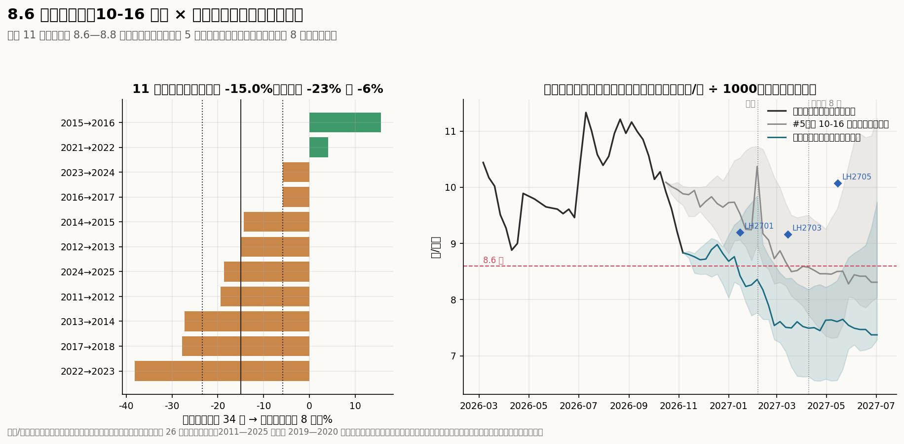
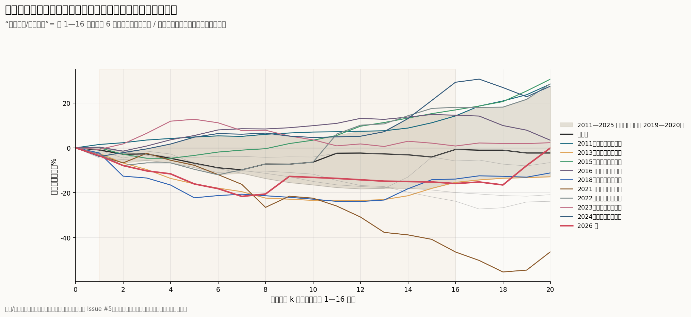
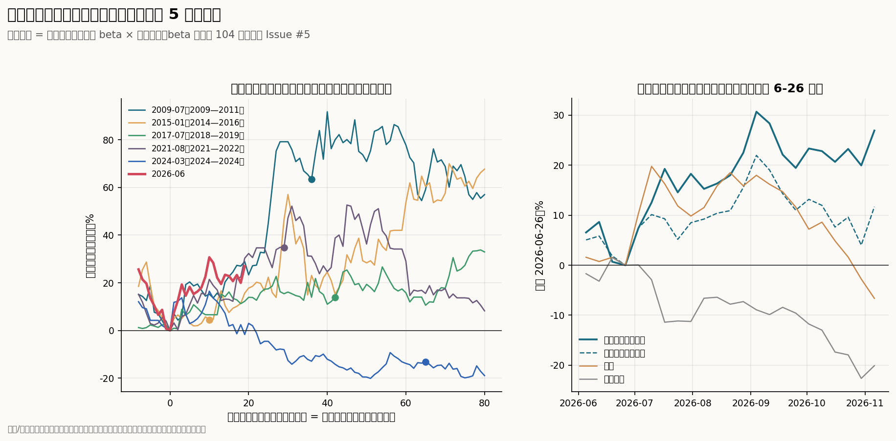

# 春节后 8.6 元的季节基准怎么算，现货提前跌到这里之后怎么检验猪股启动

回答 [Issue #10](https://github.com/AlphaCatalyst/AlphaNotes/issues/10)。数据截止：

- **现货：** 新牧网全国日度均价到 11-07（周六）。新牧网周度指数只到 9-25 所在周，之后用日度报价的周均值，按此前 26 周日度与周度的平均差（−0.032 元）调整，与 [Issue #5](05-stock-hog-timing.md) 相同。农业农村部集贸周价到 10 月第 4 周（10-29 采集）。
- **股价与期货：** 猪企等权指数（18 家，同 #5）、中证全指到 11-06 收盘；大商所生猪期货 11-06 收盘价。
- **供给：** 统计局三季度数据（10-19 发布）；农业农村部 9 月末能繁母猪 3602 万头；钢联重点养殖企业日度出栏到 11-05。

**标签：** 沿用前几期。

- 【事实】为统计与公告原文（A 级）；官员或公司管理层的口头表述为 B 级。
- 【推断】为本文计算或推理。
- 新牧网、钢联等第三方行情和样本数据按 C 级处理。
- D 表示没有找到可靠数据。

**口径：**

- 现货：统一用 #5 的"新牧网口径周均价"，按周五标注，元/公斤。
- 春节后第 k 周：从春节所在周算起的第 k 个整周，0 为春节所在周。
- 季节常态：参照年份为 2011—2025 年，剔除 2019—2020 年。先逐年计算同一农历窗口的对数变化，再取中位数和四分位；不把每周的中位数相加。
- 超额收益：猪企等权指数扣除 beta × 中证全指，beta 用此前 104 周估计，同 #5。

## 结论

1. **8.6 元的算法：10-16 那一周的周均价，乘以历年同一农历窗口跌幅的中位数；终点是春节后第 8 周的周均价。**
   - **基数 10.09 元：** 10-16 所在周（10-12 至 10-18）。#5 计算时这一周只有 10-12 一天的日度报价 10.12 元，按 −0.032 元的平均差折成周口径。它不是 7 月高点 11.33 元。事后补齐的完整周均价是 9.92 元。
   - **终点：** 2027 年春节（2-6）后第 8 周，即 4-5 至 4-11 这一周的周均价。它不是 8 周内的最低点，也不是"节前高点到节后低点"。
   - **跌幅：** 11 组参照年份，每组算"上一年农历第 34 周 → 当年春节后第 8 周"的变化。中位数 −15.0%（2012→2013 那一组），四分位 −23.4% 至 −5.8%。10.09 × (1 − 15.0%) = 8.57 元，四分位对应 7.72—9.50 元【推断】。
   - **议题里的两种算法：** 11.33 × 0.85 = 9.63 不是 #5 的算法。如果真以 7-10 所在周为基数，同口径中位数是 −12.9%，得 9.87 元。"节前高点 → 节后最低周"的中位数是 −28.7%；"春节后 8 周内最低周"是 −18.0%，得 8.28 元。

2. **8.6 元是一个宽区间的中位数，不能单独当作"淡季不淡"的门槛。**
   - **离散大：** 11 组跌幅从 +15.6% 到 −38.2%，四分位之间差 1.8 元。换参照集，中位数也会变：用 2005—2025 年全部 21 组是 −10.9%（8.99 元），只用非瘟后 4 组是 −12.4%（8.83 元）。
   - **混入了周期：** 这个窗口从 10 月跨到次年 4 月。−38% 的 2022→2023 是周期顶部回落，+16% 的 2015→2016 是上行期。所以它量的是"秋季价格到节后的整条路径"，不只是节后淡季。
   - **改用春节当周作起点：** 春节后第 8 周相对春节当周，13 个参照年份的中位数 −7.2%，上四分位 +6.0%，下四分位 −13.7%。第 16 周（端午前）中位数 −0.7%，上四分位 +14.6%。
   - **偏离要么不出界，要么连续出界：** 春节后第 1—16 周里，连续高于上四分位的周数，13 年中有 7 年只有 0—1 周，另外 6 年有 6—15 周，没有中间状态。
   - **判定线：** 以"连续 6 周以上"为界，2011、2015、2016、2022、2023、2024 年属于持续强于常态，2013、2018、2021 年和 2026 年持续弱于常态。2022 年节后前 6 周弱、后 6 周强，只看第 8 周会误判【推断】。

3. **价格偏强只是"淡季不淡"的价格层面，归因于去化还要供给数据，并排除其他解释。**
   - **6 个偏强年份：** 2015—2016 年之前能繁同比约 −15%；2022 年能繁从 2021 年 6 月高点降了 8.5%；2024 年一、二季度出栏同比 −2.2%、−4.0%【事实】。这 4 年都有供给收缩的证据。2011 年缺同口径数据（D）。
   - **反例 2023 年：** 一、二季度出栏同比 +1.7%、+3.7%，上年 9 月能繁只比一年前少 2.2%，价格也偏强。当时春节前价格已从 2022 年 10 月的高点跌去近一半，节后反弹有低基数和二次育肥入场的成分，之后没有走成周期上行【推断】。
   - **偏弱年份：** 2018、2021、2026 年一季度出栏同比为 +4.4%、+30.6%、+2.8%【事实】。
   - **其他解释：** 冻品出入库、二次育肥和压栏、出栏体重、需求恢复和疫病，都能让节后价格偏离常态。
   - **该看的供给数据：** 统计局季度出栏、产量和胴体重，钢联、涌益的周度出栏与均重，上市公司月度出栏，冻品库容率和二育栏舍利用率。

4. **现货已经提前跌到 8.6 元附近：它作为节后价位的参照已经被打破，但它要检验的事情还在。**
   - **现货新低：** 11-06 所在周 8.83 元，日度 11-06、11-07 都是 8.66 元，低于 4 月的周度低点 8.88 元，是 2026 年的最低点【事实，C】。
   - **偏离季节路径：** 比 10-16 出发的季节路径中位数 9.88 元低 10.6%，也低于路径的下四分位 9.68 元。7-10 以来累计 −22.0%，常态是 +4.8%【推断】。
   - **从最新一周重算：** 春节后第 8 周的中位数是 7.49 元（四分位 6.63—8.18）。这一算法假设本轮偏离全部延续。
   - **期货的看法不同：** LH2703 收 9160 元/吨，LH2705 收 10065 元/吨，比近月 LH2611 的 8045 高 14% 和 25%，定价的是部分回补【事实】。
   - **历史没有给出方向：** 秋季三周内弱于常态 8 个百分点以上的周观测有 14 个，分布在 4 个年份。2016 年 10 月、2021 年 9—10 月之后回补了 14—27 个百分点；2021 年 12 月、2022 年 11—12 月和 2024 年 9 月之后则继续走弱，后两者处在周期高位回落中【推断】。
   - **原因在供给端：**
     - 三季度末存栏同比 −2.6%，首次转负；能繁母猪 −10.7%。
     - 三季度出栏 +0.7%、胴体重 +2.3%、猪肉产量 +3.0%【事实】。
     - 钢联重点企业日均出栏同比，10 月上半月 +0.5%，下半月 +6.0%，11-02 至 11-05 约 +9%【事实，C】。
     - 去化已经出现在存栏上，还没有出现在出栏上。#6、#9 的时间表是 2026 年四季度约 −1%，2027 年一季度约 −2.4%，二季度约 −6%。

5. **猪股检验：现在是"现货创新低、超额收益守住"的组合。历史上这一组合之后多数有第二波，但本轮还没到检验窗口。**
   - **本轮：**
     - 超额收益 11-06 为 0.621，比 6-26 低点 0.489 高 26.9%，比 10-16 高 5.2%。
     - 等权指数绝对 +11.7%；相对中证全指（不扣 beta）+39.8%；中证全指同期 −20.1%。
     - 三种算法都远未跌破【推断】。
   - **历史 5 轮：** 看每轮超额收益低点之后的第一个节后现货低点。2007 年那轮现货当时在周期高位，不可比。
     - 4 轮守住了低点（2010-04、2015-03、2018-05、2022-03），之后 0—10 个月内现货都开始持续上涨，分别在 2010-07、2015-05、2019-03、2022-05。
     - 2018-05 和 2022-03 两次，现货比股价低点之前两年的最低价还低 23% 和 12%，超额收益仍比低点高 14% 和 35%。
     - 1 轮跌破：2024-03 的低点，到 2025 年节后现货低点时已低 13%（期间最深 −20%），之后没有新一轮上涨【推断】。
   - **怎么读：**
     - "现货 ≤ 8.6 元而超额收益守住 6-26 低点"支持"股价提前交易供给收缩"，但只是必要条件：2019 年那次第二波来自非洲猪瘟，不是去化本身。
     - "现货持续弱于常态，同时超额收益跌破 0.489"是更明确的失败信号。历史上唯一一次（2024—2025）之后没有第二波。
     - 检验窗口仍是 2027 年春节后到端午（2-6 至 6-9）：现货若在节后再创新低，看超额收益是否仍在 0.489 以上。#5 记录的失败线是回到 0.514 以下。

**回答核心问题：**

- **8.6 元怎么来的：** 10-16 那一周的 10.09 元（实际只用了 10-12 一天的报价），乘以 11 组参照年份"农历第 34 周 → 春节后第 8 周"跌幅的中位数 −15%。终点是 2027 年 4-5 至 4-11 这一周的周均价，不是最低点。
- **能不能当"淡季不淡"的基准：** 它是宽区间的中位数，而且现货 11 月初就已经到了，不宜再当价位门槛。判断节后强弱，改用春节当周作起点，看第 1—16 周是否连续 6 周以上高于上四分位（第 8 周约 +6%，第 16 周约 +15%）。
- **去化：** 价格偏强之后，还要有出栏同比转负、胴体重回落等供给证据，并排除冻品、二育、低基数，才能说是去化兑现。
- **猪股：** "现货跌破、超额收益守住"目前成立，支持股价在领先，但检验要等到节后。"现货持续偏弱且超额收益跌破 0.489"才是更大的失败信号。

议题里的那句话本文同意：高于 8.6 元不能单独证明去化生效，跌到 8.6 元也不等于猪股启动失败。

---

## 方法与口径

| 项目 | 做法 |
|---|---|
| 现货序列 | 与 #5 相同：新牧网全国周度成交价（2015 年起），之后用日度报价周均值加平均差；2008—2014 年拼接农业部集贸周价，更早拼接月报；26 周以内的缺口对数插值 |
| 复现 8.6 元 | 把截止日设回 10-12（#5 最后一个日度报价），10-16 所在周的值重新得到 10.0881 元；终点为 2027 年春节后第 8 周 |
| 季节路径 | 对未来每一周，逐年计算"当前农历周 → 目标农历周"的对数变化，取 11—13 个参照年份的中位数和四分位 |
| 节后强弱 | 以春节所在周为起点，春节后第 k 周（k = 1—16）的变化与其余参照年份的四分位比较（每年都留出自己）；数连续出界的周数 |
| 秋季偏离能否回补 | 参照年份农历第 30—45 周，每周算前 3 周相对常态的偏离，再算此后到次年春节后第 8 周的偏离（176 个重叠的周观测） |
| 猪股检验 | #5 各轮超额收益低点（`ts_cycle_milestones.csv`）之后，第一个春节后 0—20 周的现货最低周；看此时及前后 8 周超额收益是否低于低点，以及之后的现货与股价 |

## 一、8.6 元怎么算（问题一）

**基数。** #5 的数据截至 10-13。新牧网周度指数当时只到 9-25 所在周，10-16 所在周（10-12 至 10-18）只有 10-12 一天的日度报价 10.12 元，加上 −0.032 元的平均差，得 10.0881 元。这一周补齐后的周均价是 9.92 元，比当时低 1.7%【推断】。

**窗口与公式。** 10-16 是 2026 年春节（2-17）后第 34 周。对每个参照年份 y：

> 变化 = ln（y 年春节后第 8 周的周均价）− ln（y−1 年春节后第 34 周的周均价）

11 组的结果【推断】：

| 参照组 | 起点（农历第 34 周） | 终点（春节后第 8 周） | 变化 |
|---|---|---|---|
| 2011→2012 | 2011-09-30 | 2012-03-23 | −19.4% |
| 2012→2013 | 2012-09-21 | 2013-04-12 | −15.0% |
| 2013→2014 | 2013-10-11 | 2014-03-28 | −27.2% |
| 2014→2015 | 2014-09-26 | 2015-04-17 | −14.3% |
| 2015→2016 | 2015-10-16 | 2016-04-08 | +15.6% |
| 2016→2017 | 2016-10-07 | 2017-03-31 | −5.8% |
| 2017→2018 | 2017-09-29 | 2018-04-13 | −27.7% |
| 2021→2022 | 2021-10-08 | 2022-04-01 | +4.1% |
| 2022→2023 | 2022-09-30 | 2023-03-24 | −38.2% |
| 2023→2024 | 2023-09-22 | 2024-04-12 | −5.8% |
| 2024→2025 | 2024-10-11 | 2025-03-28 | −18.6% |
| **中位数（四分位）** | | | **−15.0%（−23.4% 至 −5.8%）** |

涉及 2019、2020 年的组（2018→2019、2019→2020、2020→2021）不用，原因同 #5：非洲猪瘟期间没有季节性可言。农历第 34 周落在 9 月下旬到 10 月中旬，因为春节日期每年不同。

**不同口径的结果**【推断】：

| 口径 | 基数 | 中位数 | 四分位 | 对应价格 |
|---|---|---|---|---|
| #5：10-16 所在周 → 春节后第 8 周周均价 | 10.09 | −15.0% | −23.4% 至 −5.8% | 8.57（7.72—9.50） |
| 同一基数 → 春节后 0—8 周内最低的一周 | 10.09 | −18.0% | −23.4% 至 −10.9% | 8.28（7.72—8.99） |
| 7-10 所在周（农历第 20 周）→ 春节后第 8 周 | 11.33 | −12.9% | −19.3% 至 −6.6% | 9.87（9.15—10.59） |
| 节前高点（第 34 周至春节前最高周）→ 节后 0—20 周最低周 | — | −28.7% | −32.8% 至 −19.9% | — |
| 春节当周 → 春节后第 8 周 | — | −7.2% | −13.7% 至 +6.0% | — |
| 春节当周 → 节后 0—20 周最低周 | — | −12.0% | −23.5% 至 −3.9% | — |

**参照集的影响：**

| 参照集 | 组数 | 中位数 | 对应价格 |
|---|---|---|---|
| #5：2011—2025 年，剔除 2019—2020 年 | 11 | −15.0% | 8.57 |
| 2005—2025 年全部 | 21 | −10.9% | 8.99 |
| 非瘟后：2022—2025 年 | 4 | −12.4% | 8.83 |

议题提到的约 15%，是 #5 口径的中位数；"7 月高点 × 0.85"把两种口径混在了一起。#5 原文写的"现货届时约为 8.6 元，会低于今年 4 月低点"，严格说是"10-16 价格按常年路径走到春节后第 8 周的中位数"，四分位上沿 9.50 元并不低于 4 月低点。

## 二、8.6 元能否作为"淡季不淡"的基准（问题二）

**为什么要换起点。** 10 月出发的路径包含两段：10 月到春节的旺季，以及节后淡季。到春节后第 8 周的偏离，可能在春节前就已经形成；本轮从 10-16 到 11-06 已经比常态弱了约 9 个百分点。只评判节后淡季时，以春节当周为起点更干净。

**节后常态**（春节当周 = 0，13 个参照年份）【推断】：

| 春节后 | 下四分位 | 中位数 | 上四分位 |
|---|---|---|---|
| 第 4 周 | −6.7% | −4.7% | +1.7% |
| 第 8 周 | −13.7% | −7.2% | +6.0% |
| 第 12 周 | −18.3% | −2.3% | +7.4% |
| 第 16 周 | −15.4% | −0.7% | +14.6% |

**逐年**（每年的四分位都用其余年份计算）【推断；出栏、能繁为事实】：

| 年份 | 第 8 周偏离中位数 | 连续高于上四分位（周） | 连续低于下四分位（周） | 判定 | 一、二季度出栏同比 | 上年 9 月能繁同比 |
|---|---|---|---|---|---|---|
| 2011 | +15.1 个百分点 | 12 | 0 | 持续强于常态 | — | — |
| 2012 | −6.2 | 0 | 2 | 常态波动 | — | — |
| 2013 | −19.5 | 0 | 14 | 持续弱于常态 | — | — |
| 2014 | −8.8 | 1 | 1 | 常态波动 | — | — |
| 2015 | +8.8 | 6 | 0 | 持续强于常态 | — | 2015-03 为 −15.3% |
| 2016 | +17.3 | 15 | 0 | 持续强于常态 | — | −15.4% |
| 2017 | −5.1 | 0 | 3 | 常态波动 | +0.2%，+1.4% | −3.8% |
| 2018 | −18.1 | 0 | 12 | 持续弱于常态 | +4.4%，+3.1% | −5.0% |
| 2021 | −25.0 | 0 | 11 | 持续弱于常态 | +30.6%，+38.6% | — |
| 2022 | +0.1 | 6 | 6 | 持续强于常态（前弱后强） | +14.1%，+2.5% | 2021-06 高点至 2022-04 为 −8.5% |
| 2023 | +16.8 | 8 | 0 | 持续强于常态 | +1.7%，+3.7% | −2.2% |
| 2024 | +15.6 | 8 | 1 | 持续强于常态 | −2.2%，−4.0% | −2.8% |
| 2025 | +4.9 | 0 | 0 | 常态波动 | +0.1%，+1.2% | −4.2% |
| 2026 | −15.6 | 0 | 8 | 持续弱于常态 | +2.8%，+0.4% | −0.7% |

能繁同比 2015—2018 年为农业农村部监测样本，2021 年起为全国绝对量；统计局季度出栏从 2016 年起才有同口径数据。

**怎样区分正常波动和"淡季不淡"：**

- **幅度：** 按春节当周为起点，春节后第 8 周高于约 +6%，第 16 周高于约 +15%，才算进入上四分位。
- **持续：** 历史上没有"只高 2—5 周"的中间状态，所以连续 6 周以上高于上四分位是比较干净的分界。单周、单日越过不算。
- **时间：** 至少看到春节后第 16 周（端午前）。2022 年前 6 周低于下四分位，后 6 周高于上四分位。
- **8.6 元的用法：** 只用来对照春节后第 8 周的价位，并且要和 7.7—9.5 元的四分位一起看。现货已经在 11 月到了这里，所以这个价位本身不再有区分力。

**归因于去化还要什么。** 价格偏强的 6 年里，4 年有同期的供给收缩证据，1 年缺数据，2023 年没有。所以价格层面的"淡季不淡"之后，还需要：

| 证据 | 支持"去化兑现" | 其他解释 |
|---|---|---|
| 统计局季度出栏同比 | 2027 年一季度转负，二季度 −5% 以下（#9 时间表 −2.4%、−6.0%） | 仍为正：价格偏强来自别处 |
| 胴体重（产量 ÷ 出栏） | 同比回落 | 继续上升：压栏惜售，供给后移 |
| 钢联、涌益周度出栏与均重 | 出栏同比转负且均重下降 | 出栏下降但均重上升：压栏 |
| 上市公司月度出栏 | 中小猪企增速回落到 0 附近 | 头部减、中小增 |
| 冻品库容率 | 低位，价格上涨不触发出库 | 高位出库或低位入库，平滑价格 |
| 二次育肥 | 栏舍利用率平稳 | 节后集中入场推高价格，之后集中出栏 |
| 需求 | 屠宰量、白条价格与活猪同步 | 只有活猪涨、白条不跟 |

## 三、现货提前到了 8.6 元：重算与原因

| 日期（周） | 实际 | 10-16 出发的季节中位数 | 季节下四分位 |
|---|---|---|---|
| 10-16 | 9.92（当时按 10-12 一天为 10.09） | 10.09 | 10.09 |
| 10-23 | 9.61 | 10.01 | 9.87 |
| 10-30 | 9.20 | 9.96 | 9.75 |
| 11-06 | 8.83 | 9.88 | 9.68 |

【推断；现货为事实，C】

- **重算：** 从 11-06 的 8.83 元出发，春节后第 8 周的中位数是 7.49 元（6.63—8.18），春节当周是 8.36 元（7.77—9.85）【推断】。
- **期货：** 11-06 收盘 LH2701 9195、LH2703 9160、LH2705 10065、LH2709 12315 元/吨；10-13 分别为 10605、10495、11520、13190【事实】。期货交割标准与新牧网均价不同，只能比形状：期货认为一季度与现在相近、二季度回升，不是机械地再跌 15%。
- **秋季偏离能否回补：**
  - 参照年份秋季（农历第 30—45 周）的 176 个周观测里，前 3 周的偏离与此后到春节后第 8 周的偏离相关系数为 −0.26，平均有部分回补。
  - 但偏离在 −8 个百分点以下的 14 个观测里，中位数是此后再弱 13.6 个百分点。其中 9 个继续走弱（2021 年 12 月、2022 年 11—12 月、2024 年 9 月，后两段在周期高位回落中），5 个回补（2016 年 10 月、2021 年 9—10 月）。
  - 历史不支持任何一边的机械外推【推断】。
- **原因：**
  - 统计局三季度数据：存栏 42533 万头，同比 −2.6%；能繁 3602 万头，−10.7%，是正常保有量的 96.0%；出栏 16493 万头，+0.7%；猪肉产量 1389 万吨，+3.0%；胴体重 84.2 公斤，+2.3%【事实】。
  - 钢联重点企业日均出栏同比：10-01 至 10-15 为 +0.5%，10-16 至 10-31 为 +6.0%，11-02 至 11-05 按日历对齐为 +8.7%、按星期对齐为 +9.4%【事实，C；样本扩容会抬高同比】。
  - [Issue #6](06-autumn-dip.md) 记录的冻品库容率 9-25 为 32.2%，同比高 14.55 个百分点；[Issue #9](09-daily-signal.md) 记录钢联 10 月下旬的出栏均重升到 125 公斤，二次育肥顺势出栏【事实，C】。冻品高位使价格反弹容易触发出库，压栏猪和二育猪的出栏把供给集中到了旺季【推断】。
  - 这与 #6、#9 的判断一致：去化先出现在存栏，出栏同比要到 2027 年才转负。

## 四、猪股的检验（问题三）

**本轮**【推断】：

| 项目 | 11-06 相对 6-26 |
|---|---|
| 超额收益（beta 调整）：6-26 为 0.489，10-16 为 0.590，11-06 为 0.621 | +26.9% |
| 猪企等权指数（绝对） | +11.7% |
| 猪企等权指数相对中证全指（不扣 beta） | +39.8% |
| 中证全指 | −20.1% |
| 现货周均价：6-26 为 9.46 元，11-06 为 8.83 元 | −6.6% |

现货 11 月创下年内新低，超额收益仍处在 6-26 以来的高位附近（9-04 高点为 0.639）。中证全指同期下跌 20%，猪股有防御属性，但即使不扣大盘，绝对涨幅也是 +11.7%。

**历史 5 轮：超额收益低点之后的第一个节后现货低点**【推断】：

| 轮次 | 超额收益低点 | 节后现货低点 | 现货相对此前两年最低价 | 超额收益相对低点 | 守住 | 现货持续上涨开始 | 之后 52 周超额收益 |
|---|---|---|---|---|---|---|---|
| 2009—2011 | 2009-07-31 | 2010-04-09 | +2% | +63% | 是 | 2010-07-30 | −7% |
| 2014—2016 | 2015-01-02 | 2015-03-13 | +10% | +4.5% | 是 | 2015-05-08 | +48% |
| 2018—2019 | 2017-07-21 | 2018-05-11 | **−23%** | +14% | 是 | 2019-03-15（非瘟） | +66% |
| 2021—2022 | 2021-08-27 | 2022-03-18 | **−12%** | +35% | 是 | 2022-05-13 | −18% |
| 2024 | 2024-03-15 | 2025-06-13 | +16% | **−13%**（期间最深 −20%） | 否 | 2024-05-24（之前已涨完） | −29% |
| 2026— | 2026-06-26 | 待 2027 年节后 | 11 月已低于 4 月低点 | 目前 +27% | 目前是 | — | — |

**2×2 读法**【推断】：

| | 超额收益守住低点 | 超额收益跌破低点 |
|---|---|---|
| **现货弱于常态、创新低** | 2018、2022 年：之后有第二波；本轮目前在这一格 | 失败信号：股价在跟随现货 |
| **现货强于常态** | 进入第二波的条件（#5）：现货持续上涨 | 2024—2025 年：股价先于现货转弱，没有第二波 |

- **守住是必要条件，不是充分条件。** 4 次守住之后都有现货上涨，但 2019 年来自非瘟，2010 年那次之后 52 周超额收益是负的。
- **跌破是更强的信号。** 唯一一次跌破（2024—2025）之后没有新一轮上涨，而且发生在节后现货低点之前，说明股价先于现货转弱。
- **本轮的 11 月不是 #5 设定的检验。** 下跌发生在旺季，原因是出栏后移和集团冲量；节后淡季（2027-02-06 至 06-09）才是"季节性低点"。届时现货若再创新低，0.489（失败线 0.514）就是检验线。

## 五、三层分开跟踪

| 层次 | 问题 | 看什么 | 当前 | 判定 |
|---|---|---|---|---|
| 季节性基准 | 价格是否比常年同期强 | 春节当周起的节后路径与四分位；春节后第 8 周对照 8.6 元（7.7—9.5） | 2026 年节后连续 8 周低于下四分位；2027 年待看 | 第 1—16 周连续 6 周以上高于上四分位（第 8 周约 +6%，第 16 周约 +15%） |
| 去化兑现的证据 | 供给是否真的减少 | 统计局季度出栏、产量、胴体重；钢联、涌益出栏与均重；上市公司月度出栏；冻品、二育 | 存栏 −2.6%、能繁 −10.7%；出栏 +0.7%、产量 +3.0%；重点企业 10 月下旬起出栏同比 +6%—9% | 出栏同比转负且胴体重回落（时间表：2027 年一季度约 −2.4%，二季度约 −6%） |
| 猪股启动成败 | 股价是否在领先供给收缩 | 超额收益与 6-26 低点 | 0.621，高于低点 26.9% | 守住 0.489：仍在领先；跌回 0.514 以下：#5 记为失败 |

**接下来的数据：**

| 时间 | 数据 | 看什么 |
|---|---|---|
| 每周 | 新牧网日度、钢联重点企业出栏与均重 | 出栏同比能否从 +6%—9% 回落；均重是否下降 |
| 11 月中下旬 | 农业农村部集贸周价；上市公司 10 月销售简报 | 中小猪企出栏增速 |
| 2027-01 中旬 | 统计局四季度数据 | 出栏同比（时间表约 −1%）、胴体重 |
| 2027-02-06 起 | 春节当周价格定基；第 1—16 周的路径 | 连续出界的周数；第 8 周对照 8.6 元 |
| 2027-04 中旬 | 统计局一季度数据、农业农村部季末能繁 | 出栏同比是否转负；能繁是否企稳 |
| 节后全程 | 超额收益 | 0.489 / 0.514 |

**会推翻本文判断的证据：**

- **"8.6 元已失去区分力"：** 如果现货在春节前回到 10 元以上，季节路径重新回到 #5 的轨道，8.6 元作为第 8 周的价位参照就恢复意义。
- **"连续 6 周是干净的分界"：** 只有 13 年样本。如果 2027 年出现 3—5 周的出界后又回落、事后看是去化兑现，这条线需要放宽。
- **"去化先在存栏、后在出栏"：** 如果统计局四季度出栏同比已低于 −3%，或钢联重点企业出栏同比在 11—12 月转负，说明收缩比时间表来得早。
- **"超额收益守住支持领先"：** 如果节后现货再创新低时，超额收益跌回 0.514 以下，本轮就回到"跟随现货"，与 2024—2025 年相同。
- **"股价领先不是防御"：** 如果大盘反弹时猪股超额收益明显回落，说明 6 月以来的超额收益主要来自防御，而不是对供给的定价。

## 局限

- **季节常态只有 11—13 年。** 2019—2020 年剔除；2011—2014 年是农业部周价拼接，不是新牧网原值。四分位每年变动 1—3 个百分点。
- **秋季到节后的路径混入了周期。** 本文用春节当周作起点来减轻，但节后路径同样会受周期位置影响（2021 年的 −62%）。
- **供给数据短。** 统计局季度出栏从 2016 年起，能繁母猪全国绝对量从 2020 年起；2011—2015 年的强弱年份无法逐一核对供给（D）。
- **钢联只用公开部分。** 样本名单和权重未公开，样本扩容会抬高同比。
- **股价检验只有 5 轮。** 2007 年那轮剔除；猪企样本前后变化大，早期只有 2—5 家。超额收益的 beta 用此前 104 周估计，大盘大跌时结果对 beta 敏感，所以同时给出不扣 beta 的结果。
- **期货与现货口径不同。** 只比较期货曲线形状，不比较水平。
- **不预测价格水平。** 本文只解释基准怎么来、能说明什么，以及检验条件。

## 数据与方法

| 文件 | 内容 |
|---|---|
| [`scripts/issues/seasonal_benchmark.py`](../scripts/issues/seasonal_benchmark.py) | 全部计算与 3 张图；复用 [`stock_hog_timing.py`](../scripts/issues/stock_hog_timing.py)（#5）的现货序列、季节常态和超额收益 |
| [`sb_pairs.csv`](../data/processed/issues/sb_pairs.csv)、[`sb_definitions.csv`](../data/processed/issues/sb_definitions.csv)、[`sb_reference_sets.csv`](../data/processed/issues/sb_reference_sets.csv) | 8.6 元的 11 组参照；不同口径；不同参照集 |
| [`sb_path.csv`](../data/processed/issues/sb_path.csv) | 从 10-16 和从 11-06 出发的季节路径（中位数、四分位，到春节后第 21 周） |
| [`sb_offseason_band.csv`](../data/processed/issues/sb_offseason_band.csv)、[`sb_offseason_years.csv`](../data/processed/issues/sb_offseason_years.csv) | 节后常态的四分位带；逐年偏离、连续出界周数与供给数据 |
| [`sb_carry_over.csv`](../data/processed/issues/sb_carry_over.csv) | 秋季 3 周偏离与此后到春节后第 8 周的偏离 |
| [`sb_stock_test.csv`](../data/processed/issues/sb_stock_test.csv)、[`sb_facts.csv`](../data/processed/issues/sb_facts.csv) | 历史各轮的猪股检验；本轮的关键数字（含期货） |

新牧网、钢联的原始序列，期货和股票日线只保留在本地；仓库只公开派生结果。重跑：先更新 `industry/nxin_prices.py`、`fetch_stocks.py`、`fetch_csi_index.py`、`fetch_futures.py`，再运行 `issues/seasonal_benchmark.py`。

本文不构成投资建议。
