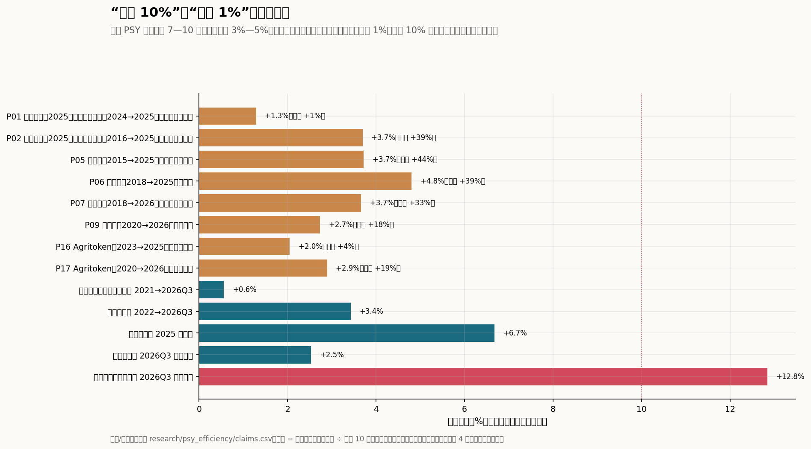
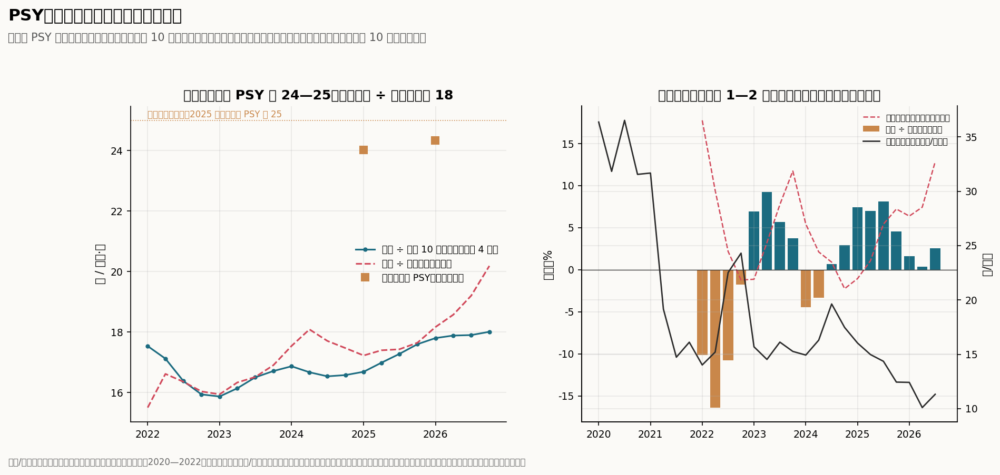
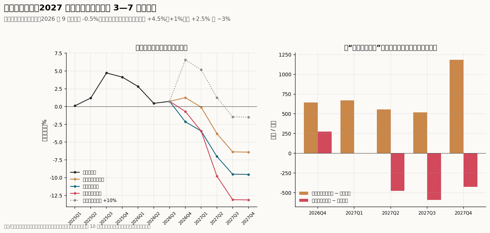

# 猪周期底部的高 PSY 能否持续：“提升 10%”与“每年 1%”的口径，以及效率能抵消多少去化

回答 [Issue #11](https://github.com/AlphaCatalyst/AlphaNotes/issues/11)。数据截止：

- **官方：**
  - 统计局季度出栏到 2026 年三季度（10-19 发布）。
  - 能繁母猪：2020—2022 年用统计局季末数，2021-12 至 2025-11 用农业农村部月末全国绝对量，之后用季末数，最新为 2026 年 9 月末 3602 万头；中间月份对数插值。2016—2019 年没有全国绝对量，只有农业农村部监测样本的同比。
  - 农业农村部集贸市场活猪周价到 10 月第 4 周；饲料工业协会产量到 2026 年 7 月（同 [Issue #7](07-feed-tracking.md)）。
- **行业说法：** 2026 年 1—10 月公开报道中的 17 条 PSY/MSY 数字、5 条机制描述和 2 条出栏预测，见 [`research/psy_efficiency/claims.csv`](../research/psy_efficiency/claims.csv)。
- **期货：** 大商所生猪期货 11-06 结算价。

**标签：** 沿用前几期。

- 【事实】为统计与公告原文（A 级）；官员、研究人员或公司管理层的表述为 B 级。
- 【推断】为本文计算或推理。
- 咨询机构、券商、媒体和行业平台的数据按 C 级处理。
- D 表示没有找到可靠数据。

**口径：**

- **PSY：** 每头能繁母猪每年提供的断奶仔猪数。
- **MSY：** 每头能繁母猪每年提供的出栏肥猪数，约等于 PSY × 断奶到出栏的成活率。
- **每头滞后母猪出栏：** 本文的官方口径。统计局季度出栏 ÷ 10 个月前 3 个月平均的全国能繁母猪，与 [Issue #6](06-autumn-dip.md)、[Issue #9](09-daily-signal.md) 相同。4 个季度滚动相加，就是全国口径 MSY 的近似。它把 PSY、育肥成活、外购仔猪和统计时点混在一起，不等于 PSY，但口径前后一致，适合看变化。
- **期末口径：** 出栏 ÷ 同期期末的能繁母猪。
- **年化：** 多年累计变化按年数开方。

## 结论

1. **"提升约 10%"找不到单年的全国口径来源；"长期年均约 1%"与官方数据一致，但只在跨完整周期时成立。**
   - **行业数字都是多年累计或水平：**
     - 2015 年 17 头 → 2025 年 24.5 头（10 年 +44%）；
     - 2018 年 18 头 → 2025 年 25 头（7 年 +39%）；
     - 2020 年 19.9 头 → 2026 年 23.4 头（6 年"接近两成"）。
     - 年化后，PSY 的说法为每年 +2.7% 至 +4.8%，MSY 为 +2.0% 至 +2.9%【推断，C】。
   - **单年数只有两条。** 微猪科技监测猪场 2025 年 PSY 24.34 头，比 2024 年多 0.31 头（+1.3%）；格隆汇预计 2026 年行业 PSY 提升不超过 0.5 头（约 +2%）【C】。
   - **10% 以上的数来自口径错配：**
     - 用出栏同比除以期末能繁同比，2026 年三季度是 +12.8%，4 个季度滚动是 +14.4%。
     - 同花顺引用的 9 月新生健仔猪同比 +0.3%，配 9 月末能繁同比 −10.7%，也是"每头 +12%"；配 4 个月前（5 月）的母猪（约 −5.5%），只有 +6.1%。
     - 两者都是用已经去化的期末母猪，去除 4—10 个月前配种的母猪生下的猪【推断】。
   - **口径一致的官方数：**
     - 每头滞后母猪出栏 2026 年三季度同比 +2.5%，4 个季度滚动 +2.3%。
     - 2021 年四季度到 2026 年三季度，跨一个完整周期，年均 +0.6%。
     - 从 2022 年四季度的低点算，年均 +3.4%。
     - 2025 年单年 +6.7%，是 2022 年以来最高的年度值【推断】。
   - **所以：** 10% 是"多年累计"或"错配口径"，1% 是"跨周期的年均"。单个季度的同比在 −16% 到 +9% 之间，随周期大幅摆动。

2. **PSY、能繁母猪、出栏三者对不上，有四个原因，影响最大的是统计范围。**
   - **范围：**
     - 行业说的 PSY 24—25 头，乘以全国滞后能繁 4037 万头和 92.67% 的育肥成活率，出栏应为 9.0—9.4 亿头。统计局近 4 个季度是 7.27 亿头，低 19%—22%。
     - 要对上，育肥成活率得只有 72%—75%，或者全国平均 PSY 只有 19.4 头左右。
     - 24—25 头是规模场和管理系统用户的水平，中小场拉低了全国平均【推断】。
   - **时滞：** 配种到分娩约 4 个月，断奶到出栏约 6 个月，能繁母猪领先出栏约 10 个月。2026 年三季度的出栏对应 2025 年 9—11 月的母猪，它们同比只少 1.8%，而期末母猪已少 10.7%。
   - **期末分母的偏差：** 用期末母猪去除，去化越快，"效率"看起来越高。2026 年三季度，错配口径（+12.8%）比一致口径（+2.5%）高 10 个百分点，几乎全部来自母猪的时间错位。
   - **仔猪外购和样本口径：**
     - 出栏含外购仔猪育肥的猪，仔猪在主体之间流动只改变归属，不增加全国总量。
     - 2016—2019 年监测样本的母猪同比配统计局出栏，隐含每头产出 2016 年 +8% 至 +15%、2017—2018 年 +3% 至 +7%。这明显高于同期规模场 PSY 的增速（年均约 3.7%），说明样本母猪的降幅被高估了，样本偏向正在退出的中小户【推断】。

3. **"低位时高、上行后回落"在全国数据里成立，但不是同步的：价格高位后 1—2 年每头产出放慢，低位淘汰后 1—2 年加快。2026 年已经在放慢。**
   - **全国数据**（每头滞后母猪出栏，季度同比）：
     - 2022 年 −1.8% 至 −16.4%：在 2020—2021 年高价期大量留用商品代（三元）母猪之后。
     - 2023 年 +3.7% 至 +9.2%：在 2021 年下半年至 2022 年上半年低价淘汰之后。
     - 2024 年上半年 −4.5%、−3.3%：在 2022 年下半年高价补栏、2023—2024 年冬季疫病之后。
     - 2025 年 +4.5% 至 +8.1%：在 2023 年至 2024 年上半年低价淘汰之后。
     - 2026 年前三季度 +1.6%、+0.4%、+2.5%。
   - **相关：** 价格同比领先 6—8 个季度时，与每头产出同比的相关系数为 −0.47 至 −0.71；领先 1—3 个季度时为正。这是同一周期的两面：高价期留种之后 1—2 年，一边是供给过剩、价格同比转负，一边是低效母猪拉低每头产出。数据只有 19 个季度、约两个周期，不足以确认因果【推断】。
   - **同场追踪没有公开数据（D）。** 能拿到的是监测样本的描述：
     - 微猪科技监测猪场 2025 年年淘汰率 34.68%，5 月起月度淘汰率上升，"说明淘汰更集中于低效个体"；
     - 1 胎母猪窝数占比 35.13%，1—2 胎合计超过 58%；
     - 涌益认为当前种群以二、三、四胎为主，2027 年一季度后有高效后备母猪投产（C）。
   - **三种来源只能分别估算：**
     - **同场提升**（育种、营养、管理）：规模场长期年均约 3%—4%（微猪 2016—2025 年 +3.7%/年），全国跨周期约 0.6%—1%。
     - **场内淘汰低效母猪：** 本轮能繁 −10.7%。如果被淘汰母猪的生产力是平均的 80%（60%—90%），每头产出一次性抬高 2.4%（1.2%—4.8%）。
     - **低效场退出：** 规模化率按 73%，中小场每头产出为规模场的 60%—80%，去化中一半到八成来自中小场整场退出，每头产出一次性抬高 0.6%—2.9%。
     - 后两项是同一次去化的不同来源，不能相加。合起来是一次性抬升约 1%—5%，体现在 2026—2027 年，之后不再重复【推断】。
   - **饲料交叉验证（#7）：** 仔猪料 ÷ 母猪料的同比，2025 年 +1.2%，2026 年上半年 −3.0%，7 月 −2.0% 至 −4.3%，不支持 2026 年每头产出再次跳升【推断】。
   - **胎次和后备：** 1 胎占比高，说明 2024 年下半年至 2025 年补进的后备母猪多，而后备母猪的 PSY 低于经产母猪。随着胎次结构变老，2026—2027 年还有一段结构红利。如果 2027 年猪价回升、留种增加，1 胎占比再次上升，会拉低平均【推断】。

4. **三种情景：同一条母猪路径下，2027 年二、三季度出栏同比相差 3—7 个百分点。**

   | 情景 | 每头滞后母猪出栏同比 | 2026Q4 | 2027Q1 | 2027Q2 | 2027Q3 | 2027Q4 |
   |---|---|---|---|---|---|---|
   | 滞后能繁同比（三者相同） | — | −3.1% | −4.4% | −7.9% | −10.4% | −10.4% |
   | 效率持续快速提升 | +4.5%（2025 年的速度） | +1.3% | −0.1% | −3.8% | −6.4% | −6.4% |
   | 回归长期增速 | +1% | −2.2% | −3.4% | −7.0% | −9.5% | −9.5% |
   | 随猪价上行回落 | +2.5%、+1%，之后 −2%、−3%、−3% | −0.7% | −3.4% | −9.8% | −13.1% | −13.1% |
   | 参照：每头 +10% | +10% | +6.6% | +5.2% | +1.3% | −1.4% | −1.5% |

   - **母猪路径：** 2026 年 9 月以前为已公布数，之后每月 −0.5%（#9 的"缓降"）。2027 年三季度起用到假设部分。
   - **绝对量：** 二、三季度，"快速"比"长期"多出栏 555 万头、517 万头；"回落"比"长期"少 476 万头、591 万头。
   - **仔猪：** 新生仔猪同比领先出栏约两个季度。2026 年四季度出生的仔猪对应 2027 年二季度出栏，三个情景分别为 −3.8%、−7.0%、−9.8%。
   - **与其他估计对照：** #9 的时间表（2027 年一季度 −2.4%、二季度 −6.0%、三季度 −8.6%）落在"快速"和"长期"之间。卓创认为出栏负增长最早出现在 2027 年二季度；Agritoken 预计 2027 年全年 −3.7% 至 −5.2%（C）。

5. **高 PSY 中"底部现象"的成分更大；如果效率回到长期速度，期货最近一个月的下修可能低估了 2027 年前三季度的出栏下降。**
   - **可持续的部分：** 育种、营养、防疫和规模化带来的长期提升，全国跨周期年均约 1%，规模场约 3%—4%。
   - **底部现象：** 2025 年 +6.7% 的跳升，来自 2023—2024 年低价淘汰和疫病之后的恢复；2026 年已回到 +0.4% 至 +2.5%。本轮去化还会带来一次性 1%—5% 的抬升，但这是水平变化，不是增速。
   - **回落的时点：** 价格回升后留种增加、淘汰放慢。按 2022 年、2024 年的经验，每头产出会在 1—2 年后放慢甚至下降，大约在 2027 年下半年到 2028 年。
   - **市场：** 沿用 [Issue #3](03-xueqiu-authors.md) 的简单对照：价格变化 = 弹性 × 供给变化，弹性取 2、5、9，需求、冻品和体重不变。
     - 10-08，期货 2701—2709 结算价均值 12.16 元/公斤，相当于 2027 年前三季度供给比 2026 年同期少 1.7%—7.5%。
     - 11-06，均值降到 10.39 元，低于 2026 年 1—9 月现货均价 10.57 元，相当于供给持平（+0.2% 至 +0.9%），接近"每头 +10%"的参照（+1.9%）。
     - 三个情景分别是 −3.2%（快速）、−6.5%（长期）、−8.4%（回落）。
     - 所以，如果效率提升回到长期速度，期货曲线低估了收缩。但期货的下修也可能是在为冻品高库存（库容率 32%）、出栏体重偏高和需求偏弱定价，这些本文没有量化。猪股超额收益仍比 6-26 低点高 27%（[Issue #10](10-seasonal-benchmark.md)），没有跟随期货下修。

**回答核心问题：**

- **高 PSY 既有长期趋势，也有底部现象。** 长期趋势是全国跨周期年均约 1%，规模场约 3%—4%。"提升 10%"来自多年累计或期末母猪口径，不是可以用来抵消去化的单年增速。
- **2025 年的跳升已经回落。** 本轮去化还能带来一次性 1%—5% 的抬升，之后猪价回升会让效率放慢。
- **出栏：** 按同一条母猪路径，2027 年二、三季度出栏同比在 −4% 到 −13% 之间。
- **市场：** 11-06 的期货曲线大致按供给持平定价。如果效率回到长期速度，期货低估了出栏下降；判断要等 2027 年一、二季度的统计局出栏和月度仔猪数据。

---

## 方法与口径

| 项目 | 做法 |
|---|---|
| 说法清单 | 2026 年 1—10 月公开报道的 PSY/MSY 数字，记录范围（全国、监测样本、集团）、起止年份和数值；累计变化按年数开方得年化增速 |
| 能繁母猪月度序列 | 统计局季末（2020—2022 年）、农业农村部月末全国绝对量（2021-12 至 2025-11）、此后的季末数；月度对数插值 |
| 每头滞后母猪出栏 | 统计局季度出栏 ÷ 10 个月前 3 个月平均的能繁母猪；4 个季度滚动；期末口径作对照 |
| 范围对账 | 说法中的 PSY × 滞后能繁 × 92.67%（涌益 7 月的育肥出栏成活率），与统计局出栏比较 |
| 周期 | 每头产出同比与农业农村部活猪价格同比（领先 0—8 个季度）的相关系数；2022 年以来按价格阶段描述 |
| 淘汰算术 | 场内淘汰：被淘汰母猪的生产力为平均的 r；中小场退出：规模化率 73%，中小场生产力为规模场的 s，去化中来自中小场的比例为 50% 或 80% |
| 情景 | 母猪路径同 #9；出栏 = 上年同期 × (1 + 滞后能繁同比) × (1 + 每头产出同比)；新生仔猪用滞后 4 个月的母猪 |
| 市场对照 | 同 #3：2027 年 1—9 月价格 = 2026 年 1—9 月现货均价 × (1 − 弹性 × 供给变化)，反过来由期货均值求隐含的供给变化 |

## 一、"10%"与"1%"分别是什么口径（问题一）

**说法清单**（摘录不超过 40 字，全文见链接）：

| 编号 | 来源 | 范围 | 摘录 | 起止 | 累计 | 年化 |
|---|---|---|---|---|---|---|
| P01 | [微猪科技 2025 年报（中国养猪网转载）](https://news.zhuwang.com.cn/xingyedianping/20260129/631630.html) | 系统监测猪场 | 「较上年增加了0.31头」 | 2024→2025：24.03→24.34 | +1.3% | +1.3% |
| P02 | 同上 | 系统监测猪场 | 「自2016年以来已累计提升6.78头」 | 2016→2025：17.56→24.34 | +38.6% | +3.7% |
| P03 | [农业农村部（界面新闻转述）](https://www.jiemian.com/article/14433444.html) | 全国行业平均 | 「2025年行业平均PSY（每头母猪年提供断奶仔猪数）升至25头左右」 | 2025：25 | — | — |
| P04 | 同上 | 部分集团企业 | 「部分集团企业PSY高于27头」 | 2025：27 以上 | — | — |
| P05 | [王立刚（第一财经）](https://www.yicai.com/news/103260655.html) | 全国行业平均 | 「10年间效率提升超过40%」 | 2015→2025：17→24.5 | +44.1% | +3.7% |
| P06 | [张卫元（人民政协网）](https://www.rmzxw.com.cn/c/2026-08-11/3959396.shtml) | 全国 | 「从2018年的18头提升至2025年的25头」 | 2018→2025 | +38.9% | +4.8% |
| P07 | [朱增勇（中国经营报，东方财富转载）](https://finance.eastmoney.com/a/202610213902868587.html) | 全国行业平均 | 「行业平均PSY已从2018年约18头提升至当前24头以上」 | 2018→2026 | +33.3% | +3.7% |
| P08 | [南华期货周报](https://www.fxbaogao.com/detail/5800946) | 全国行业平均 | 「行业平均PSY由18.3头升至24.3头」 | 起点年份未写明 | +32.8% | — |
| P09 | [新浪（自媒体，引钢联、卓创）](https://www.sina.cn/news/detail/5355064094888031.html) | 未写明 | 「已经从2020年的19.9头升到23.4头，涨幅接近两成」 | 2020→2026 | +17.6% | +2.7% |
| P10 | [同花顺专题](https://news.10jqka.com.cn/deep-topic/topic/dt_01M4ZDJPJGEZYHKGSJW20M1KTQ) | 未写明 | 「PSY升至26.34头」 | 起点 16.1，年份未写明 | +63.6% | — |
| P13 | [涌益咨询访谈纪要](https://pdf.dfcfw.com/pdf/H3_AP202608111827868054_1.pdf) | 监测样本 | 「11.4头的窝均健仔数对应的PSY约为24.7」 | 2026-07 | — | — |
| P14 | [格隆汇（36氪）](https://www.36kr.com/p/3789010587884551) | 全国行业 | 「预计2026年行业PSY提升幅度不超过0.5头」 | 2026 年预测 | 约 +2% 以内 | — |
| P15 | 同上 | 全国行业，MSY | 「全年MSY将维持在18-18.5头的区间」 | 2026 年预测 | — | — |
| P16 | [Agritoken](https://agriresearch.cn/report/pig-174) | 全国行业，MSY | 「从2023年的16.9提升至2025年的17.6」 | 2023→2025 | +4.1% | +2.0% |
| P17 | 同上 | 全国行业，MSY | 「较2020年（约15）提升近19%」 | 2020→2026 | +18.7% | +2.9% |

P03、P04 是农业农村部的说法经机构号转述，按 B 级；其余为 C 级。同花顺另有两条（PSY 约 28、9 月新生健仔猪同比 +0.3%），样本未写明，只在正文引用。

**官方口径**【推断】：

| 每头滞后母猪出栏（4 个季度滚动） | 2021Q4 | 2022Q4 | 2023Q4 | 2024Q4 | 2025Q4 | 2026Q3 |
|---|---|---|---|---|---|---|
| 头 | 17.54 | 15.87 | 16.87 | 16.69 | 17.80 | 18.01 |
| 同比 | — | −9.5% | +6.3% | −1.1% | +6.7% | +2.3% |
| 期末口径：头 | 15.51 | 15.94 | 17.54 | 17.23 | 18.17 | 20.19 |
| 期末口径：同比 | — | +2.8% | +10.0% | −1.8% | +5.5% | +14.4% |

- **"1%"：** 2021Q4 → 2026Q3 年均 +0.6%，与"长期年均约 1%"一致。全国水平 17.8—18.0 头，与格隆汇、Agritoken 估计的全国 MSY（17.6—18.5 头）一致，说明"1%"的说法指的是全国口径。
- **"10%"：** 期末口径在 2023 年（+10.0%）和 2026 年（+14.4%）都出现过，恰好都是母猪去化的年份。行业说法里能凑出 10% 的，还有多年累计（例如 Agritoken 的 MSY 2023→2026 约 +5%，2020→2026 约 +19%）。
- **可比的单年值：** 2022 年以来的年度值在 −9.5% 到 +6.7% 之间，2026 年约 +2%。

## 二、为什么 PSY、母猪和出栏对不上（问题二）

**范围：PSY 说法与统计局出栏的对账**（截至 2026 年三季度的 4 个季度；滞后能繁 4037 万头；统计局出栏 7.27 亿头）【推断】：

| PSY 说法 | 按 92.67% 成活推算的出栏 | 与统计局出栏的差 | 对上所需的成活率 |
|---|---|---|---|
| 24.0（P07） | 8.98 亿头 | −19.0% | 75.0% |
| 24.34（P01、P02） | 9.11 亿头 | −20.1% | 74.0% |
| 24.7（P13） | 9.24 亿头 | −21.3% | 72.9% |
| 25.0（P03、P06） | 9.35 亿头 | −22.3% | 72.0% |

按 92.67% 的成活率，全国平均 PSY 只有 19.4 头。成活率取自涌益 7 月的样本，全国真实成活率可能更低，但要低到 72%—75% 并不现实。所以主要原因是范围：说法中的 PSY 是规模场、系统用户和监测样本的水平。

**时滞：2026 年三季度的出栏怎么对应母猪**【推断；出栏、母猪为事实】：

| 项目 | 对应时间 | 同比 |
|---|---|---|
| 统计局出栏 | 2026 年 7—9 月 | +0.7% |
| 生下这些猪的母猪（滞后 10 个月） | 2025 年 9—11 月 | −1.8% |
| 每头滞后母猪出栏（一致口径） | — | +2.5% |
| 期末能繁母猪 | 2026 年 9 月末 | −10.7% |
| 每头期末母猪出栏（错配口径） | — | +12.8% |

链条是：配种 → 约 114 天分娩 → 3—4 周断奶 → 约 5—6 个月保育育肥 → 出栏，合计约 10 个月。期末口径把 2025 年 11 月以后淘汰的母猪从分母里去掉，但它们之前配种生下的猪仍在出栏，所以错配口径会把去化本身记成"效率提升"。#6 已经用这个口径重算过 2026—2027 年的出栏时间表。

**2016—2019 年：样本母猪与统计局出栏**【推断】：

| 年份 | 统计局出栏同比 | 样本母猪同比（滞后 10 个月） | 隐含每头产出同比 |
|---|---|---|---|
| 2016 年各季度 | −5.9% 至 −2.1% | −15.2% 至 −9.4% | +7.8% 至 +14.5% |
| 2017 年各季度 | +0.2% 至 +1.5% | −4.8% 至 −2.2% | +2.6% 至 +5.3% |
| 2018 年前三季度 | +0.7% 至 +4.4% | −5.3% 至 −2.2% | +6.4% 至 +7.1% |

样本在 2015—2017 年是 4000 个监测点，2018 年起是 400 个县。2016 年隐含的每头产出增速是规模场 PSY 增速的 2—4 倍，说明样本里退出的中小户比例高于全国。这也是早年样本母猪数据和出栏常对不上的原因之一。

## 三、"低位时高、上行后回落"是否跨周期成立（问题三）

**价格同比领先 k 个季度时，与每头产出同比的相关系数**（2022Q1—2026Q3，19 个季度）【推断】：

| k | 0 | 1 | 2 | 3 | 4 | 5 | 6 | 7 | 8 |
|---|---|---|---|---|---|---|---|---|---|
| 相关 | −0.09 | +0.54 | +0.86 | +0.77 | +0.39 | −0.07 | −0.47 | −0.60 | −0.71 |

2015—2021 年没有全国母猪绝对量，无法往前延伸。所以"跨周期"在全国口径上只有 2022—2026 年这约两个周期，样本前后的范围变化又大（见第二节），历史更长的检验只能看监测样本（D）。

**三种来源的拆分**【推断】：

| 来源 | 机制 | 大小 | 持续性 |
|---|---|---|---|
| 同场提升 | 育种、营养、防疫、管理 | 规模场年均约 3%—4%；全国跨周期约 0.6%—1% | 持续，但头部集团已在 27—28 头以上，越往上越慢 |
| 场内淘汰低效母猪 | 低价时先淘汰老龄、低产母猪 | 本轮一次性 +1.2% 至 +4.8%（被淘汰母猪生产力为平均的 60%—90%） | 一次性；猪价回升后留种增加会反向 |
| 低效场退出 | 中小场整场退出 | 本轮一次性 +0.6% 至 +2.9% | 一次性；规模化率越高，空间越小 |

两类一次性来源合计约 1%—5%，不能简单相加。

**淘汰算术**（本轮能繁 −10.7%）【推断】：

| 情形 | 被移除部分的相对生产力 | 每头产出变化 | 产出变化 |
|---|---|---|---|
| 场内淘汰 | 100%（随机淘汰） | 0 | −10.7% |
| 场内淘汰 | 90% | +1.2% | −9.7% |
| 场内淘汰 | 80% | +2.4% | −8.6% |
| 场内淘汰 | 60% | +4.8% | −6.4% |
| 中小场退出（占去化的 50%—80%） | 80% | +0.6% 至 +1.4% | −10.2% 至 −9.5% |
| 中小场退出（占去化的 50%—80%） | 60% | +1.2% 至 +2.9% | −9.6% 至 −8.2% |

即使被淘汰的都是最差的母猪（生产力只有平均的 60%），产出也会减少 6.4%，效率只能抵消去化的四成。

**饲料交叉验证**（仔猪料 ÷ 母猪料，[Issue #7](07-feed-tracking.md) 的 `ft_stages.csv`）【推断】：

| 时期 | 仔猪料同比 | 母猪料同比 | 比值变化 |
|---|---|---|---|
| 2023 年 1—9 月 | +9.5% | +9.1% | +0.4% |
| 2024 年 1—9 月 | −12.5% | −7.7% | −5.2% |
| 2025 年 | +15.6% | +14.2% | +1.2% |
| 2026 年上半年 | +1.1% | +4.2% | −3.0% |
| 2026 年 7 月（全国畜牧总站） | −4.1%（实物）、−9.8%（折全价） | −2.1%、−5.8% | −2.0%、−4.3% |

饲料是销量，含配合料与浓缩料的替代、自配料，只能看方向。2025 年比值上升与每头产出 +6.7% 同向；2026 年比值下降，与每头产出放慢一致。

## 四、三种情景下的仔猪和出栏缺口（问题四）

情景表见结论第 4 条。"快速"取 2025 年的速度（+4.5%，也接近 2022—2026 年从低点算的年均 +3.4%）；"长期"取跨周期的 +1%；"回落"按 2022 年、2024 年上半年的经验，价格回升 2—3 个季度后转为 −2% 至 −3%，比历史上的 −3% 至 −16% 温和。

**哪些数据能先确认哪个情景：**

| 数据 | 时间 | 快速 | 长期 | 回落 |
|---|---|---|---|---|
| 统计局四季度出栏同比 | 2027-01 中旬 | +1% 左右 | −2% 左右 | −1% 左右 |
| 统计局一季度出栏同比 | 2027-04 中旬 | 0 左右 | −3% 左右 | −3% 左右 |
| 统计局二季度出栏同比 | 2027-07 中旬 | −4% 左右 | −7% 左右 | −10% 左右 |
| 每头仔猪（新生仔猪同比 ÷ 4 个月前的母猪同比；涌益、钢联、iFinD 月度） | 每月 | +4% 以上 | 0—2% | 转负 |
| 仔猪料 ÷ 母猪料同比（饲料工业协会） | 每月 | 转正 | 0 附近 | 下降 |
| 上市公司 PSY、MSY（年报、投资者交流） | 2027-03 至 04 | 继续提升 | 持平 | 下降 |
| 1 胎母猪占比、后备母猪存栏（微猪、涌益） | 季度 | 下降 | 稳定 | 上升 |

钢联重点企业 10 月下旬以来出栏同比 +6%—9%（[Issue #10](10-seasonal-benchmark.md)），同花顺引用的 9 月每头仔猪约 +6%，都更接近"快速"。但这两组都是样本，样本扩容会抬高同比；四季度统计局数据出来之前，不足以改判。

## 五、高 PSY 能否持续，市场是否低估了出栏下降

**市场对照**（2026 年 1—9 月现货均价 10.57 元/公斤；需求、冻品、体重、进口不变）【推断】：

| 情形 | 2027 年前三季度供给变化 | 弹性 2 | 弹性 5 | 弹性 9 |
|---|---|---|---|---|
| 效率持续快速提升 | −3.2% | 11.2 | 12.3 | 13.6 |
| 回归长期增速 | −6.5% | 11.9 | 14.0 | 16.7 |
| 随猪价上行回落 | −8.4% | 12.4 | 15.0 | 18.6 |
| 参照：每头 +10% | +1.9% | 10.2 | 9.6 | 8.8 |

| 期货 2701—2709 结算价均值 | 元/公斤 | 隐含供给变化（弹性 2 / 5 / 9） |
|---|---|---|
| 10-08 | 12.16 | −7.5% / −3.0% / −1.7% |
| 11-06 | 10.39 | +0.9% / +0.3% / +0.2% |

- **一个月里，期货对 2027 年前三季度的定价从"小幅收缩"变成"持平"。** 同期现货从 10 元附近跌到 8.7 元，期货的下修和现货的下跌同步。
- **其他解释：** 冻品库容率 32%（同比高 14.55 个百分点，#6）、出栏均重 125 公斤（#9）、胴体重同比 +2.3%，都意味着同样的出栏头数对应更多猪肉，价格反弹会触发冻品出库。这些不在简单对照里。
- **判断：** 如果效率提升回到长期速度，且冻品和体重的影响在 2027 年二季度前消化，期货低估了出栏下降。如果效率继续以 2025 年的速度提升，同时冻品和体重压价，期货的定价可以成立。

**跟踪：**

| 指标 | 下次数据 | 支持"底部现象、效率放慢" | 支持"效率持续抵消去化" |
|---|---|---|---|
| 每头滞后母猪出栏同比（统计局出栏 ÷ 滞后能繁） | 2027-01 中旬（四季度） | +2% 以下 | +4% 以上 |
| 期末口径同比 | 同上 | 随去化放缓而回落 | — |
| 仔猪料 ÷ 母猪料同比 | 每月 | 继续为负 | 转正 |
| 1 胎占比、后备母猪 | 季度 | 上升（留种增加） | 下降 |
| 期货 2701—2709 均值隐含的供给变化 | 每天 | 回到 −3% 以下 | 维持持平或转正 |

**会推翻本文判断的证据：**

- **"10% 来自错配口径"：** 如果有官方或全国样本给出 2026 年单年 PSY 提升 10% 左右的数，并且统计局 2026 年四季度、2027 年一季度出栏同比高于 +3%，说明效率提升确实在抵消去化。
- **"一次性抬升 1%—5%"：** 如果 2027 年上半年每头滞后母猪出栏同比持续高于 +5%，说明被淘汰母猪的生产力比假设的更低，或者同场提升在加速。
- **"高价后 1—2 年回落"：** 如果 2027 年猪价回升而 1 胎占比没有上升、每头产出同比到 2028 年仍为正，说明规模化以后留种行为改变了，周期规律需要修正。
- **"期货低估了收缩"：** 如果统计局 2027 年一、二季度出栏同比在 0 附近，期货的定价就是对的。

## 局限

- **每头滞后母猪出栏不是 PSY。** 它混合了成活率、外购仔猪和时点；成活率 92.67% 取自涌益样本。
- **母猪数据有插值和假设。** 2025 年 12 月以后的月度数在季末之间插值；2026 年 10 月以后是假设，2027 年三季度起的情景用到了假设部分。
- **2022 年以前缺全国口径。** 2016—2019 年只有样本同比；2020—2021 年只有季末数。周期规律在全国口径上只有约两个周期。
- **同场追踪、胎次结构和后备母猪数据只有 C 级样本，全国口径没有（D）。** 上市公司自披露的 PSY 口径各异、多为年度，本文没有系统收集。
- **淘汰算术是假设。** 被淘汰母猪和中小场的相对生产力没有直接数据。
- **市场对照沿用 #3 的简单弹性。** 忽略冻品、体重、需求和进口，只说明期货定价需要什么条件。
- **不预测价格水平。** 本文只说明效率能抵消多少去化，以及用哪些数据检验。

## 数据与方法

| 文件 | 内容 |
|---|---|
| [`scripts/issues/psy_efficiency.py`](../scripts/issues/psy_efficiency.py) | 全部计算与 3 张图；复用 [`autumn_dip.py`](../scripts/issues/autumn_dip.py)（#6）的滞后母猪口径和母猪延伸 |
| [`psy_claims.csv`](../data/processed/issues/psy_claims.csv) | 说法的累计与年化变化 |
| [`psy_official.csv`](../data/processed/issues/psy_official.csv)、[`psy_sample_era.csv`](../data/processed/issues/psy_sample_era.csv) | 2021 年以来每头滞后母猪出栏、期末口径及同比；2016—2019 年样本母猪隐含的每头产出 |
| [`psy_reconcile.csv`](../data/processed/issues/psy_reconcile.csv) | PSY 说法与统计局出栏的对账 |
| [`psy_cycle.csv`](../data/processed/issues/psy_cycle.csv)、[`psy_cycle_lag_corr.csv`](../data/processed/issues/psy_cycle_lag_corr.csv)、[`psy_feed_ratio.csv`](../data/processed/issues/psy_feed_ratio.csv) | 每头产出同比与价格；领先相关；仔猪料与母猪料 |
| [`psy_culling.csv`](../data/processed/issues/psy_culling.csv) | 淘汰算术 |
| [`psy_scenarios.csv`](../data/processed/issues/psy_scenarios.csv)、[`psy_market.csv`](../data/processed/issues/psy_market.csv)、[`psy_facts.csv`](../data/processed/issues/psy_facts.csv) | 三种情景的仔猪与出栏；市场对照；参数 |
| [`research/psy_efficiency/`](../research/psy_efficiency/README.md) | 说法清单 `claims.csv`：17 条数字、5 条机制、2 条预测，每条附范围、口径、40 字以内的摘录和链接 |

期货日线只保留在本地，仓库只公开派生结果。重跑：先运行 `scripts/issues/autumn_dip.py`、`scripts/issues/feed_tracking.py`、`scripts/issues/xueqiu_checks.py`，再运行 `scripts/issues/psy_efficiency.py`。

本文不构成投资建议。
